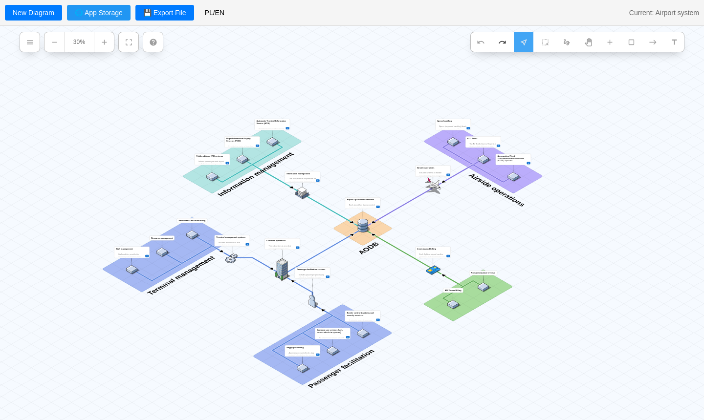
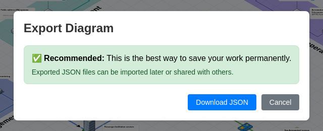
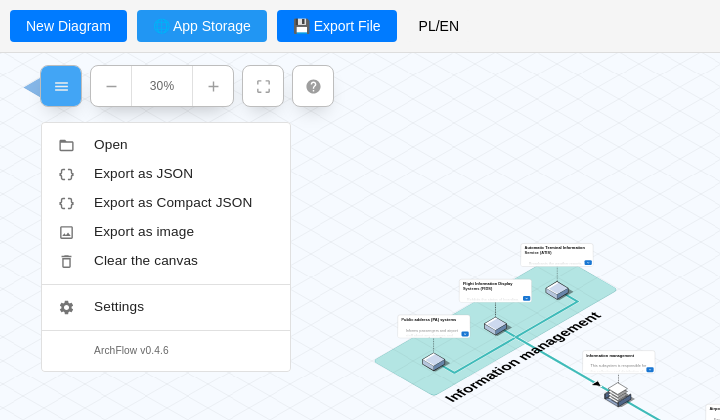
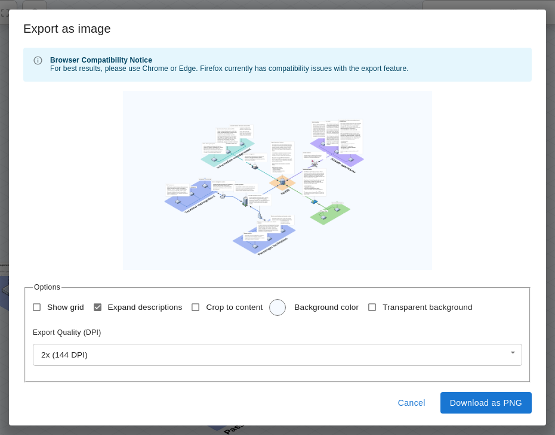
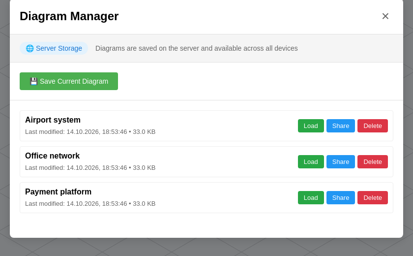

<p align="center">
  <picture>
    <source media="(prefers-color-scheme: dark)" srcset="docs/brand/logo-dark.svg">
    
  </picture>
</p>

<p align="center">
 <a href="README.md">English</a> | <a href="docs/README.pl.md">Polski</a>
</p>

<p align="center">
  
</p>

**ArchFlow** is a fork of <a href="https://github.com/stan-smith/FossFLOW">FossFLOW</a> by Stan Smith, which is itself a fork/rewrite of <a href="https://github.com/markmanx/isoflow">Isoflow</a> by @markmanx — this project stands on both of their shoulders. If either project has helped you, please check them out and consider supporting their work.

------------------------------------------------------------------------------------------------------------------------------
ArchFlow is a powerful, open-source web app for creating beautiful isometric diagrams. Built with React and the <a href="https://github.com/markmanx/isoflow">Isoflow</a> (forked and published to NPM as `fossflow`) library, it runs entirely in your browser. A native desktop version (Electron) is also available in `packages/fossflow-desktop`.



- **📝 [ARCHFLOW_TODO.md](https://github.com/cyryllo/ArchFlow/blob/master/ARCHFLOW_TODO.md)** - Current issues and roadmap with codebase mappings, most gripes are with the isoflow library itself.
- **🤝 [CONTRIBUTING.md](https://github.com/cyryllo/ArchFlow/blob/master/CONTRIBUTING.md)** - How to contribute to the project.

### Performance updates
 - **Reduced frame refresh delay, should look much smoother now**

### Multilingual Support
- **2 Languages Supported** - Full interface translation in English and Polish
- **Language Selector** - Easy-to-use language switcher in the app header
- **Complete Translation** - All menus, dialogs, settings, tooltips, and help content translated
- **Locale-Aware** - Automatically detects and remembers your language preference

### Improved Connector Tool
- **Click-based Creation** - New default mode: click first node, then second node to connect
- **Drag Mode Option** - Original drag-and-drop still available via settings
- **Mode Selection** - Switch between click and drag modes in Settings → Connectors tab
- **Better Reliability** - Click mode provides more predictable connection creation


## 🐳 Quick Deploy with Docker

A prebuilt image is published to GitHub Container Registry on every successful build of `master`:

```
ghcr.io/cyryllo/archflow
```

| Tag | Meaning |
|---|---|
| `latest` | Latest build of `master` |
| `0.4.7` (any version) | A specific ArchFlow version, from `package.json` |
| `sha-abc1234` | A specific commit |

The image is currently built for `linux/amd64` only.

ArchFlow listens on port **9500** in all examples below. Ports like 80 or 8080 are often already taken by other services, so 9500 is a safer default. You can change it, see [Changing the port](#changing-the-port).

### Option 1: Docker Compose (recommended)

You don't need to clone the repository, just the compose file.

```bash
# 1. Create a folder for ArchFlow and download the compose file
mkdir archflow && cd archflow
curl -O https://raw.githubusercontent.com/cyryllo/ArchFlow/master/compose.yml

# 2. Pull the image and start the container in the background
docker compose pull
docker compose up -d
```

Open **http://localhost:9500** in your browser. Diagrams are saved as JSON files in `./diagrams`, next to `compose.yml`.

Everyday commands, run from the same folder:

```bash
docker compose ps                   # is it running?
docker compose logs -f              # follow logs
docker compose stop                 # stop (container is kept)
docker compose start                # start it again
docker compose down                 # stop and remove the container (diagrams stay in ./diagrams)
docker compose pull && docker compose up -d   # update to the newest image
```

To pin a specific version instead of `latest`, set `ARCHFLOW_VERSION`, either inline or in a `.env` file next to `compose.yml`:

```bash
ARCHFLOW_VERSION=0.4.7 docker compose up -d
```

### Option 2: `docker run`

```bash
docker run -d --name archflow \
  -p 9500:80 \
  -v "$(pwd)/diagrams:/data/diagrams" \
  --restart unless-stopped \
  ghcr.io/cyryllo/archflow:latest
```

Everyday commands:

```bash
docker ps                        # is it running?
docker logs -f archflow          # follow logs
docker stop archflow             # stop the container
docker start archflow            # start it again
docker rm -f archflow            # remove the container (diagrams stay in ./diagrams)
```

To update: `docker pull ghcr.io/cyryllo/archflow:latest`, then `docker rm -f archflow` and run the command above again. Your diagrams are kept in `./diagrams`.

If you prefer a named Docker volume over a host folder, use `-v archflow-diagrams:/data/diagrams` instead. The volume survives `docker rm`. To list or delete it:

```bash
docker volume ls                                                          # list volumes
docker run --rm -v archflow-diagrams:/data alpine ls -la /data            # see what's inside
docker volume rm archflow-diagrams                                        # delete it, with all diagrams in it
```

### Option 3: Build from source

If you have cloned the repository, you can build the image yourself instead of pulling it:

```bash
docker compose up -d --build                     # build from the local source and start
docker compose -f compose.dev.yml up --build     # dev variant: ports 3000 (app) and 3001 (API)
```

### Changing the port

The port is the number **before** the colon in the port mapping (`HOST:CONTAINER`). Inside the container ArchFlow always listens on `80`; only change the host side.

- **Compose:** edit the `ports` line in `compose.yml`, e.g. `- "9600:80"`, then run `docker compose up -d`.
- **`docker run`:** change `-p 9500:80` to e.g. `-p 9600:80`.

To check whether a port is free on Linux: `ss -ltn | grep :9500` (no output means it's free).

### How the container works

Good to know before you run it on a server:

- **One container, two processes.** nginx serves the web app on port `80` inside the container, and a small Node.js backend (port `3001`) stores diagrams. nginx forwards `/api/...` requests to the backend, so you only need to publish port 80 (mapped to 9500 on the host). Don't publish 3001.
- **Where diagrams live.** The backend writes each diagram as a JSON file to `/data/diagrams` inside the container. The image doesn't declare a volume, so **if you don't mount anything there, diagrams live only inside the container**. They survive `stop`/`start`/restart, but are **lost on `docker rm`, `docker compose down`, or when updating to a new image**. Always mount a folder or a named volume (the examples above do).
- **Host folder vs named volume.**
  - Host folder (`./diagrams:/data/diagrams`): files are directly visible on your disk, easy to back up or copy. If the folder doesn't exist, Docker creates it for you on the first start.
  - Named volume (`archflow-diagrams:/data/diagrams`): Docker manages the storage (under `/var/lib/docker/volumes/` on Linux). Not visible as a normal folder, but avoids the permission issue below.
- **File ownership (Linux).** The container runs as `root`, so the `./diagrams` folder and the JSON files in it are owned by `root` on the host. To edit, move or delete them by hand, use `sudo` or take ownership: `sudo chown -R $USER: diagrams`. ArchFlow itself keeps working after that.
- **Works offline.** Everything the app needs is inside the image, so the container starts in a few seconds and doesn't need internet access, only for pulling the image.
- **Restarts.** Both examples use `restart: unless-stopped`: the container starts again after a crash or a reboot of the machine, unless you stopped it yourself.
- **No logins.** ArchFlow has no user accounts. Anyone who can open the address can view, change and delete diagrams in App Storage. Run it on a trusted network, or put it behind a reverse proxy with authentication (e.g. basic auth) if it's reachable from the internet.
- **Backups.** Everything ArchFlow stores is in `/data/diagrams` (your `./diagrams` folder), so backing up that folder is enough.

### Configuration

| Variable | Default | Description |
|---|---|---|
| `ARCHFLOW_VERSION` | `latest` | Image tag used by `compose.yml`. |
| `ENABLE_SERVER_STORAGE` | `true` | Save diagrams as files on the server (App Storage). Set to `false` for browser-only (session) storage. |
| `STORAGE_PATH` | `/data/diagrams` | Where diagrams are stored inside the container. Mount a host folder or volume here. |

To disable server storage and fall back to browser-only (session) storage, set `ENABLE_SERVER_STORAGE=false`:
```bash
ENABLE_SERVER_STORAGE=false docker compose up -d
# or
docker run -d -p 9500:80 -e ENABLE_SERVER_STORAGE=false ghcr.io/cyryllo/archflow:latest
```

See [Saving and Opening Diagrams](#saving-and-opening-diagrams) for what changes in the app.

## 🖥️ Desktop App (Electron)

A native desktop version is also available for Windows, macOS, and Linux — it wraps the same web app in a native window, with native "Save As"/"Open" dialogs instead of browser downloads.

```bash
# Run in dev mode (opens a native window)
npm run dev:desktop

# Build installers (Windows .exe, macOS .dmg, Linux AppImage/.deb)
npm run build:desktop
```

Installers are written to `packages/fossflow-desktop/dist/`. Both commands build the library and web app internally first, so there's no separate build step needed.

Diagrams are saved as real files on disk, automatically — no location prompt, no browser storage involved. The desktop app creates an `ArchFlow` folder inside your OS's Documents directory (`~/Documents/ArchFlow`, or the localized equivalent, e.g. `~/Dokumenty/ArchFlow` on a Polish system) the first time it runs, and every diagram you save through the "📁 App Storage" list becomes a `.json` file there. As with Docker, the session-only Save/Load/Quick-save buttons are hidden in the desktop app, since real persistent storage is always available.

## Quick Start (Local Development)

```bash
# Clone the repository
git clone https://github.com/cyryllo/ArchFlow
cd ArchFlow

# Install dependencies
npm install

# Build the library (required first time)
npm run build:lib

# Start development server
npm run dev
```

Open [http://localhost:3000](http://localhost:3000) in your browser.

## Monorepo Structure

This is a monorepo containing several packages:

- `packages/fossflow-lib` - React component library for drawing network diagrams (built with Webpack)
- `packages/fossflow-app` - Progressive Web App which wraps the lib and presents it (built with RSBuild)
- `packages/fossflow-backend` - Optional backend server for persistent diagram storage
- `packages/fossflow-desktop` - Native desktop app (Electron)

### Development Commands

```bash
# Development
npm run dev          # Start app development server
npm run dev:lib      # Watch mode for library development

# Building
npm run build        # Build both library and app
npm run build:lib    # Build library only
npm run build:app    # Build app only

# Desktop app (Electron)
npm run dev:desktop   # Run desktop app in dev mode
npm run build:desktop # Build desktop installers

# Testing & Linting
npm test             # Run unit tests
npm run lint         # Check for linting errors

# E2E Tests (Selenium)
cd e2e-tests
./run-tests.sh       # Run end-to-end tests (requires Docker & Python)

# Publishing
npm run publish:lib  # Publish library to npm
```

## How to Use

### Creating Diagrams

1. **Add Items**:
   - Press the "+" button on the top right menu, the library of components will appear on the left
   - Drag and drop components from the library onto the canvas
   - Or right-click on the grid and select "Add node"

2. **Connect Items**: 
   - Select the Connector tool (press 'C' or click connector icon)
   - **Click mode** (default): Click first node, then click second node
   - **Drag mode** (optional): Click and drag from first to second node
   - Switch modes in Settings → Connectors tab

3. **Save Your Work**: see [Saving and Opening Diagrams](#saving-and-opening-diagrams) below.

## Saving and Opening Diagrams

ArchFlow has **two independent ways** to keep your work. You can use both at the same time.

| | 💾 Files on your computer | 🌐 / 📁 App Storage |
|---|---|---|
| What it is | You download a `.json` file and open it again later | Diagrams are kept by ArchFlow itself, in a list |
| Where the data is | Wherever you save the downloaded file | Docker: `./diagrams` on the server. Desktop app: `~/Documents/ArchFlow` |
| Available | Always, everywhere | Docker with server storage enabled (default) and the desktop app |
| Good for | Backups, sending a diagram to someone, moving between ArchFlow installations | Everyday work, a shared list for the whole team |

### 💾 Files on your computer: Export and Open



- **Export File** (toolbar button) downloads the current diagram as `<name>-<date>.json`. The file includes every icon the diagram uses, also custom imported ones, so it opens correctly in any other ArchFlow.
- The **main menu** (☰, top left of the canvas) has more options:
  - **Open**: load a diagram from a `.json` file. It replaces what's on the canvas.
  - **Export as JSON** / **Export as Compact JSON**: download the diagram as JSON (the compact variant is a smaller file).
  - **Export as image**: save a PNG picture of the diagram.
  - **Clear the canvas**: remove everything from the current diagram.



**Export as image** shows a preview and lets you choose whether to show the grid, expand item descriptions, crop to the content, the background color (or transparent), and the resolution (DPI). Use Chrome or Edge for this; Firefox has known issues with image export.



### 🌐 / 📁 App Storage



The **App Storage** button opens the Diagram Manager, with the list of saved diagrams:

- **Save Current Diagram**: saves the diagram under a name. If a diagram with that name already exists, ArchFlow asks before overwriting it. Each diagram becomes a file named after it, e.g. `./diagrams/Airport system.json`.
- **Load**: opens a saved diagram.
- **Share**: copies a link like `http://your-server:9500/display/<name>`, which opens the diagram in **read-only** mode. Anyone who can reach your server can open it (Docker only).
- **Delete**: removes the diagram (and its file) for good, after a confirmation.

Important:

- **Saving is manual.** Changes are written to App Storage only when you click *Save Current Diagram*. The toolbar shows **• Modified** when there are changes that aren't saved yet, and the browser warns you if you try to close the tab.
- **In Docker, App Storage is shared.** Everyone who opens the same ArchFlow address sees and edits the same list. There are no user accounts.
- The icon tells you where diagrams go: 🌐 means the Docker server, 📁 means files on your computer (desktop app).

### Session storage (browser only)

When App Storage isn't available (ArchFlow hosted as a plain static website, or Docker with `ENABLE_SERVER_STORAGE=false`), the toolbar shows **Save (Session Only)**, **Load (Session Only)** and **Quick Save (Session)** instead. These keep diagrams in your browser's storage:

- they are only in this browser, on this computer,
- they disappear when you clear the browser's data,
- browser storage is small (a few MB), so big diagrams may not fit.

Use **Export File** regularly in this mode, it's the only way to keep your work safe.

### Automatic restore

Independently of the above, the browser remembers the diagram you were working on and opens it again after a page reload. This is a convenience, **not a backup**: it lives only in your browser and is replaced as soon as you open another diagram.

### Which options do I get?

| Where ArchFlow runs | What you get |
|---|---|
| Desktop app | **📁 App Storage** (files in `~/Documents/ArchFlow`) + Export/Open. No session buttons. |
| Docker, server storage enabled (default) | **🌐 App Storage** (files in `./diagrams` on the host) + Export/Open. No session buttons. |
| Plain web hosting / Docker with server storage disabled | Session Save/Load/Quick Save (browser only) + Export/Open |

## Contributing

We welcome contributions! Please see [CONTRIBUTING.md](CONTRIBUTING.md) for guidelines.

## Documentation

- [ARCHFLOW_ENCYCLOPEDIA.md](ARCHFLOW_ENCYCLOPEDIA.md) - Comprehensive guide to the codebase
- [ARCHFLOW_TODO.md](ARCHFLOW_TODO.md) - Current issues and roadmap
- [CONTRIBUTING.md](CONTRIBUTING.md) - Contributing guidelines

## License

MIT
