<p align="center">
  <picture>
    <source media="(prefers-color-scheme: dark)" srcset="docs/brand/logo-dark.svg">
    
  </picture>
</p>

<p align="center">
 <a href="README.md">English</a> | <a href="docs/README.pl.md">Polski</a>
</p>

<p align="center">
  <b>See how it looks:</b>
  <a href="https://cyryllo.github.io/ArchFlow/app/"><b>▶ Try the live demo</b></a> (runs in your browser, no install)
  &nbsp;·&nbsp;
  <a href="https://cyryllo.github.io/ArchFlow/">🌐 Project website</a>
</p>

**ArchFlow** is a fork of <a href="https://github.com/stan-smith/FossFLOW">FossFLOW</a> by Stan Smith, which is itself a fork/rewrite of <a href="https://github.com/markmanx/isoflow">Isoflow</a> by @markmanx — this project stands on both of their shoulders. If either project has helped you, please check them out and consider supporting their work.

------------------------------------------------------------------------------------------------------------------------------
ArchFlow is a free, open-source editor for clear, good-looking **isometric diagrams**: system architecture, networks, cloud infrastructure and business processes. Use it in the browser, install the desktop app on Linux or Windows, or host it yourself with one Docker command.

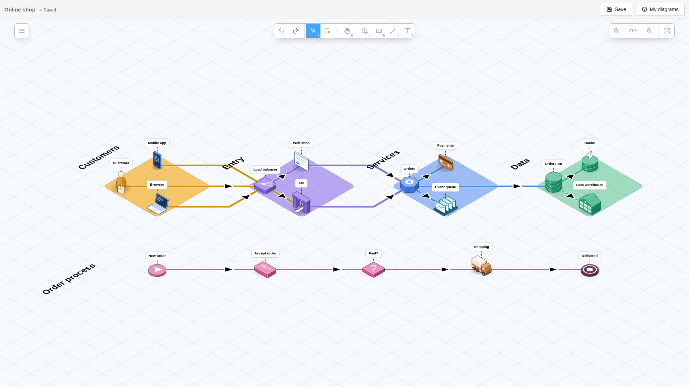

## ✨ Features

- **177 isometric icons in 9 colour-coded categories**: servers & computers, network, communication, data, security, people & organisation, flow & process, business & logistics, shapes. Import your own images as icons too.
- **Not only infrastructure:** start and end events, decisions, gateways, documents, approvals, timers and milestones for process diagrams.
- **Zones, connectors and text:** group elements in coloured zones, connect them (with waypoints, labels, line styles and arrows), add text and rich-text descriptions.
- **Right-click menus** on the canvas and on every element; a **☰ menu** for files, export and settings.
- **Select and move together:** selection box, Shift+click, then drag or nudge with the arrow keys. Connectors keep their shape.
- **Keyboard shortcuts** for copy, cut, paste, duplicate, select all, delete, zoom, fit, rename and every tool (press F1 for the list).
- **Export** to a portable JSON file (every icon included) or to a PNG image with your choice of resolution, background and cropping.
- **Save where you like:** files on your computer, a shared list on your Docker server, or the desktop app's `Documents/ArchFlow` folder.
- **English and Polish** interface, icon names included.

## ⬇️ Download

Ready-made desktop builds are attached to every [release](https://github.com/cyryllo/ArchFlow/releases/latest):

| File | For |
|---|---|
| `ArchFlow-X.Y.Z-x86_64.AppImage` | Linux, any distribution |
| `ArchFlow-X.Y.Z-amd64.deb` | Debian / Ubuntu |
| `ArchFlow-Setup-X.Y.Z.exe` | Windows (installer) |

```bash
# Linux AppImage
chmod +x ArchFlow-*-x86_64.AppImage
./ArchFlow-*-x86_64.AppImage
```

The Windows installer isn't code-signed yet, so SmartScreen may warn you the first time: click **More info → Run anyway**. Prefer the browser? [Try the live demo](https://cyryllo.github.io/ArchFlow/app/) or [run it with Docker](#-quick-deploy-with-docker).

- **🚀 [Quick start](docs/quick-start.md)** - Your first diagram in ten steps.
- **📝 [ARCHFLOW_TODO.md](https://github.com/cyryllo/ArchFlow/blob/master/ARCHFLOW_TODO.md)** - Current issues and roadmap.
- **🤝 [CONTRIBUTING.md](https://github.com/cyryllo/ArchFlow/blob/master/CONTRIBUTING.md)** - How to contribute to the project.

## 🐳 Quick Deploy with Docker

A prebuilt image is published to GitHub Container Registry on every successful build of `master`:

```
ghcr.io/cyryllo/archflow
```

| Tag | Meaning |
|---|---|
| `latest` | Latest build of `master` |
| `0.6.1` (any version) | A specific ArchFlow version, from `package.json` |
| `sha-abc1234` | A specific commit |

The image is currently built for `linux/amd64` only.

ArchFlow listens on port **9500** in all examples below. Ports like 80 or 8080 are often already taken by other services, so 9500 is a safer default. You can change it, see [Changing the port](#changing-the-port).

### Option 1: Docker Compose (recommended)

You don't need to clone the repository, just the compose file.

```bash
# 1. Create a folder for ArchFlow and download the compose file
mkdir archflow && cd archflow
curl -O https://raw.githubusercontent.com/cyryllo/ArchFlow/master/compose.yml

# 2. Pull the image and start the container in the background
docker compose pull
docker compose up -d
```

Open **http://localhost:9500** in your browser. Diagrams are saved as JSON files in `./diagrams`, next to `compose.yml`.

Everyday commands, run from the same folder:

```bash
docker compose ps                   # is it running?
docker compose logs -f              # follow logs
docker compose stop                 # stop (container is kept)
docker compose start                # start it again
docker compose down                 # stop and remove the container (diagrams stay in ./diagrams)
docker compose pull && docker compose up -d   # update to the newest image
```

To pin a specific version instead of `latest`, set `ARCHFLOW_VERSION`, either inline or in a `.env` file next to `compose.yml`:

```bash
ARCHFLOW_VERSION=0.6.1 docker compose up -d
```

### Option 2: `docker run`

```bash
docker run -d --name archflow \
  -p 9500:80 \
  -v "$(pwd)/diagrams:/data/diagrams" \
  --restart unless-stopped \
  ghcr.io/cyryllo/archflow:latest
```

Everyday commands:

```bash
docker ps                        # is it running?
docker logs -f archflow          # follow logs
docker stop archflow             # stop the container
docker start archflow            # start it again
docker rm -f archflow            # remove the container (diagrams stay in ./diagrams)
```

To update: `docker pull ghcr.io/cyryllo/archflow:latest`, then `docker rm -f archflow` and run the command above again. Your diagrams are kept in `./diagrams`.

If you prefer a named Docker volume over a host folder, use `-v archflow-diagrams:/data/diagrams` instead. The volume survives `docker rm`. To list or delete it:

```bash
docker volume ls                                                          # list volumes
docker run --rm -v archflow-diagrams:/data alpine ls -la /data            # see what's inside
docker volume rm archflow-diagrams                                        # delete it, with all diagrams in it
```

### Option 3: Build from source

If you have cloned the repository, you can build the image yourself instead of pulling it:

```bash
docker compose up -d --build                     # build from the local source and start
docker compose -f compose.dev.yml up --build     # dev variant: ports 3000 (app) and 3001 (API)
```

### Changing the port

The port is the number **before** the colon in the port mapping (`HOST:CONTAINER`). Inside the container ArchFlow always listens on `80`; only change the host side.

- **Compose:** edit the `ports` line in `compose.yml`, e.g. `- "9600:80"`, then run `docker compose up -d`.
- **`docker run`:** change `-p 9500:80` to e.g. `-p 9600:80`.

To check whether a port is free on Linux: `ss -ltn | grep :9500` (no output means it's free).

### How the container works

Good to know before you run it on a server:

- **One container, two processes.** nginx serves the web app on port `80` inside the container, and a small Node.js backend (port `3001`) stores diagrams. nginx forwards `/api/...` requests to the backend, so you only need to publish port 80 (mapped to 9500 on the host). Don't publish 3001.
- **Where diagrams live.** The backend writes each diagram as a JSON file to `/data/diagrams` inside the container. The image doesn't declare a volume, so **if you don't mount anything there, diagrams live only inside the container**. They survive `stop`/`start`/restart, but are **lost on `docker rm`, `docker compose down`, or when updating to a new image**. Always mount a folder or a named volume (the examples above do).
- **Host folder vs named volume.**
  - Host folder (`./diagrams:/data/diagrams`): files are directly visible on your disk, easy to back up or copy. If the folder doesn't exist, Docker creates it for you on the first start.
  - Named volume (`archflow-diagrams:/data/diagrams`): Docker manages the storage (under `/var/lib/docker/volumes/` on Linux). Not visible as a normal folder, but avoids the permission issue below.
- **File ownership (Linux).** The container runs as `root`, so the `./diagrams` folder and the JSON files in it are owned by `root` on the host. To edit, move or delete them by hand, use `sudo` or take ownership: `sudo chown -R $USER: diagrams`. ArchFlow itself keeps working after that.
- **Works offline.** Everything the app needs is inside the image, so the container starts in a few seconds and doesn't need internet access, only for pulling the image.
- **Restarts.** Both examples use `restart: unless-stopped`: the container starts again after a crash or a reboot of the machine, unless you stopped it yourself.
- **No logins.** ArchFlow has no user accounts. Anyone who can open the address can view, change and delete diagrams in My diagrams. Run it on a trusted network, or put it behind a reverse proxy with authentication (e.g. basic auth) if it's reachable from the internet.
- **Backups.** Everything ArchFlow stores is in `/data/diagrams` (your `./diagrams` folder), so backing up that folder is enough.

### Configuration

| Variable | Default | Description |
|---|---|---|
| `ARCHFLOW_VERSION` | `latest` | Image tag used by `compose.yml`. |
| `ENABLE_SERVER_STORAGE` | `true` | Save diagrams as files on the server (My diagrams). Set to `false` for browser-only (session) storage. |
| `STORAGE_PATH` | `/data/diagrams` | Where diagrams are stored inside the container. Mount a host folder or volume here. |

To disable server storage and fall back to browser-only (session) storage, set `ENABLE_SERVER_STORAGE=false`:
```bash
ENABLE_SERVER_STORAGE=false docker compose up -d
# or
docker run -d -p 9500:80 -e ENABLE_SERVER_STORAGE=false ghcr.io/cyryllo/archflow:latest
```

See [Saving and Opening Diagrams](#saving-and-opening-diagrams) for what changes in the app.

## 🖥️ Desktop App

The desktop app (Electron) wraps the same editor in a native window. **Download it from the [latest release](https://github.com/cyryllo/ArchFlow/releases/latest)**: AppImage or `.deb` for Linux, an installer for Windows (see [Download](#️-download)).

Diagrams are saved as real files on disk, automatically — no location prompt, no browser storage involved. The app creates an `ArchFlow` folder inside your Documents directory (`~/Documents/ArchFlow`, or the localized equivalent, e.g. `~/Dokumenty/ArchFlow` on a Polish system) the first time it runs, and every diagram you save through **Save** / **My diagrams** becomes a `.json` file there. Exports use native "Save As" dialogs.

To build it yourself:

```bash
npm run dev:desktop     # run in dev mode (opens a native window)
npm run build:desktop   # build the packages for your system into packages/fossflow-desktop/dist/
```

On Linux this produces the AppImage and `.deb`. The Windows installer is built on Windows (building it on Linux needs wine); the `Desktop builds` GitHub workflow builds all of them for every version tag and attaches them to the release.

## Quick Start (Local Development)

```bash
# Clone the repository
git clone https://github.com/cyryllo/ArchFlow
cd ArchFlow

# Install dependencies
npm install

# Build the library (required first time)
npm run build:lib

# Start development server
npm run dev
```

Open [http://localhost:3000](http://localhost:3000) in your browser.

## Monorepo Structure

This is a monorepo containing several packages:

- `packages/fossflow-lib` - React component library for drawing network diagrams (built with Webpack)
- `packages/fossflow-app` - Progressive Web App which wraps the lib and presents it (built with RSBuild)
- `packages/fossflow-backend` - Optional backend server for persistent diagram storage
- `packages/fossflow-desktop` - Native desktop app (Electron)

### Development Commands

```bash
# Development
npm run dev          # Start app development server
npm run dev:lib      # Watch mode for library development

# Building
npm run build        # Build both library and app
npm run build:lib    # Build library only
npm run build:app    # Build app only

# Desktop app (Electron)
npm run dev:desktop   # Run desktop app in dev mode
npm run build:desktop # Build desktop installers

# Testing & Linting
npm test             # Run unit tests
npm run lint         # Check for linting errors

# E2E Tests (Selenium)
cd e2e-tests
./run-tests.sh       # Run end-to-end tests (requires Docker & Python)

# Publishing
npm run publish:lib  # Publish library to npm
```

## How to Use

**New to ArchFlow? Start with the [quick start](docs/quick-start.md):** ten steps from an empty canvas to a saved diagram, with screenshots.

### The screen

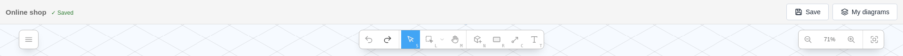

- **Top bar:** the diagram's name and save state (**Modified** / **Saved**), **Save** and **My diagrams**.
- **☰ menu** (left): New diagram, My diagrams, Save, Open from file, Clear the canvas, Export as JSON / image, Settings, Language, Help.
- **Tools** (middle): Undo, Redo · **Select / move** (S), **Box select** or **Freehand lasso** (L / F, switch with the small arrow), **Pan view** (M) · **Add node** (N), **Rectangle / zone** (R), **Connector** (C), **Text** (T). The letter in each button's corner is its shortcut.
- **Zoom** (right): zoom out / in and **Fit to screen**.

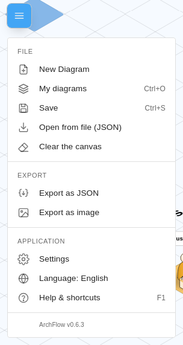

### Building a diagram

1. **Add a node:** press **N** (or the node button, or right-click the canvas → *Add node*), pick an icon from a category or search, then click a spot on the canvas.
2. **Draw a zone:** press **R** and drag out a rectangle.
3. **Connect:** press **C**, click the first node, then the second (or right-click a node → *Connect to…*). To bend a connector, drag its line.
4. **Add text:** press **T** and click where it should go.
5. **Edit properties:** click an element to open its panel (name, description, icon, colours, line style…), or right-click it → *Properties*.

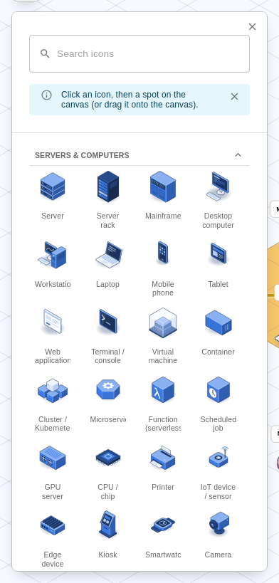 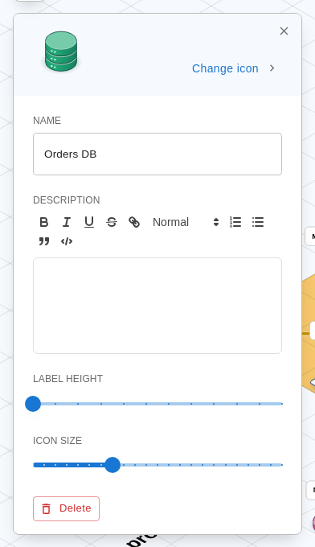 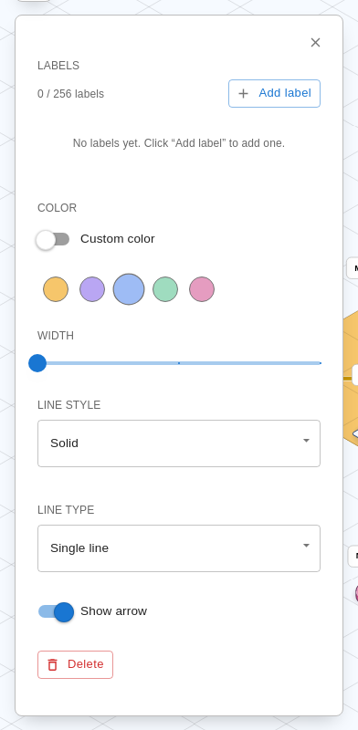

Rectangle, node and text tools return to **Select** after one use; Connector and the lassos stay active until you press **Esc**, which always brings you back to Select.

### Right-click menus

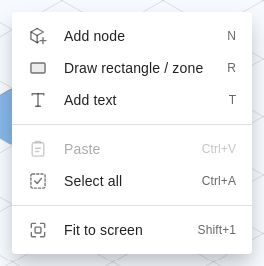 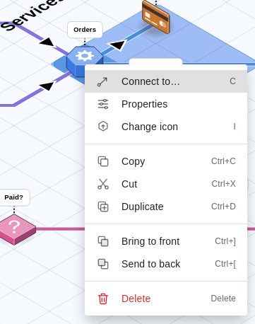

- **On the canvas:** add a node, draw a rectangle, add text, paste, select all, fit to screen.
- **On an element:** connect to…, properties, change icon, copy, cut, duplicate, bring to front / send to back, delete. If the element is part of a selection, the action applies to the whole selection.

### Selecting and moving

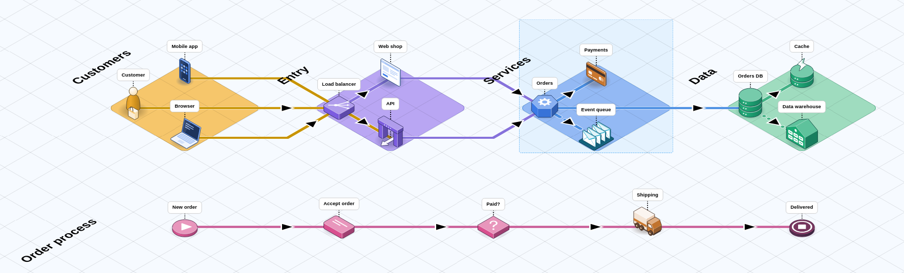

- **Drag on empty space** to draw a selection box; **Shift+click** adds or removes elements.
- **Drag the selection** (or use the **arrow keys**) to move nodes, zones, text and connector points together.
- **Middle mouse button** or **Space + drag** moves the view from any tool; the mouse wheel zooms.

### Keyboard shortcuts

| Shortcut | Action |
|---|---|
| Ctrl+Z / Ctrl+Y (Ctrl+Shift+Z) | Undo / redo |
| Ctrl+C / Ctrl+X / Ctrl+V | Copy / cut / paste (at the mouse position) |
| Ctrl+D | Duplicate |
| Ctrl+A | Select all |
| Delete / Backspace | Delete the selection |
| ← ↑ → ↓ | Move the selection one tile (nothing selected: move the view) |
| Ctrl+] / Ctrl+[ | Bring to front / send to back |
| Ctrl + / Ctrl − | Zoom in / out |
| Shift+1 | Fit to screen |
| F2 | Rename the selected node |
| Esc | Cancel and return to Select |
| S M N R C T L F | Tools (letters can be changed in Settings) |
| F1 | Help with all shortcuts |

### Settings

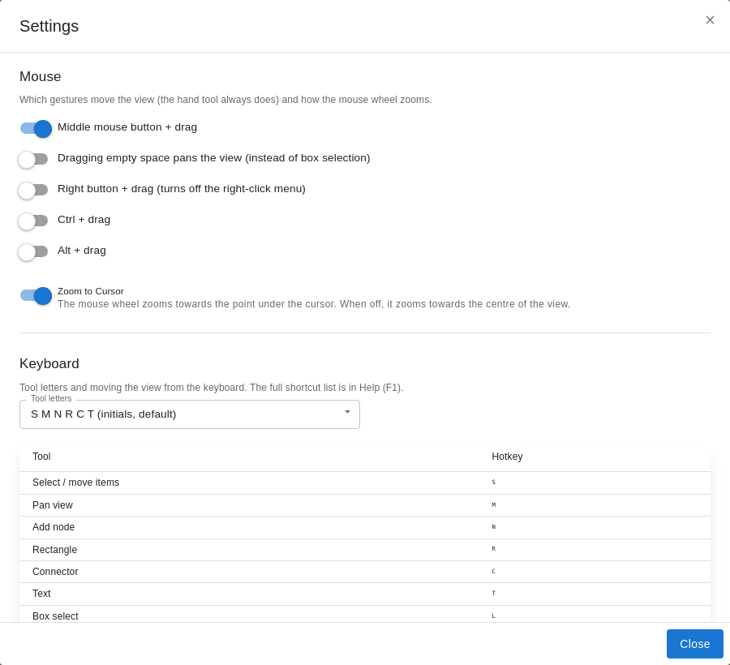

**☰ → Settings** has three sections: **Mouse** (which gestures move the view, zoom towards the cursor), **Keyboard** (tool letters, moving the view with the keyboard) and **Connectors** (create them by clicking or by dragging).

## Saving and Opening Diagrams

ArchFlow has **two independent ways** to keep your work. You can use both at the same time.

| | 💾 Files on your computer | 🗄️ My diagrams |
|---|---|---|
| What it is | You export a `.json` file and open it again later | Diagrams are kept by ArchFlow itself, in a list |
| Where the data is | Wherever you save the exported file | Docker: `./diagrams` on the server. Desktop app: `~/Documents/ArchFlow` |
| Available | Always, everywhere | Docker with server storage enabled (default) and the desktop app |
| Good for | Backups, sending a diagram to someone, moving between ArchFlow installations | Everyday work, a shared list for the whole team |

### 💾 Files on your computer

- **☰ → Export as JSON** downloads the current diagram as `<name>-<date>.json`. The file includes every icon the diagram uses, also custom imported ones, so it opens correctly in any other ArchFlow.
- **☰ → Open from file** loads a diagram from a `.json` file. It replaces what's on the canvas. Older files keep working, and built-in icons get the current drawings.
- **☰ → Export as image** saves a PNG picture. It shows a preview and lets you choose whether to show the grid, expand descriptions, crop to the content, the background colour (or transparent) and the resolution (DPI). Use Chrome or Edge for this; Firefox has known issues with image export.

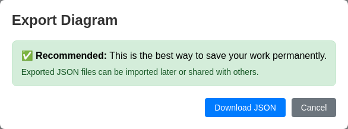 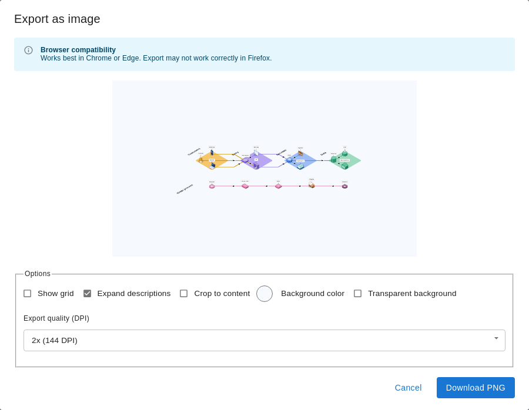

### 🗄️ My diagrams

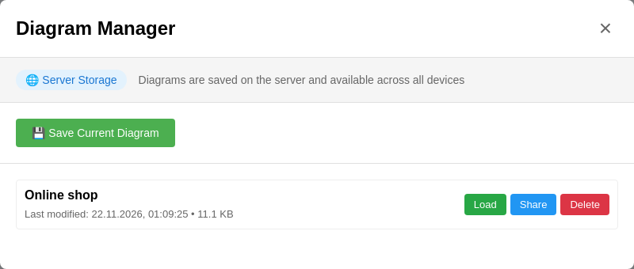

**My diagrams** (top bar, ☰ menu or **Ctrl+O**) opens the list of saved diagrams:

- **Save Current Diagram** saves the diagram under a name. If a diagram with that name already exists, ArchFlow asks before overwriting it. Each diagram becomes a file named after it, e.g. `./diagrams/Online shop.json`.
- **Load** opens a saved diagram, **Share** copies a read-only link (`http://your-server:9500/display/<name>`, Docker only), **Delete** removes the diagram and its file after a confirmation.
- **Save** in the top bar (or **Ctrl+S**) saves the open diagram again under the same name.

Important:

- **Saving is manual.** The top bar shows **Modified** until you save, and the browser warns you if you try to close the tab with unsaved changes.
- **In Docker, the list is shared.** Everyone who opens the same ArchFlow address sees and edits the same diagrams. There are no user accounts.

### Browser only (no server storage)

When ArchFlow is hosted as a plain website (like the demo) or Docker runs with `ENABLE_SERVER_STORAGE=false`, **Save** and **My diagrams** keep diagrams in your browser's storage instead:

- they are only in this browser, on this computer,
- they disappear when you clear the browser's data,
- browser storage is small (a few MB), so big diagrams may not fit.

Export to a file regularly in this mode, it's the only way to keep your work safe.

### Automatic restore

Independently of the above, the browser remembers the diagram you were working on and opens it again after a page reload. This is a convenience, **not a backup**: it lives only in your browser and is replaced as soon as you open another diagram.

### Which options do I get?

| Where ArchFlow runs | What you get |
|---|---|
| Desktop app | **My diagrams** (files in `~/Documents/ArchFlow`) + export / open files |
| Docker, server storage enabled (default) | **My diagrams** (files in `./diagrams` on the host, shared) + export / open files |
| Plain web hosting / Docker with server storage disabled | My diagrams in the browser only + export / open files |

## Contributing

We welcome contributions! Please see [CONTRIBUTING.md](CONTRIBUTING.md) for guidelines.

## Documentation

- [ARCHFLOW_ENCYCLOPEDIA.md](ARCHFLOW_ENCYCLOPEDIA.md) - Comprehensive guide to the codebase
- [ARCHFLOW_TODO.md](ARCHFLOW_TODO.md) - Current issues and roadmap
- [CONTRIBUTING.md](CONTRIBUTING.md) - Contributing guidelines

## License

MIT
