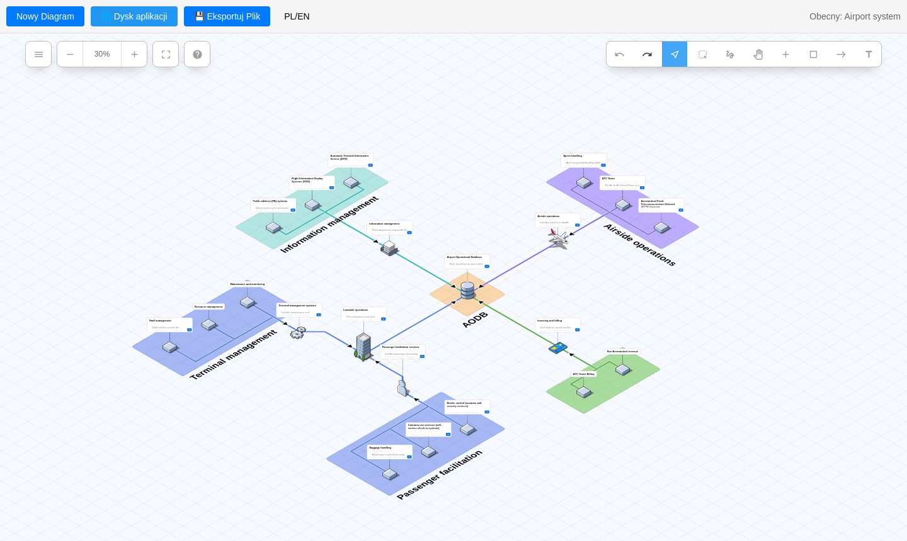
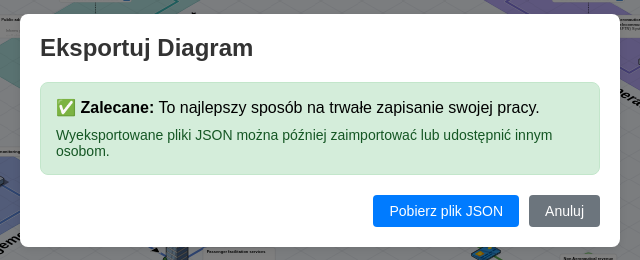
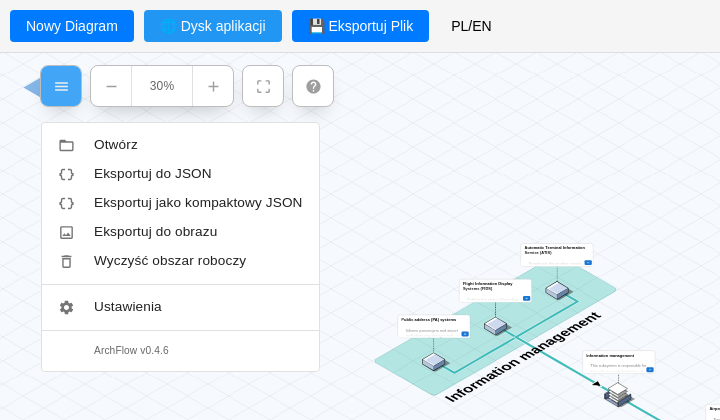
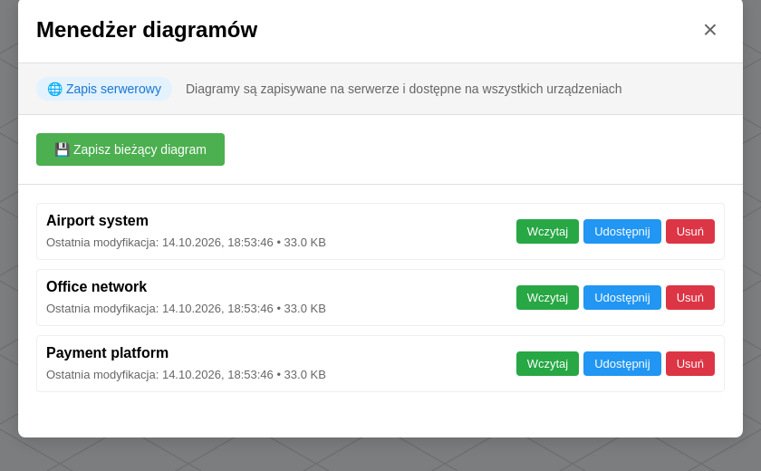

<p align="center">
  <picture>
    <source media="(prefers-color-scheme: dark)" srcset="brand/logo-dark.svg">
    
  </picture>
</p>

<p align="center">
 <a href="../README.md">English</a> | <a href="README.pl.md">Polski</a>
</p>

<p align="center">
  <b>Zobacz, jak to wygląda:</b>
  <a href="https://cyryllo.github.io/ArchFlow/app/"><b>▶ Wypróbuj demo online</b></a> (działa w przeglądarce, bez instalacji)
  &nbsp;·&nbsp;
  <a href="https://cyryllo.github.io/ArchFlow/pl/">🌐 Strona projektu</a>
</p>

<p align="center">
  
</p>

**ArchFlow** jest forkiem <a href="https://github.com/stan-smith/FossFLOW">FossFLOW</a> autorstwa Stana Smitha, które samo jest forkiem/przepisaniem <a href="https://github.com/markmanx/isoflow">Isoflow</a> autorstwa @markmanx — ten projekt stoi na barkach obu tych projektów. Jeśli któryś z nich Ci pomógł, koniecznie je odwiedź i rozważ wsparcie ich twórców.

------------------------------------------------------------------------------------------------------------------------------
ArchFlow to potężna, open-source'owa aplikacja webowa do tworzenia pięknych diagramów izometrycznych. Zbudowana w React i na bibliotece <a href="https://github.com/markmanx/isoflow">Isoflow</a> (sforkowanej i opublikowanej na NPM jako `fossflow`), działa całkowicie w przeglądarce. Dostępna jest też natywna wersja okienkowa (Electron) w `packages/fossflow-desktop`.




- **📝 [ARCHFLOW_TODO.md](https://github.com/cyryllo/ArchFlow/blob/master/ARCHFLOW_TODO.md)** - Bieżące problemy i plan rozwoju wraz z mapowaniem kodu, większość uwag dotyczy samej biblioteki isoflow.
- **🤝 [CONTRIBUTING.md](https://github.com/cyryllo/ArchFlow/blob/master/CONTRIBUTING.md)** - Jak włączyć się w rozwój projektu.

### Wielojęzyczność
- **2 obsługiwane języki** - Pełne tłumaczenie interfejsu na angielski i polski
- **Selektor języka** - Łatwy w użyciu przełącznik języka w nagłówku aplikacji
- **Pełne tłumaczenie** - Wszystkie menu, okna dialogowe, ustawienia, podpowiedzi i pomoc przetłumaczone
- **Zapamiętywanie wyboru** - Aplikacja automatycznie wykrywa i zapamiętuje preferowany język

### Ulepszone narzędzie do łączenia
- **Tworzenie kliknięciem** - Nowy domyślny tryb: kliknij pierwszy węzeł, potem drugi, aby je połączyć
- **Tryb przeciągania** - Oryginalny tryb "przeciągnij i upuść" nadal dostępny w ustawieniach
- **Wybór trybu** - Przełączaj między trybem kliknięcia a przeciągania w Ustawienia → zakładka Połączenia
- **Większa niezawodność** - Tryb kliknięcia daje bardziej przewidywalne tworzenie połączeń

## 🐳 Szybkie wdrożenie z Dockerem

Gotowy obraz jest publikowany w GitHub Container Registry po każdym udanym buildzie gałęzi `master`:

```
ghcr.io/cyryllo/archflow
```

| Tag | Znaczenie |
|---|---|
| `latest` | Najnowszy build gałęzi `master` |
| `0.4.7` (dowolna wersja) | Konkretna wersja ArchFlow, z `package.json` |
| `sha-abc1234` | Konkretny commit |

Na razie obraz jest budowany tylko dla `linux/amd64`.

We wszystkich przykładach poniżej ArchFlow działa na porcie **9500**. Porty takie jak 80 czy 8080 są często zajęte przez inne usługi, więc 9500 jest bezpieczniejszym wyborem. Możesz go zmienić, patrz [Zmiana portu](#zmiana-portu).

### Opcja 1: Docker Compose (zalecane)

Nie trzeba klonować repozytorium, wystarczy sam plik compose.

```bash
# 1. Utwórz katalog na ArchFlow i pobierz plik compose
mkdir archflow && cd archflow
curl -O https://raw.githubusercontent.com/cyryllo/ArchFlow/master/compose.yml

# 2. Pobierz obraz i uruchom kontener w tle
docker compose pull
docker compose up -d
```

Otwórz **http://localhost:9500** w przeglądarce. Diagramy są zapisywane jako pliki JSON w `./diagrams`, obok `compose.yml`.

Codzienne komendy (uruchamiane z tego samego katalogu):

```bash
docker compose ps                   # czy działa?
docker compose logs -f              # podgląd logów
docker compose stop                 # zatrzymanie (kontener zostaje)
docker compose start                # ponowne uruchomienie
docker compose down                 # zatrzymanie i usunięcie kontenera (diagramy zostają w ./diagrams)
docker compose pull && docker compose up -d   # aktualizacja do najnowszego obrazu
```

Aby przypiąć konkretną wersję zamiast `latest`, ustaw `ARCHFLOW_VERSION`, w linii komendy albo w pliku `.env` obok `compose.yml`:

```bash
ARCHFLOW_VERSION=0.4.7 docker compose up -d
```

### Opcja 2: `docker run`

```bash
docker run -d --name archflow \
  -p 9500:80 \
  -v "$(pwd)/diagrams:/data/diagrams" \
  --restart unless-stopped \
  ghcr.io/cyryllo/archflow:latest
```

Codzienne komendy:

```bash
docker ps                        # czy działa?
docker logs -f archflow          # podgląd logów
docker stop archflow             # zatrzymanie kontenera
docker start archflow            # ponowne uruchomienie
docker rm -f archflow            # usunięcie kontenera (diagramy zostają w ./diagrams)
```

Aktualizacja: `docker pull ghcr.io/cyryllo/archflow:latest`, potem `docker rm -f archflow` i ponownie komenda powyżej. Diagramy zostają w `./diagrams`.

Jeśli wolisz nazwany wolumen Dockera zamiast katalogu na hoście, użyj `-v archflow-diagrams:/data/diagrams`. Wolumen przetrwa `docker rm`. Podgląd i usuwanie:

```bash
docker volume ls                                                          # lista wolumenów
docker run --rm -v archflow-diagrams:/data alpine ls -la /data            # zawartość wolumenu
docker volume rm archflow-diagrams                                        # usunięcie wolumenu razem z diagramami
```

### Opcja 3: Budowanie ze źródeł

Jeśli masz sklonowane repozytorium, możesz zbudować obraz samodzielnie zamiast go pobierać:

```bash
docker compose up -d --build                     # zbuduj z lokalnych źródeł i uruchom
docker compose -f compose.dev.yml up --build     # wariant deweloperski: porty 3000 (aplikacja) i 3001 (API)
```

### Zmiana portu

Port to liczba **przed** dwukropkiem w mapowaniu portów (`HOST:KONTENER`). W kontenerze ArchFlow zawsze nasłuchuje na `80`, zmieniasz tylko stronę hosta.

- **Compose:** zmień linię `ports` w `compose.yml`, np. na `- "9600:80"`, i uruchom `docker compose up -d`.
- **`docker run`:** zmień `-p 9500:80` np. na `-p 9600:80`.

Sprawdzenie, czy port jest wolny (Linux): `ss -ltn | grep :9500` (brak wyniku oznacza, że jest wolny).

### Jak działa kontener

Warto wiedzieć, zanim uruchomisz go na serwerze:

- **Jeden kontener, dwa procesy.** nginx serwuje aplikację na porcie `80` w kontenerze, a mały backend w Node.js (port `3001`) zapisuje diagramy. nginx przekazuje zapytania `/api/...` do backendu, więc wystarczy wystawić port 80 (zmapowany na 9500 na hoście). Portu 3001 nie wystawiaj.
- **Gdzie są diagramy.** Backend zapisuje każdy diagram jako plik JSON w `/data/diagrams` w kontenerze. Obraz nie deklaruje wolumenu, więc **jeśli nic tam nie zamontujesz, diagramy są tylko wewnątrz kontenera**. Przetrwają `stop`/`start`/restart, ale **znikną po `docker rm`, `docker compose down` albo przy aktualizacji do nowego obrazu**. Zawsze montuj katalog albo nazwany wolumen (przykłady powyżej to robią).
- **Katalog na hoście czy nazwany wolumen.**
  - Katalog na hoście (`./diagrams:/data/diagrams`): pliki widać bezpośrednio na dysku, łatwo je skopiować i zrobić kopię zapasową. Jeśli katalog nie istnieje, Docker sam go utworzy przy pierwszym starcie.
  - Nazwany wolumen (`archflow-diagrams:/data/diagrams`): miejscem zarządza Docker (na Linuksie w `/var/lib/docker/volumes/`). Nie widać go jako zwykłego katalogu, ale nie ma problemu z uprawnieniami opisanego niżej.
- **Właściciel plików (Linux).** Kontener działa jako `root`, więc katalog `./diagrams` i pliki JSON w nim należą na hoście do `root`. Aby je ręcznie edytować, przenosić czy usuwać, użyj `sudo` albo przejmij je: `sudo chown -R $USER: diagrams`. ArchFlow dalej będzie działał.
- **Działa bez internetu.** Wszystko, czego potrzebuje aplikacja, jest w obrazie, więc kontener startuje w kilka sekund i nie potrzebuje internetu, poza samym pobraniem obrazu.
- **Restarty.** Oba przykłady używają `restart: unless-stopped`: kontener wstaje sam po awarii albo po restarcie maszyny, chyba że sam go zatrzymasz.
- **Brak logowania.** ArchFlow nie ma kont użytkowników. Każdy, kto otworzy adres, może przeglądać, zmieniać i usuwać diagramy w Dysku aplikacji. Uruchamiaj go w zaufanej sieci albo za reverse proxy z uwierzytelnianiem (np. basic auth), jeśli ma być dostępny z internetu.
- **Kopie zapasowe.** Wszystko, co zapisuje ArchFlow, jest w `/data/diagrams` (czyli w katalogu `./diagrams`), więc wystarczy kopia tego katalogu.

### Konfiguracja

| Zmienna | Domyślnie | Opis |
|---|---|---|
| `ARCHFLOW_VERSION` | `latest` | Tag obrazu używany przez `compose.yml`. |
| `ENABLE_SERVER_STORAGE` | `true` | Zapis diagramów jako plików na serwerze (Dysk aplikacji). `false` przełącza na zapis tylko w przeglądarce (sesja). |
| `STORAGE_PATH` | `/data/diagrams` | Gdzie w kontenerze zapisywane są diagramy. Tu montuj katalog z hosta albo wolumen. |

Aby wyłączyć zapis serwerowy i wrócić do zapisu tylko w przeglądarce (sesja), ustaw `ENABLE_SERVER_STORAGE=false`:
```bash
ENABLE_SERVER_STORAGE=false docker compose up -d
# albo
docker run -d -p 9500:80 -e ENABLE_SERVER_STORAGE=false ghcr.io/cyryllo/archflow:latest
```

Co wtedy zmienia się w aplikacji, opisuje sekcja [Zapisywanie i otwieranie diagramów](#zapisywanie-i-otwieranie-diagramów).

## 🖥️ Aplikacja okienkowa (Electron)

Dostępna jest też natywna wersja okienkowa dla Windows, macOS i Linuksa — opakowuje tę samą aplikację webową w natywne okno, z natywnymi oknami dialogowymi "Zapisz jako"/"Otwórz" zamiast pobierania plików przez przeglądarkę.

```bash
# Uruchom w trybie dev (otwiera natywne okno)
npm run dev:desktop

# Zbuduj instalatory (Windows .exe, macOS .dmg, Linux AppImage/.deb)
npm run build:desktop
```

Instalatory trafiają do `packages/fossflow-desktop/dist/`. Oba polecenia same budują najpierw bibliotekę i aplikację webową, więc nie trzeba robić tego osobno.

Diagramy są zapisywane jako prawdziwe pliki na dysku, automatycznie — bez pytania o lokalizację, bez pamięci przeglądarki. Aplikacja desktopowa przy pierwszym uruchomieniu tworzy katalog `ArchFlow` w katalogu Dokumentów systemu (`~/Documents/ArchFlow`, a na spolszczonym systemie `~/Dokumenty/ArchFlow`), i każdy diagram zapisany przez listę "📁 Dysk aplikacji" trafia tam jako plik `.json`. Tak samo jak w Dockerze, przyciski Zapisz/Wczytaj/Szybki zapis (sesja) są ukryte w aplikacji desktopowej, bo zawsze dostępny jest trwały zapis.

## Szybki start (lokalny development)

```bash
# Sklonuj repozytorium
git clone https://github.com/cyryllo/ArchFlow
cd ArchFlow

# Zainstaluj zależności
npm install

# Zbuduj bibliotekę (wymagane przy pierwszym uruchomieniu)
npm run build:lib

# Uruchom serwer deweloperski
npm run dev
```

Otwórz [http://localhost:3000](http://localhost:3000) w przeglądarce.

## Struktura monorepo

To monorepo zawierające kilka pakietów:

- `packages/fossflow-lib` - biblioteka komponentów React do rysowania diagramów sieciowych (budowana Webpackiem)
- `packages/fossflow-app` - Progressive Web App opakowująca bibliotekę i prezentująca ją użytkownikowi (budowana RSBuildem)
- `packages/fossflow-backend` - opcjonalny serwer do trwałego zapisu diagramów
- `packages/fossflow-desktop` - natywna aplikacja okienkowa (Electron)

### Polecenia deweloperskie

```bash
# Development
npm run dev          # Uruchom serwer deweloperski aplikacji
npm run dev:lib      # Tryb watch dla rozwoju biblioteki
npm run dev:desktop  # Uruchom wersję okienkową (Electron) w trybie dev

# Budowanie
npm run build        # Zbuduj bibliotekę i aplikację
npm run build:lib    # Zbuduj tylko bibliotekę
npm run build:app    # Zbuduj tylko aplikację
npm run build:desktop # Zbuduj instalator aplikacji okienkowej

# Testy i lint
npm test             # Uruchom testy jednostkowe
npm run lint         # Sprawdź błędy lintera

# Testy E2E (Selenium)
cd e2e-tests
./run-tests.sh       # Uruchom testy end-to-end (wymaga Dockera i Pythona)

# Publikacja
npm run publish:lib  # Opublikuj bibliotekę na npm
```

## Jak korzystać

### Tworzenie diagramów

1. **Dodawanie elementów**:
   - Naciśnij przycisk "+" w górnym prawym menu, po lewej pojawi się biblioteka komponentów
   - Przeciągnij i upuść komponenty z biblioteki na płótno
   - Albo kliknij prawym przyciskiem na siatce i wybierz "Dodaj węzeł"

2. **Łączenie elementów**:
   - Wybierz narzędzie Łącznik (naciśnij 'C' lub kliknij ikonę łącznika)
   - **Tryb kliknięcia** (domyślny): kliknij pierwszy węzeł, potem drugi
   - **Tryb przeciągania** (opcjonalny): kliknij i przeciągnij od pierwszego do drugiego węzła
   - Przełączaj tryby w Ustawienia → zakładka Połączenia

3. **Zapisywanie pracy**: patrz [Zapisywanie i otwieranie diagramów](#zapisywanie-i-otwieranie-diagramów) poniżej.

## Zapisywanie i otwieranie diagramów

ArchFlow ma **dwa niezależne sposoby** przechowywania pracy. Można używać obu jednocześnie.

| | 💾 Pliki na Twoim komputerze | 🌐 / 📁 Dysk aplikacji |
|---|---|---|
| Co to jest | Pobierasz plik `.json` i później otwierasz go ponownie | Diagramy przechowuje sam ArchFlow, na liście |
| Gdzie są dane | Tam, gdzie zapiszesz pobrany plik | Docker: `./diagrams` na serwerze. Aplikacja desktopowa: `~/Dokumenty/ArchFlow` |
| Dostępność | Zawsze i wszędzie | Docker z włączonym zapisem serwerowym (domyślnie) i aplikacja desktopowa |
| Do czego | Kopie zapasowe, wysłanie diagramu komuś, przenoszenie między instalacjami ArchFlow | Codzienna praca, wspólna lista dla całego zespołu |

### 💾 Pliki na Twoim komputerze: eksport i otwieranie



- **Eksportuj Plik** (przycisk na pasku) pobiera bieżący diagram jako `<nazwa>-<data>.json`. Plik zawiera wszystkie ikony użyte w diagramie, także własne zaimportowane, więc otworzy się poprawnie w każdym innym ArchFlow.
- **Menu główne** (☰, w lewym górnym rogu obszaru roboczego) ma więcej opcji:
  - **Otwórz**: wczytaj diagram z pliku `.json`. Zastępuje to, co jest na obszarze roboczym.
  - **Eksportuj do JSON** / **Eksportuj jako kompaktowy JSON**: pobierz diagram jako JSON (wariant kompaktowy to mniejszy plik).
  - **Eksportuj do obrazu**: zapisz obraz PNG diagramu.
  - **Wyczyść obszar roboczy**: usuń wszystko z bieżącego diagramu.



**Eksportuj do obrazu** pokazuje podgląd i pozwala wybrać, czy pokazać siatkę, rozwinąć opisy elementów, przyciąć do zawartości, kolor tła (albo przezroczyste) i rozdzielczość (DPI). Używaj do tego Chrome albo Edge, w Firefoksie eksport obrazu ma znane problemy. To okno nie jest jeszcze przetłumaczone na polski.


### 🌐 / 📁 Dysk aplikacji



Przycisk **Dysk aplikacji** otwiera Menedżer diagramów z listą zapisanych diagramów:

- **Zapisz bieżący diagram**: zapisuje diagram pod nazwą. Jeśli diagram o tej nazwie już istnieje, ArchFlow zapyta przed nadpisaniem. Każdy diagram to plik nazwany tak jak diagram, np. `./diagrams/Airport system.json`.
- **Wczytaj**: otwiera zapisany diagram.
- **Udostępnij**: kopiuje link w rodzaju `http://twoj-serwer:9500/display/<nazwa>`, który otwiera diagram w trybie **tylko do odczytu**. Otworzy go każdy, kto ma dostęp do serwera (tylko Docker).
- **Usuń**: po potwierdzeniu trwale usuwa diagram (i jego plik).

Ważne:

- **Zapis jest ręczny.** Zmiany trafiają do Dysku aplikacji dopiero po kliknięciu *Zapisz bieżący diagram*. Na pasku widać **• Zmodyfikowany**, gdy są niezapisane zmiany, a przeglądarka ostrzeże przy próbie zamknięcia karty.
- **W Dockerze Dysk aplikacji jest wspólny.** Wszyscy, którzy otwierają ten sam adres ArchFlow, widzą i edytują tę samą listę. Nie ma kont użytkowników.
- Ikona mówi, gdzie trafiają diagramy: 🌐 to serwer w Dockerze, 📁 to pliki na Twoim komputerze (aplikacja desktopowa).

### Zapis w sesji (tylko przeglądarka)

Gdy Dysk aplikacji nie jest dostępny (ArchFlow hostowany jako zwykła strona statyczna albo Docker z `ENABLE_SERVER_STORAGE=false`), pasek pokazuje zamiast niego **Zapisz (tylko bieżąca sesja)**, **Wczytaj (tylko bieżąca sesja)** i **Szybki zapis (Sesji)**. Diagramy są wtedy trzymane w pamięci przeglądarki:

- są tylko w tej przeglądarce, na tym komputerze,
- znikają po wyczyszczeniu danych przeglądarki,
- pamięć przeglądarki jest mała (kilka MB), więc duże diagramy mogą się nie zmieścić.

W tym trybie regularnie używaj **Eksportuj Plik**, to jedyny sposób, żeby praca była bezpieczna.

### Automatyczne przywracanie

Niezależnie od powyższego przeglądarka pamięta diagram, nad którym pracujesz, i otwiera go ponownie po odświeżeniu strony. To wygoda, **nie kopia zapasowa**: jest tylko w Twojej przeglądarce i zostaje zastąpiona, gdy otworzysz inny diagram.

### Jakie opcje mam?

| Gdzie działa ArchFlow | Co dostajesz |
|---|---|
| Aplikacja desktopowa | **📁 Dysk aplikacji** (pliki w `~/Dokumenty/ArchFlow`) + eksport/otwieranie. Bez przycisków sesji. |
| Docker, zapis serwerowy włączony (domyślnie) | **🌐 Dysk aplikacji** (pliki w `./diagrams` na hoście) + eksport/otwieranie. Bez przycisków sesji. |
| Zwykły hosting webowy / Docker z wyłączonym zapisem serwerowym | Zapisz/Wczytaj/Szybki zapis w sesji (tylko przeglądarka) + eksport/otwieranie |

## Współtworzenie

Chętnie przyjmiemy Twój wkład! Zobacz [CONTRIBUTING.md](https://github.com/cyryllo/ArchFlow/blob/master/CONTRIBUTING.md), by poznać zasady.

## Dokumentacja

- [ARCHFLOW_ENCYCLOPEDIA.md](https://github.com/cyryllo/ArchFlow/blob/master/ARCHFLOW_ENCYCLOPEDIA.md) - Obszerny przewodnik po kodzie projektu
- [ARCHFLOW_TODO.md](https://github.com/cyryllo/ArchFlow/blob/master/ARCHFLOW_TODO.md) - Bieżące problemy i plan rozwoju
- [CONTRIBUTING.md](https://github.com/cyryllo/ArchFlow/blob/master/CONTRIBUTING.md) - Zasady współtworzenia

## Licencja

MIT
