<p align="center">
  <picture>
    <source media="(prefers-color-scheme: dark)" srcset="brand/logo-dark.svg">
    
  </picture>
</p>

<p align="center">
 <a href="../README.md">English</a> | <a href="README.pl.md">Polski</a>
</p>

<p align="center">
  <b>Zobacz, jak to wygląda:</b>
  <a href="https://cyryllo.github.io/ArchFlow/app/"><b>▶ Wypróbuj demo online</b></a> (działa w przeglądarce, bez instalacji)
  &nbsp;·&nbsp;
  <a href="https://cyryllo.github.io/ArchFlow/pl/">🌐 Strona projektu</a>
</p>

**ArchFlow** jest forkiem <a href="https://github.com/stan-smith/FossFLOW">FossFLOW</a> autorstwa Stana Smitha, które samo jest forkiem/przepisaniem <a href="https://github.com/markmanx/isoflow">Isoflow</a> autorstwa @markmanx — ten projekt stoi na barkach obu tych projektów. Jeśli któryś z nich Ci pomógł, koniecznie je odwiedź i rozważ wsparcie ich twórców.

------------------------------------------------------------------------------------------------------------------------------
ArchFlow to darmowy edytor open source do czytelnych, ładnych **diagramów izometrycznych**: architektury systemów, sieci, infrastruktury chmurowej i procesów biznesowych. Używaj go w przeglądarce, zainstaluj aplikację na Linuksie lub Windows albo uruchom u siebie jednym poleceniem Dockera.

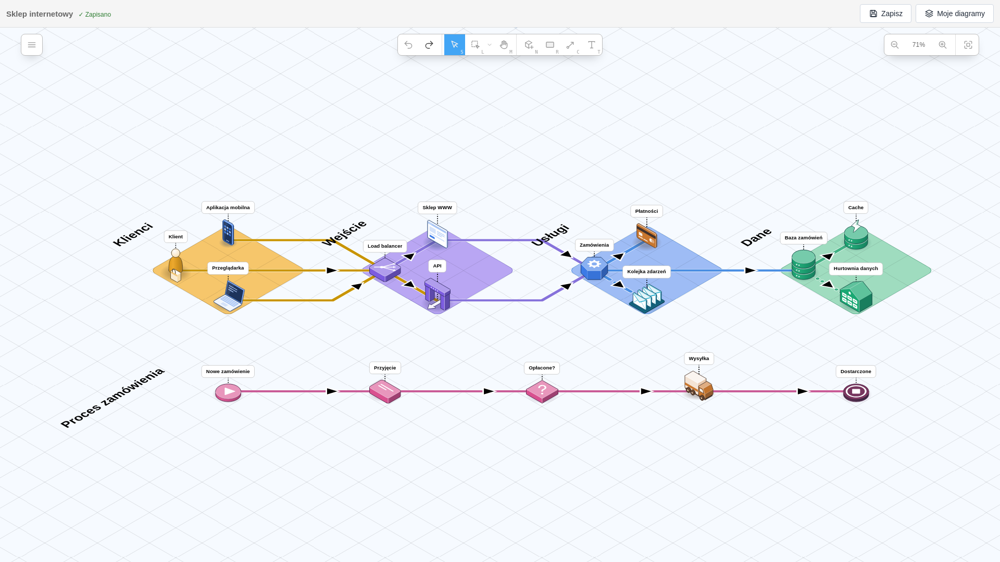

## ✨ Funkcje

- **177 ikon izometrycznych w 9 kategoriach, każda w swoim kolorze**: serwery i komputery, sieć, komunikacja, dane, bezpieczeństwo, ludzie i organizacja, przepływ i procesy, biznes i logistyka, kształty. Możesz też importować własne obrazy jako ikony.
- **Nie tylko infrastruktura:** zdarzenia początkowe i końcowe, decyzje, bramki, dokumenty, akceptacje, czasomierze i kamienie milowe do diagramów procesów.
- **Strefy, połączenia i teksty:** grupuj elementy w kolorowe strefy, łącz je (z punktami pośrednimi, etykietami, stylami linii i strzałkami), dodawaj teksty i opisy.
- **Menu prawego przycisku** na płótnie i na każdym elemencie oraz **menu ☰** z plikami, eksportem i ustawieniami.
- **Zaznaczanie i przesuwanie razem:** ramka zaznaczenia, Shift+klik, potem przeciągnięcie albo strzałki. Połączenia zachowują kształt.
- **Skróty klawiszowe** do kopiowania, wycinania, wklejania, duplikowania, zaznaczania wszystkiego, usuwania, zoomu, dopasowania, zmiany nazwy i wszystkich narzędzi (lista pod F1).
- **Eksport** do przenośnego pliku JSON (ze wszystkimi ikonami) albo obrazu PNG z wyborem rozdzielczości, tła i przycięcia.
- **Zapis tam, gdzie wolisz:** pliki na komputerze, wspólna lista na serwerze w Dockerze albo folder `Dokumenty/ArchFlow` aplikacji desktopowej.
- **Interfejs po polsku i angielsku**, łącznie z nazwami ikon.

## ⬇️ Pobierz

Gotowe wersje desktopowe są dołączone do każdego [wydania](https://github.com/cyryllo/ArchFlow/releases/latest):

| Plik | Dla |
|---|---|
| `ArchFlow-X.Y.Z-x86_64.AppImage` | Linux, dowolna dystrybucja |
| `ArchFlow-X.Y.Z-amd64.deb` | Debian / Ubuntu |
| `ArchFlow-Setup-X.Y.Z.exe` | Windows (instalator) |

```bash
# Linux AppImage
chmod +x ArchFlow-*-x86_64.AppImage
./ArchFlow-*-x86_64.AppImage
```

Instalator Windows nie jest jeszcze podpisany certyfikatem, więc SmartScreen może pokazać ostrzeżenie przy pierwszym uruchomieniu: kliknij **Więcej informacji → Uruchom mimo to**. Wolisz przeglądarkę? [Wypróbuj demo online](https://cyryllo.github.io/ArchFlow/app/) albo [uruchom w Dockerze](#-szybkie-wdrożenie-z-dockerem).

- **🚀 [Szybki start](quick-start.pl.md)** - Pierwszy diagram w dziesięciu krokach.
- **📝 [ARCHFLOW_TODO.md](https://github.com/cyryllo/ArchFlow/blob/master/ARCHFLOW_TODO.md)** - Bieżące problemy i plan rozwoju.
- **🤝 [CONTRIBUTING.md](https://github.com/cyryllo/ArchFlow/blob/master/CONTRIBUTING.md)** - Jak włączyć się w rozwój projektu.

## 🐳 Szybkie wdrożenie z Dockerem

Gotowy obraz jest publikowany w GitHub Container Registry po każdym udanym buildzie gałęzi `master`:

```
ghcr.io/cyryllo/archflow
```

| Tag | Znaczenie |
|---|---|
| `latest` | Najnowszy build gałęzi `master` |
| `0.6.1` (dowolna wersja) | Konkretna wersja ArchFlow, z `package.json` |
| `sha-abc1234` | Konkretny commit |

Na razie obraz jest budowany tylko dla `linux/amd64`.

We wszystkich przykładach poniżej ArchFlow działa na porcie **9500**. Porty takie jak 80 czy 8080 są często zajęte przez inne usługi, więc 9500 jest bezpieczniejszym wyborem. Możesz go zmienić, patrz [Zmiana portu](#zmiana-portu).

### Opcja 1: Docker Compose (zalecane)

Nie trzeba klonować repozytorium, wystarczy sam plik compose.

```bash
# 1. Utwórz katalog na ArchFlow i pobierz plik compose
mkdir archflow && cd archflow
curl -O https://raw.githubusercontent.com/cyryllo/ArchFlow/master/compose.yml

# 2. Pobierz obraz i uruchom kontener w tle
docker compose pull
docker compose up -d
```

Otwórz **http://localhost:9500** w przeglądarce. Diagramy są zapisywane jako pliki JSON w `./diagrams`, obok `compose.yml`.

Codzienne komendy (uruchamiane z tego samego katalogu):

```bash
docker compose ps                   # czy działa?
docker compose logs -f              # podgląd logów
docker compose stop                 # zatrzymanie (kontener zostaje)
docker compose start                # ponowne uruchomienie
docker compose down                 # zatrzymanie i usunięcie kontenera (diagramy zostają w ./diagrams)
docker compose pull && docker compose up -d   # aktualizacja do najnowszego obrazu
```

Aby przypiąć konkretną wersję zamiast `latest`, ustaw `ARCHFLOW_VERSION`, w linii komendy albo w pliku `.env` obok `compose.yml`:

```bash
ARCHFLOW_VERSION=0.6.1 docker compose up -d
```

### Opcja 2: `docker run`

```bash
docker run -d --name archflow \
  -p 9500:80 \
  -v "$(pwd)/diagrams:/data/diagrams" \
  --restart unless-stopped \
  ghcr.io/cyryllo/archflow:latest
```

Codzienne komendy:

```bash
docker ps                        # czy działa?
docker logs -f archflow          # podgląd logów
docker stop archflow             # zatrzymanie kontenera
docker start archflow            # ponowne uruchomienie
docker rm -f archflow            # usunięcie kontenera (diagramy zostają w ./diagrams)
```

Aktualizacja: `docker pull ghcr.io/cyryllo/archflow:latest`, potem `docker rm -f archflow` i ponownie komenda powyżej. Diagramy zostają w `./diagrams`.

Jeśli wolisz nazwany wolumen Dockera zamiast katalogu na hoście, użyj `-v archflow-diagrams:/data/diagrams`. Wolumen przetrwa `docker rm`. Podgląd i usuwanie:

```bash
docker volume ls                                                          # lista wolumenów
docker run --rm -v archflow-diagrams:/data alpine ls -la /data            # zawartość wolumenu
docker volume rm archflow-diagrams                                        # usunięcie wolumenu razem z diagramami
```

### Opcja 3: Budowanie ze źródeł

Jeśli masz sklonowane repozytorium, możesz zbudować obraz samodzielnie zamiast go pobierać:

```bash
docker compose up -d --build                     # zbuduj z lokalnych źródeł i uruchom
docker compose -f compose.dev.yml up --build     # wariant deweloperski: porty 3000 (aplikacja) i 3001 (API)
```

### Zmiana portu

Port to liczba **przed** dwukropkiem w mapowaniu portów (`HOST:KONTENER`). W kontenerze ArchFlow zawsze nasłuchuje na `80`, zmieniasz tylko stronę hosta.

- **Compose:** zmień linię `ports` w `compose.yml`, np. na `- "9600:80"`, i uruchom `docker compose up -d`.
- **`docker run`:** zmień `-p 9500:80` np. na `-p 9600:80`.

Sprawdzenie, czy port jest wolny (Linux): `ss -ltn | grep :9500` (brak wyniku oznacza, że jest wolny).

### Jak działa kontener

Warto wiedzieć, zanim uruchomisz go na serwerze:

- **Jeden kontener, dwa procesy.** nginx serwuje aplikację na porcie `80` w kontenerze, a mały backend w Node.js (port `3001`) zapisuje diagramy. nginx przekazuje zapytania `/api/...` do backendu, więc wystarczy wystawić port 80 (zmapowany na 9500 na hoście). Portu 3001 nie wystawiaj.
- **Gdzie są diagramy.** Backend zapisuje każdy diagram jako plik JSON w `/data/diagrams` w kontenerze. Obraz nie deklaruje wolumenu, więc **jeśli nic tam nie zamontujesz, diagramy są tylko wewnątrz kontenera**. Przetrwają `stop`/`start`/restart, ale **znikną po `docker rm`, `docker compose down` albo przy aktualizacji do nowego obrazu**. Zawsze montuj katalog albo nazwany wolumen (przykłady powyżej to robią).
- **Katalog na hoście czy nazwany wolumen.**
  - Katalog na hoście (`./diagrams:/data/diagrams`): pliki widać bezpośrednio na dysku, łatwo je skopiować i zrobić kopię zapasową. Jeśli katalog nie istnieje, Docker sam go utworzy przy pierwszym starcie.
  - Nazwany wolumen (`archflow-diagrams:/data/diagrams`): miejscem zarządza Docker (na Linuksie w `/var/lib/docker/volumes/`). Nie widać go jako zwykłego katalogu, ale nie ma problemu z uprawnieniami opisanego niżej.
- **Właściciel plików (Linux).** Kontener działa jako `root`, więc katalog `./diagrams` i pliki JSON w nim należą na hoście do `root`. Aby je ręcznie edytować, przenosić czy usuwać, użyj `sudo` albo przejmij je: `sudo chown -R $USER: diagrams`. ArchFlow dalej będzie działał.
- **Działa bez internetu.** Wszystko, czego potrzebuje aplikacja, jest w obrazie, więc kontener startuje w kilka sekund i nie potrzebuje internetu, poza samym pobraniem obrazu.
- **Restarty.** Oba przykłady używają `restart: unless-stopped`: kontener wstaje sam po awarii albo po restarcie maszyny, chyba że sam go zatrzymasz.
- **Brak logowania.** ArchFlow nie ma kont użytkowników. Każdy, kto otworzy adres, może przeglądać, zmieniać i usuwać diagramy w Dysku aplikacji. Uruchamiaj go w zaufanej sieci albo za reverse proxy z uwierzytelnianiem (np. basic auth), jeśli ma być dostępny z internetu.
- **Kopie zapasowe.** Wszystko, co zapisuje ArchFlow, jest w `/data/diagrams` (czyli w katalogu `./diagrams`), więc wystarczy kopia tego katalogu.

### Konfiguracja

| Zmienna | Domyślnie | Opis |
|---|---|---|
| `ARCHFLOW_VERSION` | `latest` | Tag obrazu używany przez `compose.yml`. |
| `ENABLE_SERVER_STORAGE` | `true` | Zapis diagramów jako plików na serwerze (Moje diagramy). `false` przełącza na zapis tylko w przeglądarce (sesja). |
| `STORAGE_PATH` | `/data/diagrams` | Gdzie w kontenerze zapisywane są diagramy. Tu montuj katalog z hosta albo wolumen. |

Aby wyłączyć zapis serwerowy i wrócić do zapisu tylko w przeglądarce (sesja), ustaw `ENABLE_SERVER_STORAGE=false`:
```bash
ENABLE_SERVER_STORAGE=false docker compose up -d
# albo
docker run -d -p 9500:80 -e ENABLE_SERVER_STORAGE=false ghcr.io/cyryllo/archflow:latest
```

Co wtedy zmienia się w aplikacji, opisuje sekcja [Zapisywanie i otwieranie diagramów](#zapisywanie-i-otwieranie-diagramów).

## 🖥️ Aplikacja desktopowa

Aplikacja desktopowa (Electron) to ten sam edytor we własnym oknie. **Pobierz ją z [ostatniego wydania](https://github.com/cyryllo/ArchFlow/releases/latest)**: AppImage albo `.deb` dla Linuksa, instalator dla Windows (zobacz [Pobierz](#️-pobierz)).

Diagramy zapisują się jako zwykłe pliki na dysku, automatycznie — bez pytania o lokalizację i bez pamięci przeglądarki. Przy pierwszym uruchomieniu aplikacja tworzy folder `ArchFlow` w katalogu Dokumenty (`~/Dokumenty/ArchFlow` na polskim systemie, `~/Documents/ArchFlow` na angielskim), a każdy diagram zapisany przez **Zapisz** / **Moje diagramy** staje się tam plikiem `.json`. Eksport korzysta z systemowych okien „Zapisz jako”.

Budowanie samodzielne:

```bash
npm run dev:desktop     # uruchomienie w trybie deweloperskim (otwiera okno)
npm run build:desktop   # paczki dla Twojego systemu w packages/fossflow-desktop/dist/
```

Na Linuksie powstaje AppImage i `.deb`. Instalator Windows buduje się na Windows (na Linuksie wymagałby wine); workflow `Desktop builds` na GitHubie buduje wszystkie paczki przy każdym tagu wersji i dołącza je do wydania.

## Szybki start (lokalny development)

```bash
# Sklonuj repozytorium
git clone https://github.com/cyryllo/ArchFlow
cd ArchFlow

# Zainstaluj zależności
npm install

# Zbuduj bibliotekę (wymagane przy pierwszym uruchomieniu)
npm run build:lib

# Uruchom serwer deweloperski
npm run dev
```

Otwórz [http://localhost:3000](http://localhost:3000) w przeglądarce.

## Struktura monorepo

To monorepo zawierające kilka pakietów:

- `packages/fossflow-lib` - biblioteka komponentów React do rysowania diagramów sieciowych (budowana Webpackiem)
- `packages/fossflow-app` - Progressive Web App opakowująca bibliotekę i prezentująca ją użytkownikowi (budowana RSBuildem)
- `packages/fossflow-backend` - opcjonalny serwer do trwałego zapisu diagramów
- `packages/fossflow-desktop` - natywna aplikacja okienkowa (Electron)

### Polecenia deweloperskie

```bash
# Development
npm run dev          # Uruchom serwer deweloperski aplikacji
npm run dev:lib      # Tryb watch dla rozwoju biblioteki
npm run dev:desktop  # Uruchom wersję okienkową (Electron) w trybie dev

# Budowanie
npm run build        # Zbuduj bibliotekę i aplikację
npm run build:lib    # Zbuduj tylko bibliotekę
npm run build:app    # Zbuduj tylko aplikację
npm run build:desktop # Zbuduj instalator aplikacji okienkowej

# Testy i lint
npm test             # Uruchom testy jednostkowe
npm run lint         # Sprawdź błędy lintera

# Testy E2E (Selenium)
cd e2e-tests
./run-tests.sh       # Uruchom testy end-to-end (wymaga Dockera i Pythona)

# Publikacja
npm run publish:lib  # Opublikuj bibliotekę na npm
```

## Jak korzystać

**Pierwszy raz z ArchFlow? Zacznij od [szybkiego startu](quick-start.pl.md):** dziesięć kroków od pustego płótna do zapisanego diagramu, ze zrzutami ekranu.

### Ekran

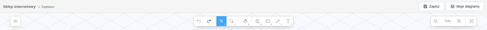

- **Górny pasek:** nazwa diagramu i stan zapisu (**Zmodyfikowany** / **Zapisano**), **Zapisz** i **Moje diagramy**.
- **Menu ☰** (po lewej): Nowy diagram, Moje diagramy, Zapisz, Otwórz z pliku, Wyczyść obszar roboczy, Eksportuj do JSON / obrazu, Ustawienia, Język, Pomoc.
- **Narzędzia** (na środku): Cofnij, Ponów · **Zaznacz / przesuń** (S), **Zaznaczanie ramką** albo **Lasso odręczne** (L / F, przełączane strzałką obok), **Przesuń widok** (M) · **Dodaj węzeł** (N), **Prostokąt / strefa** (R), **Połączenie** (C), **Tekst** (T). Litera w rogu przycisku to jego skrót.
- **Zoom** (po prawej): pomniejsz / powiększ i **Dopasuj do ekranu**.

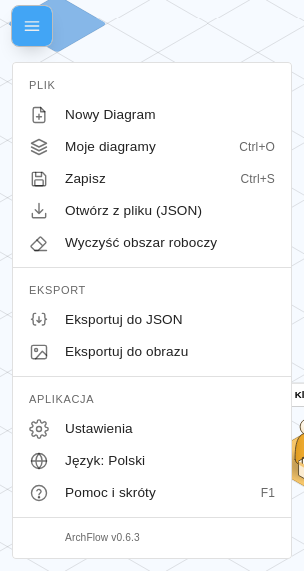

### Budowanie diagramu

1. **Dodaj węzeł:** naciśnij **N** (albo przycisk węzła, albo prawy przycisk na płótnie → *Dodaj węzeł*), wybierz ikonę z kategorii lub wyszukaj, potem kliknij miejsce na płótnie.
2. **Narysuj strefę:** naciśnij **R** i przeciągnij prostokąt.
3. **Połącz:** naciśnij **C**, kliknij pierwszy węzeł, potem drugi (albo prawy przycisk na węźle → *Połącz z…*). Żeby zagiąć połączenie, przeciągnij jego linię.
4. **Dodaj tekst:** naciśnij **T** i kliknij, gdzie ma się pojawić.
5. **Zmień właściwości:** kliknij element, żeby otworzyć jego panel (nazwa, opis, ikona, kolory, styl linii…), albo prawy przycisk → *Właściwości*.

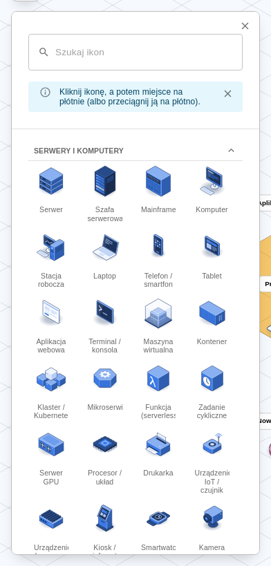 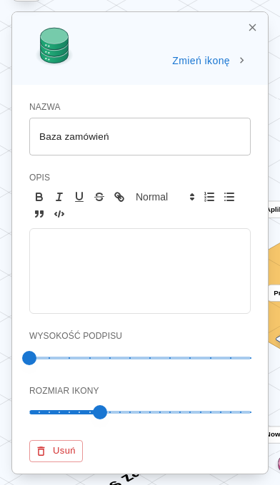 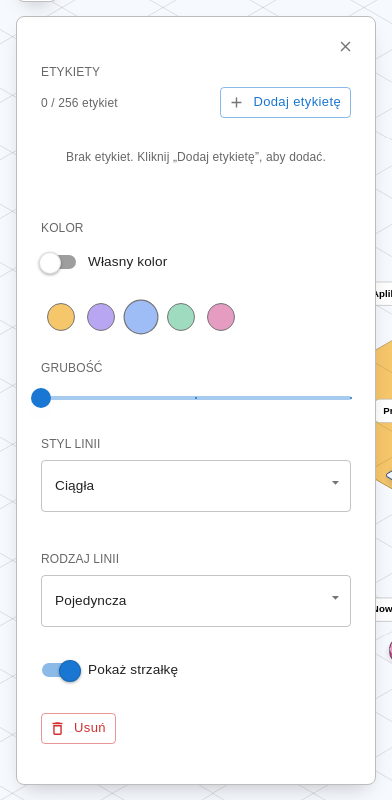

Prostokąt, węzeł i tekst wracają do **Zaznaczania** po jednym użyciu; Połączenie i lassa zostają aktywne, dopóki nie naciśniesz **Esc**, który zawsze wraca do Zaznaczania.

### Menu prawego przycisku

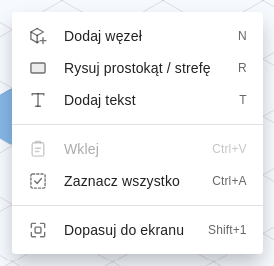 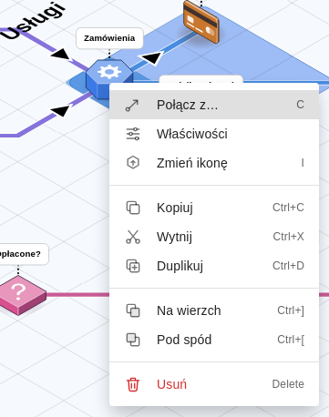

- **Na płótnie:** dodaj węzeł, narysuj prostokąt, dodaj tekst, wklej, zaznacz wszystko, dopasuj do ekranu.
- **Na elemencie:** połącz z…, właściwości, zmień ikonę, kopiuj, wytnij, duplikuj, na wierzch / pod spód, usuń. Jeśli element jest częścią zaznaczenia, akcja dotyczy całego zaznaczenia.

### Zaznaczanie i przesuwanie

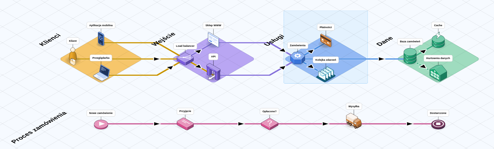

- **Przeciągnij po pustym polu**, żeby narysować ramkę zaznaczenia; **Shift+klik** dodaje albo zabiera elementy.
- **Przeciągnij zaznaczenie** (albo użyj **strzałek**), żeby przesunąć razem węzły, strefy, teksty i punkty połączeń.
- **Środkowy przycisk myszy** albo **Spacja + przeciągnij** przesuwa widok w każdym narzędziu; kółko myszy przybliża.

### Skróty klawiszowe

| Skrót | Działanie |
|---|---|
| Ctrl+Z / Ctrl+Y (Ctrl+Shift+Z) | Cofnij / ponów |
| Ctrl+C / Ctrl+X / Ctrl+V | Kopiuj / wytnij / wklej (w miejscu kursora) |
| Ctrl+D | Duplikuj |
| Ctrl+A | Zaznacz wszystko |
| Delete / Backspace | Usuń zaznaczenie |
| ← ↑ → ↓ | Przesuń zaznaczenie o jedno pole (bez zaznaczenia: przesuń widok) |
| Ctrl+] / Ctrl+[ | Na wierzch / pod spód |
| Ctrl + / Ctrl − | Powiększ / pomniejsz |
| Shift+1 | Dopasuj do ekranu |
| F2 | Zmień nazwę zaznaczonego węzła |
| Esc | Anuluj i wróć do Zaznaczania |
| S M N R C T L F | Narzędzia (litery zmienisz w Ustawieniach) |
| F1 | Pomoc ze wszystkimi skrótami |

### Ustawienia

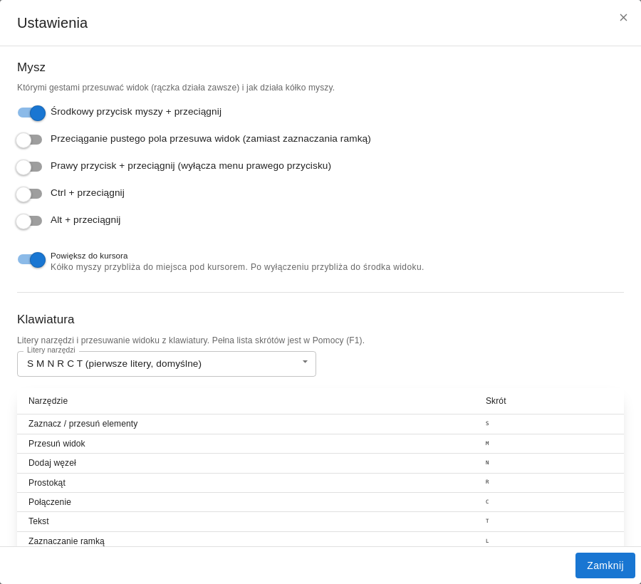

**☰ → Ustawienia** mają trzy sekcje: **Mysz** (którymi gestami przesuwać widok, przybliżanie do kursora), **Klawiatura** (litery narzędzi, przesuwanie widoku klawiaturą) i **Połączenia** (tworzenie przez klikanie albo przeciąganie).

## Zapisywanie i otwieranie diagramów

ArchFlow ma **dwa niezależne sposoby** na zachowanie pracy. Możesz używać obu jednocześnie.

| | 💾 Pliki na Twoim komputerze | 🗄️ Moje diagramy |
|---|---|---|
| Co to jest | Eksportujesz plik `.json` i otwierasz go później | Diagramy przechowuje sam ArchFlow, na liście |
| Gdzie są dane | Tam, gdzie zapiszesz wyeksportowany plik | Docker: `./diagrams` na serwerze. Aplikacja desktopowa: `~/Dokumenty/ArchFlow` |
| Dostępne | Zawsze, wszędzie | Docker z zapisem na serwerze (domyślnie) i aplikacja desktopowa |
| Do czego | Kopie zapasowe, wysyłanie diagramu, przenoszenie między instalacjami | Codzienna praca, wspólna lista dla zespołu |

### 💾 Pliki na Twoim komputerze

- **☰ → Eksportuj do JSON** pobiera bieżący diagram jako `<nazwa>-<data>.json`. Plik zawiera wszystkie użyte ikony, także zaimportowane, więc otworzy się poprawnie w każdym innym ArchFlow.
- **☰ → Otwórz z pliku** wczytuje diagram z pliku `.json` i zastępuje to, co jest na płótnie. Starsze pliki nadal działają, a wbudowane ikony dostają aktualne rysunki.
- **☰ → Eksportuj do obrazu** zapisuje obraz PNG. Pokazuje podgląd i pozwala wybrać siatkę, rozwinięte opisy, przycięcie do zawartości, kolor tła (albo przezroczyste) i rozdzielczość (DPI). Używaj Chrome lub Edge; w Firefoksie eksport obrazu ma znane problemy.

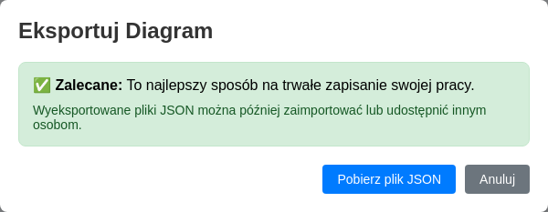 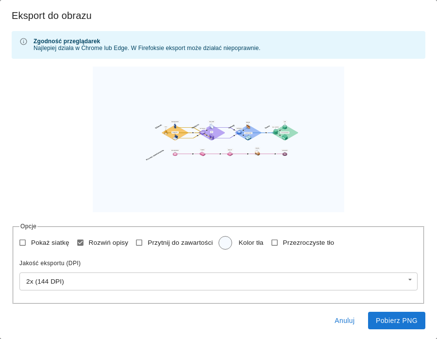

### 🗄️ Moje diagramy

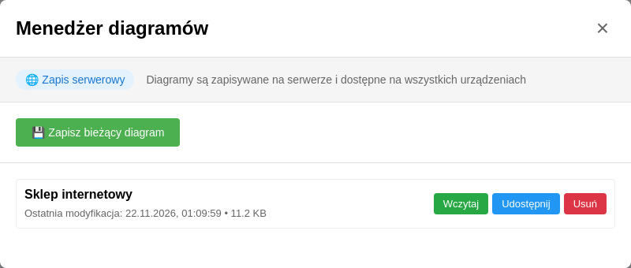

**Moje diagramy** (górny pasek, menu ☰ albo **Ctrl+O**) otwierają listę zapisanych diagramów:

- **Zapisz bieżący diagram** zapisuje diagram pod nazwą. Jeśli diagram o tej nazwie już istnieje, ArchFlow zapyta przed nadpisaniem. Każdy diagram staje się plikiem nazwanym tak jak on, np. `./diagrams/Sklep internetowy.json`.
- **Wczytaj** otwiera zapisany diagram, **Udostępnij** kopiuje link tylko do odczytu (`http://twoj-serwer:9500/display/<nazwa>`, tylko Docker), **Usuń** usuwa diagram i jego plik po potwierdzeniu.
- **Zapisz** na górnym pasku (albo **Ctrl+S**) zapisuje otwarty diagram ponownie pod tą samą nazwą.

Ważne:

- **Zapis jest ręczny.** Górny pasek pokazuje **Zmodyfikowany**, dopóki nie zapiszesz, a przeglądarka ostrzeże Cię przy zamykaniu karty z niezapisanymi zmianami.
- **W Dockerze lista jest wspólna.** Każdy, kto otworzy ten sam adres ArchFlow, widzi i edytuje te same diagramy. Nie ma kont użytkowników.

### Tylko przeglądarka (bez zapisu na serwerze)

Gdy ArchFlow działa jako zwykła strona WWW (jak demo) albo Docker ma `ENABLE_SERVER_STORAGE=false`, **Zapisz** i **Moje diagramy** trzymają diagramy w pamięci przeglądarki:

- są tylko w tej przeglądarce, na tym komputerze,
- znikają po wyczyszczeniu danych przeglądarki,
- pamięć przeglądarki jest mała (kilka MB), więc duże diagramy mogą się nie zmieścić.

W tym trybie regularnie eksportuj do pliku, to jedyny pewny sposób na zachowanie pracy.

### Automatyczne przywracanie

Niezależnie od powyższego przeglądarka pamięta diagram, nad którym pracowałeś, i otwiera go ponownie po odświeżeniu strony. To wygoda, **nie kopia zapasowa**: istnieje tylko w Twojej przeglądarce i zostaje zastąpiona, gdy tylko otworzysz inny diagram.

### Jakie opcje mam?

| Gdzie działa ArchFlow | Co dostajesz |
|---|---|
| Aplikacja desktopowa | **Moje diagramy** (pliki w `~/Dokumenty/ArchFlow`) + eksport / otwieranie plików |
| Docker z zapisem na serwerze (domyślnie) | **Moje diagramy** (pliki w `./diagrams` na serwerze, wspólne) + eksport / otwieranie plików |
| Zwykły hosting WWW / Docker bez zapisu na serwerze | Moje diagramy tylko w przeglądarce + eksport / otwieranie plików |

## Współtworzenie

Chętnie przyjmiemy Twój wkład! Zobacz [CONTRIBUTING.md](https://github.com/cyryllo/ArchFlow/blob/master/CONTRIBUTING.md), by poznać zasady.

## Dokumentacja

- [ARCHFLOW_ENCYCLOPEDIA.md](https://github.com/cyryllo/ArchFlow/blob/master/ARCHFLOW_ENCYCLOPEDIA.md) - Obszerny przewodnik po kodzie projektu
- [ARCHFLOW_TODO.md](https://github.com/cyryllo/ArchFlow/blob/master/ARCHFLOW_TODO.md) - Bieżące problemy i plan rozwoju
- [CONTRIBUTING.md](https://github.com/cyryllo/ArchFlow/blob/master/CONTRIBUTING.md) - Zasady współtworzenia

## Licencja

MIT
