# ArchFlow user manual

 <b>English</b> | <a href="manual.pl.md">Polski</a>

Everything ArchFlow can do, chapter by chapter. New here? The [quick start](quick-start.md) takes you from an empty canvas to a saved diagram in ten steps; come back to this manual when you want the details.

**Contents**

1. [Getting ArchFlow](#1-getting-archflow)
2. [The editor screen](#2-the-editor-screen)
3. [Moving around the canvas](#3-moving-around-the-canvas)
4. [Nodes](#4-nodes)
5. [Zones (rectangles)](#5-zones-rectangles)
6. [Connectors](#6-connectors)
7. [Text](#7-text)
8. [Selecting and editing](#8-selecting-and-editing)
9. [Right-click menus](#9-right-click-menus)
10. [Undo and redo](#10-undo-and-redo)
11. [Saving and opening](#11-saving-and-opening)
12. [Export](#12-export)
13. [Settings](#13-settings)
14. [Language](#14-language)
15. [Keyboard shortcuts](#15-keyboard-shortcuts)
16. [Troubleshooting](#16-troubleshooting)

---

## 1. Getting ArchFlow

ArchFlow is the same editor in three packages:

| | What you get | Where diagrams are saved |
|---|---|---|
| **[Live demo](https://cyryllo.github.io/ArchFlow/app/)** | Runs in your browser, nothing to install | Only in this browser (export to keep them) |
| **[Desktop app](https://github.com/cyryllo/ArchFlow/releases/latest)** | AppImage / `.deb` for Linux, installer for Windows | Files in `Documents/ArchFlow` |
| **[Docker](docker.md)** | Your own server, for you or your team | Files in `./diagrams` on the server, shared by everyone who opens it |

The rest of this manual works the same in all three, except where noted.

## 2. The editor screen

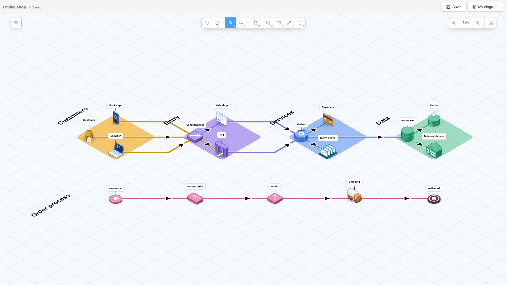

**Top bar.** The diagram's name and its save state: **Saved**, or **Modified** when there are changes you haven't saved yet. On the right: **Save** and **My diagrams** (see [chapter 11](#11-saving-and-opening)).

**Toolbar row** across the top of the canvas:

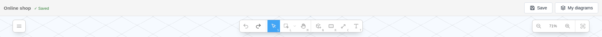

| Part | Buttons |
|---|---|
| ☰ (left) | The main menu |
| History | Undo, Redo |
| Selecting and moving | **Select / move items** (S), **Box select** or **Freehand lasso** (L / F), **Pan view** (M) |
| Adding | **Add node** (N), **Rectangle / zone** (R), **Connector** (C), **Text** (T) |
| Zoom (right) | Zoom out, zoom level, Zoom in, **Fit to screen** |

The small letter in a button's corner is its keyboard shortcut. The highlighted button is the active tool.

**Box select and freehand lasso share one button.** The small arrow next to it switches which of the two the button starts:

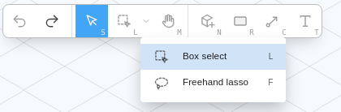

**The ☰ menu** holds everything that isn't drawing:

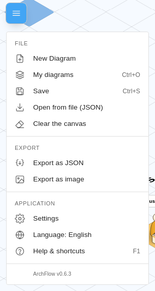

- **File:** New diagram, My diagrams, Save, Open from file (JSON), Clear the canvas.
- **Export:** Export as JSON, Export as image.
- **Application:** Settings, Language, Help & shortcuts, and the version number.

**Which tools stay on.** Rectangle, Add node and Text go back to Select after one use. Connector, Box select and Freehand lasso stay active so you can use them several times; **Esc** always takes you back to Select and cancels anything half-done (a connector you've started, a text that hasn't been placed).

## 3. Moving around the canvas

**Moving the view (panning):**

- drag with the **middle mouse button**, in any tool;
- hold **Space** and drag with the left button, in any tool;
- pick the **Pan view** tool (M) and drag anywhere;
- with nothing selected, use the **arrow keys** (also W A S D or I J K L if you turn them on in [Settings](#13-settings)).

**Zooming:**

- the **mouse wheel** zooms towards the mouse pointer (or towards the centre of the view, see Settings);
- **Ctrl +** / **Ctrl −**, or the + and − buttons, zoom in steps of 5 %;
- **Fit to screen** (Shift+1) shows the whole diagram.

The zoom goes from 10 % to 100 %.

## 4. Nodes

A node is an icon with a name: a server, a database, a person, a document, a step in a process…

### Adding a node

1. Press **N**, click **Add node** on the toolbar, or right-click empty canvas → **Add node**.
2. Pick an icon. Icons are grouped into colour-coded categories (servers & computers, network, communication, data, security, people & organisation, flow & process, business & logistics, shapes); type in the search box to find one by name.
3. Click a spot on the canvas. You can also drag the icon straight onto the canvas.

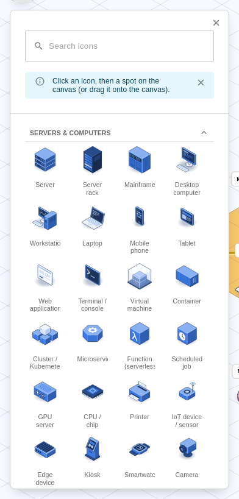

After placing one node the tool goes back to Select. Two nodes can't share a tile; if the spot is taken, the node goes to the nearest free tile.

### Node properties

Click a node to open its panel (or right-click it → **Properties**):

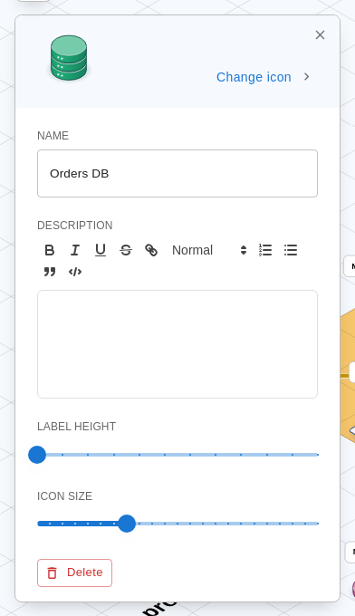

- **Name** – shown in the label above the node. **F2** jumps straight to this field for the selected node.
- **Description** – formatted text (bold, lists, links…). Nodes with a description show it in their label, with a button to expand it.
- **Label height** – how high the label floats above the node. Labels never go lower than the top of the icon.
- **Icon size** – make the icon bigger or smaller.
- **Delete** – remove the node.

Close the panel with **×**, **Esc**, or by clicking empty canvas.

### Changing a node's icon

Select the node and press **I** (or right-click → **Change icon**, or **Change icon** at the top of its panel). Search or pick a new icon; **Enter** takes the highlighted one, a double-click picks and closes.

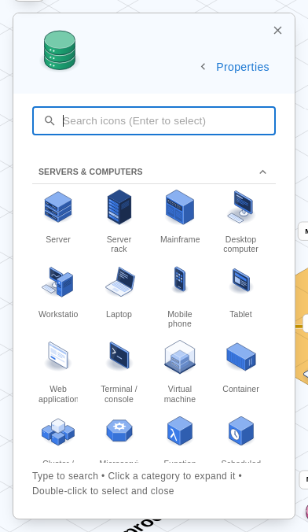

### Your own icons

At the bottom of the icon picker, **Import icons** adds images from your computer (PNG, SVG, JPG; several at once). Keep **Treat as isometric** ticked for drawings that are already isometric; untick it for flat images such as logos, and ArchFlow lays them flat on the grid.

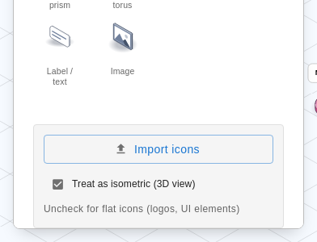

Imported icons are saved inside the diagram, so they travel with exported files.

## 5. Zones (rectangles)

Zones are coloured areas under the nodes that group things that belong together: a network, an environment, a team, a phase of a process.

- **Draw:** press **R** (or right-click → **Draw rectangle / zone**) and drag. The tool goes back to Select afterwards.
- **Select:** click the zone where there's no node, connector or label on top of it.
- **Resize:** drag one of the four handles at its corners.
- **Move:** drag it. Nodes on top don't move with it unless you select them too ([chapter 8](#8-selecting-and-editing)).
- **Colour:** pick one in the panel, or turn on **Custom colour** for any colour (with an eyedropper in browsers that support it).

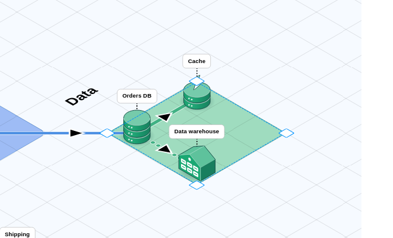 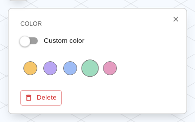

When zones overlap, **Bring to front** / **Send to back** (right-click, or Ctrl+] / Ctrl+[) changes which one is on top.

## 6. Connectors

Connectors are the lines between nodes, with an arrow showing the direction.

### Drawing a connector

1. Press **C** (or click **Connector**).
2. Click the first node, then the second. The arrow points at the second one.

Instead of a node you can click an empty tile: the connector then starts or ends there. The connector tool stays on, so you can draw several in a row; press **Esc** when you're done.

**Shortcut from a node:** right-click a node → **Connect to…**, then click the other node.

If you prefer to drag from one node to the other, switch **Settings → Connectors** to drag mode.

### Shaping and reconnecting

- **Bend a connector:** drag its line. That adds a bend point; drag it again to move it.
- **Move an end to another node:** drag the end of the line and drop it on the node.
- Connectors follow their nodes when you move them. When you move a whole selection, the bend points move with it.

### Connector properties

Click a connector to open its panel:

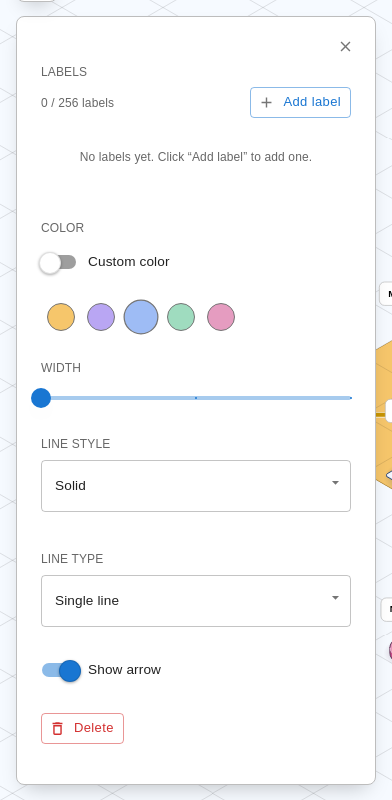

- **Labels** – **Add label** puts text on the line. For each label: the text, the **position** along the line (0–100 %), a **height offset**, and a dotted line to the connector. Double lines let you choose which line the label belongs to. Up to 256 labels.
- **Colour** – from the diagram's palette or a custom colour.
- **Width** – line thickness.
- **Line style** – solid, dotted or dashed.
- **Line type** – single, double, or double with a circle.
- **Show arrow** – turn the arrowhead on or off.
- **Delete** – remove the connector.

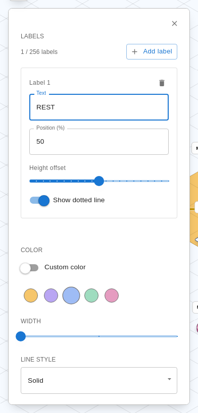 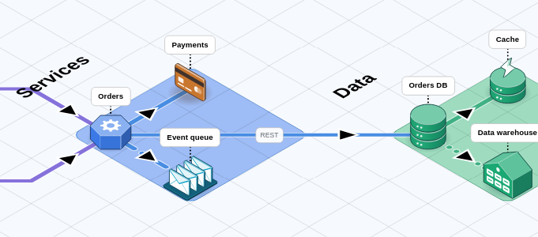

## 7. Text

Free text on the canvas: titles, captions, names of zones.

1. Press **T** (or right-click → **Add text**) and click where the text should go.
2. Type it in the panel. **Text size** makes it bigger or smaller; **Direction** chooses which of the two grid directions it runs along.

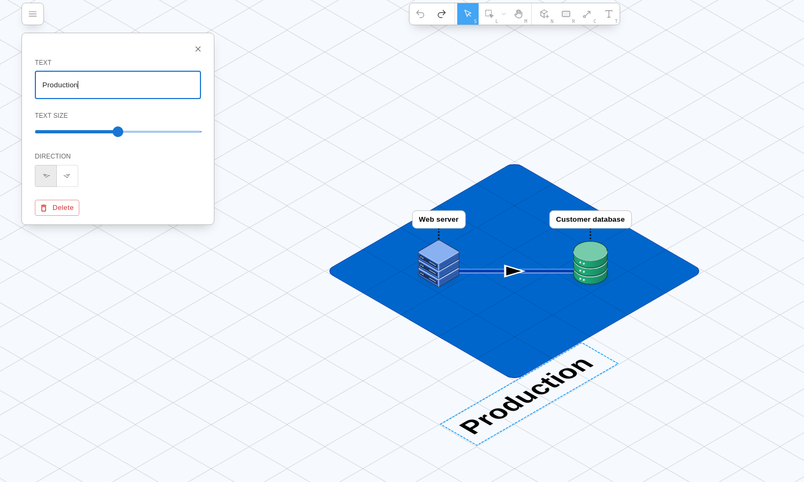

The tool goes back to Select after one text. Click a text later to edit it.

## 8. Selecting and editing

### Selecting

- **One element:** click it. Its panel opens.
- **Several elements:**
  - drag on empty canvas with the Select tool to draw a **selection box**: everything whose position is inside is selected (zones only when the whole zone is inside);
  - **Shift+click** adds an element to the selection or takes it out;
  - **Box select** (L) and **Freehand lasso** (F) tools do the same and stay on for more selections; the lasso lets you draw any shape;
  - **Ctrl+A** selects everything.
- A connector is selected with the others when all its bend points are inside the box and the nodes it connects are selected too.

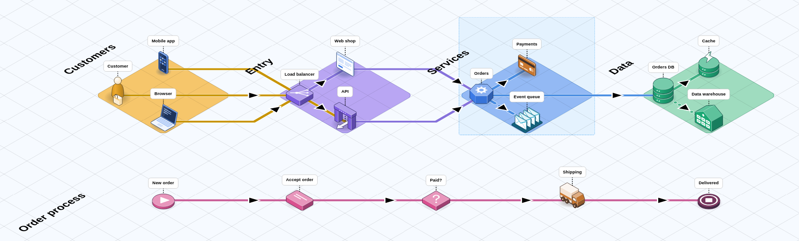

### Moving

- **Drag** a selected element and the whole selection moves together, bend points of selected connectors included. It stays selected afterwards.
- The **arrow keys** move the selection one tile at a time.
- A single node, zone or text can be dragged without selecting it first.

### Copy, paste, duplicate, delete

| Action | Keys | Notes |
|---|---|---|
| Copy | Ctrl+C | Connectors between the copied nodes are copied too |
| Cut | Ctrl+X | Copy, then delete |
| Paste | Ctrl+V | At the mouse pointer (right-click → Paste: at that spot); the pasted elements stay selected |
| Duplicate | Ctrl+D | A copy right next to the original, without touching the clipboard |
| Delete | Delete or Backspace | The selection, as one step you can undo |
| Bring to front / Send to back | Ctrl+] / Ctrl+[ | Stacking order of overlapping zones, texts and nodes |

Copy and paste work inside the open diagram. The clipboard is emptied when you open another diagram, and it doesn't exchange anything with other programs.

## 9. Right-click menus

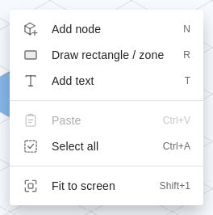 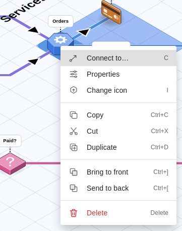

**On empty canvas:** Add node, Draw rectangle / zone, Add text, Paste, Select all, Fit to screen.

**On an element:**

- everything: Properties, Delete;
- nodes: Connect to…, Change icon;
- nodes, zones and texts: Copy, Cut, Duplicate, Bring to front, Send to back.

If the element you right-click is part of a selection, Copy, Cut, Duplicate, stacking order and Delete apply to the whole selection.

## 10. Undo and redo

**Ctrl+Z** undoes the last change, **Ctrl+Y** (or **Ctrl+Shift+Z**) redoes it; the arrows at the left of the toolbar do the same. Pasting and deleting several elements count as one step each. Dragging is recorded in small steps, so undoing a long drag may take several Ctrl+Z.

## 11. Saving and opening

The short version (details in [Saving and opening diagrams](saving.md)):

- **Save** (top bar, ☰ or **Ctrl+S**) saves the open diagram. The first time it asks for a name.
- **My diagrams** (top bar, ☰ or **Ctrl+O**) lists saved diagrams: **Load**, **Share** (a read-only link, Docker only) and **Delete**.

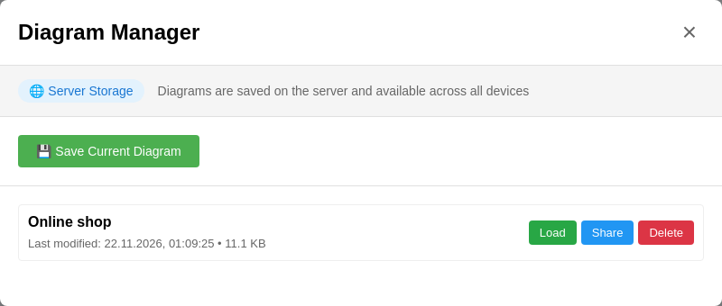

- Saving is manual: the top bar says **Modified** until you save, and the browser warns you before closing a tab with unsaved changes.
- **☰ → New diagram** starts an empty one; **☰ → Clear the canvas** empties the current one.
- **☰ → Open from file** opens an exported `.json` file. Diagrams from older versions open fine and their built-in icons get the current drawings.

Where diagrams are kept: on your server (Docker, shared by everyone who opens it), in `Documents/ArchFlow` (desktop app), or only in your browser (the demo, or Docker with server storage turned off). In the browser-only case, export your work to a file regularly.

## 12. Export

**☰ → Export as JSON** downloads the diagram as a file you can open in any ArchFlow (☰ → Open from file). Every icon it uses is included, also your imported ones. Use it for backups and to send diagrams to others.

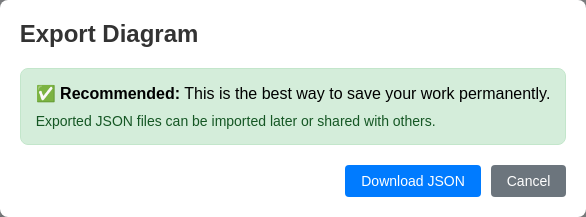

**☰ → Export as image** saves a PNG picture. The dialog shows a preview and lets you choose:

- show the grid or not;
- expand node descriptions;
- crop to the content, or draw an area to export;
- background colour, or a transparent background;
- quality (72 to 288 DPI, or a custom scale).

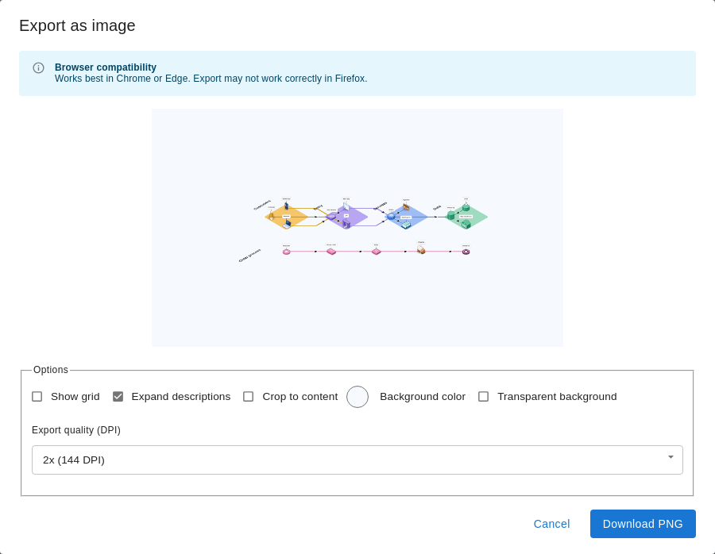

Image export works best in Chrome or Edge; Firefox has known problems with it.

## 13. Settings

**☰ → Settings**, three sections on one page:

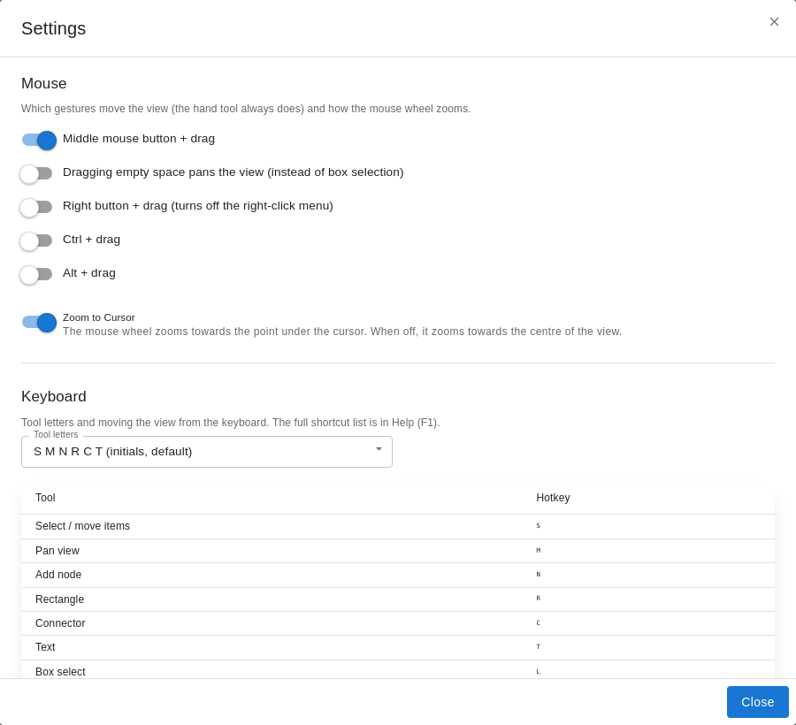

**Mouse**

- which gestures move the view: middle button + drag (on by default), dragging empty canvas (off by default: that draws a selection box), right button + drag (turns off the right-click menu), Ctrl + drag, Alt + drag;
- **Zoom to cursor**: the wheel zooms towards the mouse pointer; off: towards the centre of the view.

**Keyboard**

- **Tool letters**: S M N R C T (initials, default), Q W E R T Y (left hand), or none; the table shows which letter starts which tool;
- moving the view with the arrow keys, W A S D or I J K L when nothing is selected, and how fast.

**Connectors**

- **Click mode** (default): click the first node, then the second;
- **Drag mode**: drag from the first node to the second.

The mouse gestures for moving the view are remembered in this browser (or in the desktop app). The other settings currently go back to their defaults when the page is reloaded.

## 14. Language

**☰ → Language** switches between English and Polish. Everything follows, including icon names and categories. Your choice is remembered.

## 15. Keyboard shortcuts

Press **F1** in ArchFlow to see them all.

**Tools** (default letters; change them in Settings → Keyboard)

| Key | Tool |
|---|---|
| S | Select / move items |
| L / F | Box select / Freehand lasso |
| M | Pan view |
| N | Add node |
| R | Rectangle / zone |
| C | Connector |
| T | Text |
| Esc | Cancel, back to Select |

**Editing**

| Keys | Action |
|---|---|
| Ctrl+Z / Ctrl+Y (Ctrl+Shift+Z) | Undo / redo |
| Ctrl+C / Ctrl+X / Ctrl+V | Copy / cut / paste |
| Ctrl+D | Duplicate |
| Ctrl+A | Select all |
| Delete / Backspace | Delete the selection |
| Arrow keys | Move the selection one tile (nothing selected: move the view) |
| Ctrl+] / Ctrl+[ | Bring to front / send to back |
| F2 | Rename the selected node |
| I | Change the selected node's icon |

**View and files**

| Keys | Action |
|---|---|
| Middle button + drag, Space + drag | Move the view |
| Mouse wheel, Ctrl + / Ctrl − | Zoom |
| Shift+1 | Fit to screen |
| Ctrl+S | Save |
| Ctrl+O | My diagrams |
| F1 | Help |

**Mouse**

| | |
|---|---|
| Shift+click | Add to / remove from the selection |
| Right-click | Menu for the canvas or the element |

Shortcuts don't fire while you're typing in a text field.

## 16. Troubleshooting

**"I clicked but nothing got selected."** Labels sit above their nodes and catch clicks; click the icon or the zone a bit further away from labels.

**"My connector ended in the middle of nowhere."** In click mode, clicking an empty tile ends the connector there. To bend a connector, draw it node to node first, then drag its line.

**"Dragging empty canvas draws a box instead of moving the view."** That's the default. Move the view with the middle mouse button or Space + drag, or turn on *Dragging empty space pans the view* in Settings → Mouse.

**"The right-click menu doesn't appear."** *Right button + drag* in Settings → Mouse is on; it uses the right button for moving the view.

**"Image export looks wrong."** Use Chrome or Edge.

**"I can't zoom in further."** The zoom stops at 100 %.

**"My diagrams disappeared" (demo / browser-only).** In that mode diagrams live in the browser's storage, which is cleared together with browser data. Export important diagrams to files.

**Windows: "Windows protected your PC".** The installer isn't code-signed yet. Click **More info → Run anyway**.

**Linux: the AppImage doesn't start.** Make it executable (`chmod +x`). On some distributions AppImages also need FUSE 2 (e.g. `sudo apt install libfuse2` on Ubuntu).

**Docker: I can't edit the files in `./diagrams`.** The container writes them as `root`; take them over with `sudo chown -R $USER: diagrams`. More in the [Docker guide](docker.md).

---

[← Back to the README](../README.md)
