# Instrukcja obsługi ArchFlow

 <a href="manual.md">English</a> | <b>Polski</b>

Wszystko, co potrafi ArchFlow, rozdział po rozdziale. Pierwszy raz? [Szybki start](quick-start.pl.md) w dziesięciu krokach prowadzi od pustego płótna do zapisanego diagramu; do tej instrukcji wróć, gdy będziesz potrzebować szczegółów.

**Spis treści**

1. [Skąd wziąć ArchFlow](#1-skąd-wziąć-archflow)
2. [Ekran edytora](#2-ekran-edytora)
3. [Poruszanie się po płótnie](#3-poruszanie-się-po-płótnie)
4. [Węzły](#4-węzły)
5. [Strefy (prostokąty)](#5-strefy-prostokąty)
6. [Połączenia](#6-połączenia)
7. [Teksty](#7-teksty)
8. [Zaznaczanie i edycja](#8-zaznaczanie-i-edycja)
9. [Menu prawego przycisku](#9-menu-prawego-przycisku)
10. [Cofanie i ponawianie](#10-cofanie-i-ponawianie)
11. [Zapisywanie i otwieranie](#11-zapisywanie-i-otwieranie)
12. [Eksport](#12-eksport)
13. [Ustawienia](#13-ustawienia)
14. [Język](#14-język)
15. [Skróty klawiszowe](#15-skróty-klawiszowe)
16. [Rozwiązywanie problemów](#16-rozwiązywanie-problemów)
17. [Konta i logowanie](#17-konta-i-logowanie)
18. [Asystenci AI (MCP)](#18-asystenci-ai-mcp)

---

## 1. Skąd wziąć ArchFlow

ArchFlow to ten sam edytor w trzech wydaniach:

| | Co dostajesz | Gdzie zapisują się diagramy |
|---|---|---|
| **[Demo online](https://cyryllo.github.io/ArchFlow/app/)** | Działa w przeglądarce, bez instalacji | Tylko w tej przeglądarce (eksportuj, żeby zachować) |
| **[Aplikacja na komputer](https://github.com/cyryllo/ArchFlow/releases/latest)** | AppImage / `.deb` dla Linuksa, instalator dla Windows | Pliki w `Dokumenty/ArchFlow` |
| **[Docker](docker.pl.md)** | Twój własny serwer, dla Ciebie lub zespołu | Pliki w `./diagrams` na serwerze, wspólne dla wszystkich, którzy go otworzą |

Reszta instrukcji działa tak samo we wszystkich trzech, chyba że zaznaczono inaczej.

## 2. Ekran edytora

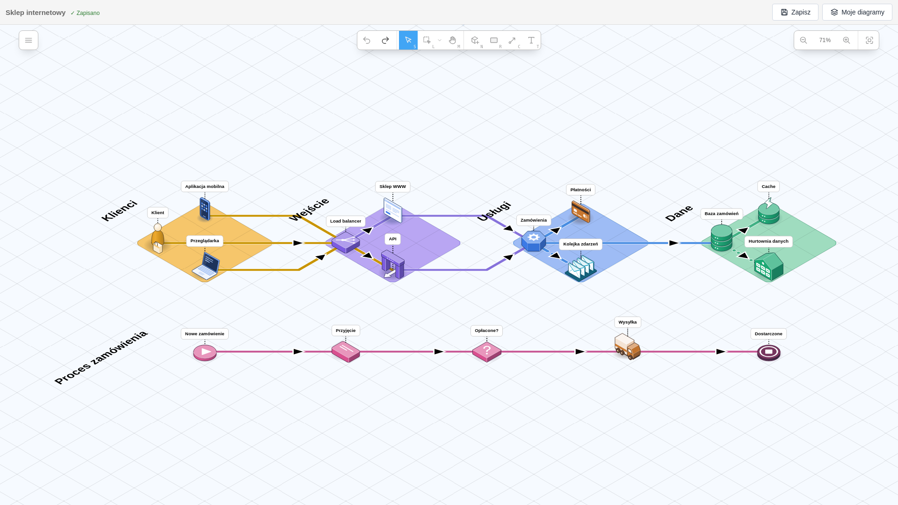

**Górny pasek.** Nazwa diagramu i stan zapisu: **Zapisano** albo **Zmodyfikowany**, gdy są niezapisane zmiany. Po prawej: **Zapisz** i **Moje diagramy** (zobacz [rozdział 11](#11-zapisywanie-i-otwieranie)).

**Rząd narzędzi** u góry płótna:

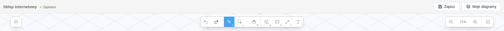

| Część | Przyciski |
|---|---|
| ☰ (po lewej) | Menu główne |
| Historia | Cofnij, Ponów |
| Zaznaczanie i przesuwanie | **Zaznacz / przesuń elementy** (S), **Zaznaczanie ramką** albo **Lasso odręczne** (L / F), **Przesuń widok** (M) |
| Dodawanie | **Dodaj węzeł** (N), **Prostokąt / strefa** (R), **Połączenie** (C), **Tekst** (T) |
| Zoom (po prawej) | Pomniejsz, poziom powiększenia, Powiększ, **Dopasuj do ekranu** |

Mała litera w rogu przycisku to jego skrót klawiszowy. Podświetlony przycisk to aktywne narzędzie.

**Zaznaczanie ramką i lasso odręczne dzielą jeden przycisk.** Mała strzałka obok przełącza, które z nich uruchamia przycisk:

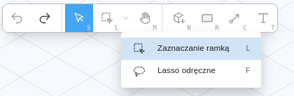

**Menu ☰** zawiera wszystko, co nie jest rysowaniem:

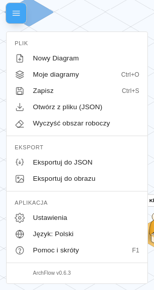

- **Plik:** Nowy diagram, Moje diagramy, Zapisz, Otwórz z pliku (JSON), Wyczyść obszar roboczy.
- **Eksport:** Eksportuj do JSON, Eksportuj do obrazu.
- **Aplikacja:** Ustawienia, Język, Pomoc i skróty oraz numer wersji.

**Które narzędzia zostają włączone.** Prostokąt, Dodaj węzeł i Tekst wracają do Zaznaczania po jednym użyciu. Połączenie, Zaznaczanie ramką i Lasso odręczne zostają aktywne, żeby można było użyć ich kilka razy; **Esc** zawsze wraca do Zaznaczania i anuluje to, co niedokończone (rozpoczęte połączenie, niepostawiony tekst).

## 3. Poruszanie się po płótnie

**Przesuwanie widoku:**

- przeciągnij **środkowym przyciskiem myszy**, w każdym narzędziu;
- przytrzymaj **Spację** i przeciągnij lewym przyciskiem, w każdym narzędziu;
- wybierz narzędzie **Przesuń widok** (M) i przeciągnij w dowolnym miejscu;
- gdy nic nie jest zaznaczone, użyj **strzałek** (albo W A S D lub I J K L, jeśli je włączysz w [Ustawieniach](#13-ustawienia)).

**Przybliżanie:**

- **kółko myszy** przybliża w stronę kursora (albo środka widoku, zobacz Ustawienia);
- **Ctrl +** / **Ctrl −** albo przyciski + i − przybliżają skokami po 5 %;
- **Dopasuj do ekranu** (Shift+1) pokazuje cały diagram.

Zoom działa w zakresie od 10 % do 100 %.

## 4. Węzły

Węzeł to ikona z nazwą: serwer, baza danych, osoba, dokument, krok procesu…

### Dodawanie węzła

1. Naciśnij **N**, kliknij **Dodaj węzeł** na pasku albo prawy przycisk na pustym płótnie → **Dodaj węzeł**.
2. Wybierz ikonę. Ikony są pogrupowane w kategorie, każda w swoim kolorze (serwery i komputery, sieć, komunikacja, dane, bezpieczeństwo, ludzie i organizacja, przepływ i procesy, biznes i logistyka, kształty); wpisz nazwę w wyszukiwarkę, żeby szybko znaleźć ikonę.
3. Kliknij miejsce na płótnie. Ikonę możesz też przeciągnąć prosto na płótno.

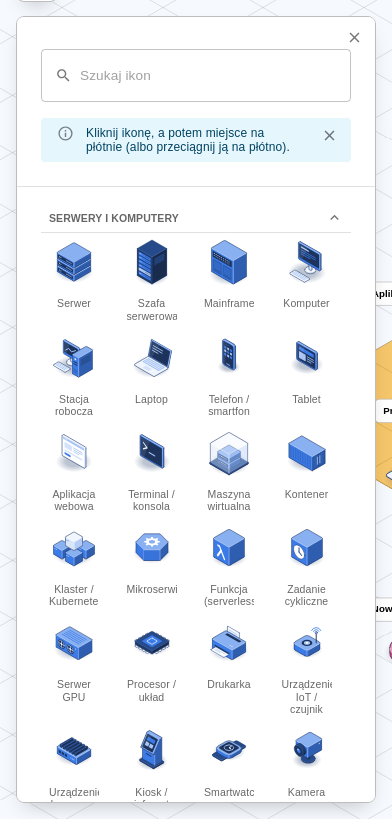

Po postawieniu węzła narzędzie wraca do Zaznaczania. Dwa węzły nie mogą stać na jednym polu; jeśli miejsce jest zajęte, węzeł trafi na najbliższe wolne pole.

### Właściwości węzła

Kliknij węzeł, żeby otworzyć jego panel (albo prawy przycisk → **Właściwości**):

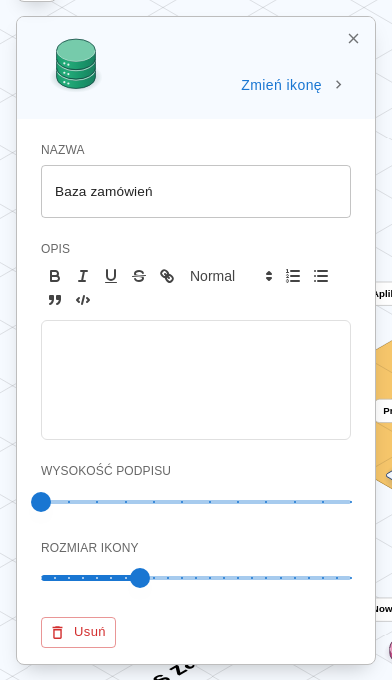

- **Nazwa** – pokazywana w podpisie nad węzłem. **F2** przenosi prosto do tego pola dla zaznaczonego węzła.
- **Opis** – tekst z formatowaniem (pogrubienie, listy, linki…). Węzły z opisem pokazują go w podpisie, z przyciskiem do rozwinięcia.
- **Wysokość podpisu** – jak wysoko nad węzłem wisi podpis. Podpis nigdy nie schodzi niżej niż czubek ikony.
- **Rozmiar ikony** – większa albo mniejsza ikona.
- **Usuń** – usuwa węzeł.

Panel zamkniesz **×**, klawiszem **Esc** albo kliknięciem w puste płótno.

### Zmiana ikony węzła

Zaznacz węzeł i naciśnij **I** (albo prawy przycisk → **Zmień ikonę**, albo **Zmień ikonę** na górze panelu). Wyszukaj albo wybierz nową ikonę; **Enter** bierze podświetloną, podwójne kliknięcie wybiera i zamyka.

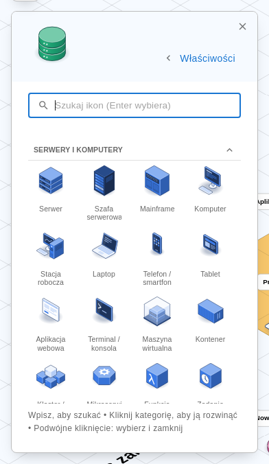

### Własne ikony

Na dole wyboru ikon **Importuj ikony** dodaje obrazy z Twojego komputera (PNG, SVG, JPG; kilka naraz). Zostaw zaznaczone **Traktuj jako izometryczne** dla rysunków, które już są izometryczne; odznacz dla płaskich obrazów, np. logotypów, a ArchFlow położy je płasko na siatce.

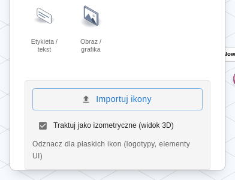

Zaimportowane ikony zapisują się w diagramie, więc podróżują razem z wyeksportowanymi plikami.

## 5. Strefy (prostokąty)

Strefy to kolorowe obszary pod węzłami, grupujące to, co do siebie należy: sieć, środowisko, zespół, etap procesu.

- **Rysowanie:** naciśnij **R** (albo prawy przycisk → **Rysuj prostokąt / strefę**) i przeciągnij. Narzędzie potem wraca do Zaznaczania.
- **Zaznaczanie:** kliknij strefę tam, gdzie nie leży na niej węzeł, połączenie ani podpis.
- **Zmiana rozmiaru:** przeciągnij jeden z czterech uchwytów w jej rogach.
- **Przesuwanie:** przeciągnij ją. Węzły na niej nie przesuną się razem z nią, chyba że też je zaznaczysz ([rozdział 8](#8-zaznaczanie-i-edycja)).
- **Kolor:** wybierz w panelu albo włącz **Własny kolor**, żeby wybrać dowolny (z pipetą w przeglądarkach, które ją obsługują).

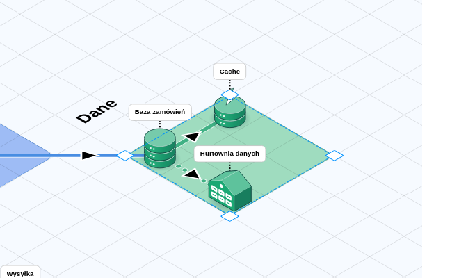 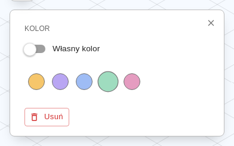

Gdy strefy na siebie nachodzą, **Na wierzch** / **Pod spód** (prawy przycisk albo Ctrl+] / Ctrl+[) zmienia, która jest na górze.

## 6. Połączenia

Połączenia to linie między węzłami, ze strzałką pokazującą kierunek.

### Rysowanie połączenia

1. Naciśnij **C** (albo kliknij **Połączenie**).
2. Kliknij pierwszy węzeł, potem drugi. Strzałka wskazuje drugi.

Zamiast węzła możesz kliknąć puste pole: połączenie zaczyna się albo kończy wtedy w tym miejscu. Narzędzie połączeń zostaje włączone, więc możesz narysować kilka pod rząd; na koniec naciśnij **Esc**.

**Skrót z węzła:** prawy przycisk na węźle → **Połącz z…**, potem kliknij drugi węzeł.

Jeśli wolisz przeciągać od jednego węzła do drugiego, przełącz **Ustawienia → Połączenia** na tryb przeciągania.

### Kształt i przepinanie

- **Zagięcie połączenia:** przeciągnij jego linię. Powstanie punkt załamania; przeciągnij go znowu, żeby go przesunąć.
- **Przepięcie końca do innego węzła:** przeciągnij koniec linii i upuść go na węźle.
- Połączenia podążają za węzłami, gdy je przesuwasz. Gdy przesuwasz całe zaznaczenie, punkty załamania przesuwają się razem z nim.

### Właściwości połączenia

Kliknij połączenie, żeby otworzyć jego panel:

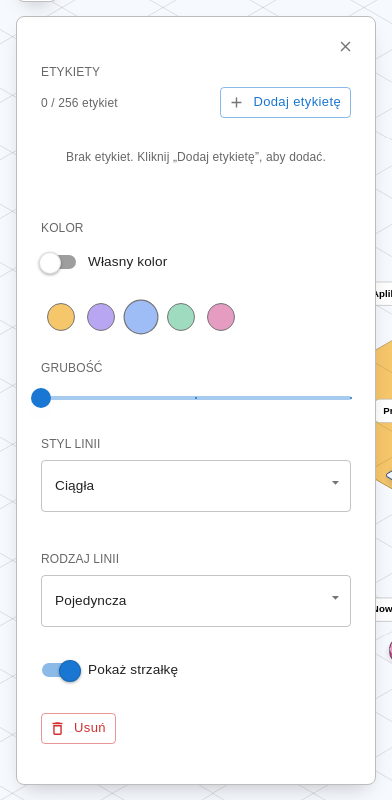

- **Etykiety** – **Dodaj etykietę** umieszcza tekst na linii. Dla każdej etykiety: tekst, **położenie** wzdłuż linii (0–100 %), **przesunięcie w pionie** i kropkowana linia do połączenia. Przy liniach podwójnych wybierasz, do której linii należy etykieta. Do 256 etykiet.
- **Kolor** – z palety diagramu albo własny.
- **Grubość** – grubość linii.
- **Styl linii** – ciągła, kropkowana albo przerywana.
- **Rodzaj linii** – pojedyncza, podwójna albo podwójna z kółkiem.
- **Pokaż strzałkę** – włącza albo wyłącza grot.
- **Usuń** – usuwa połączenie.

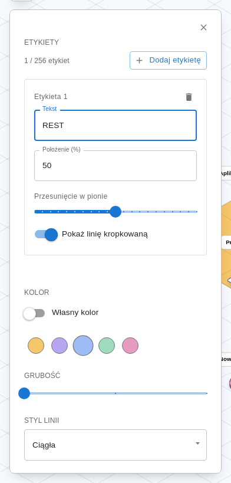 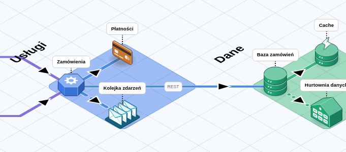

## 7. Teksty

Swobodny tekst na płótnie: tytuły, podpisy, nazwy stref.

1. Naciśnij **T** (albo prawy przycisk → **Dodaj tekst**) i kliknij, gdzie ma być tekst.
2. Wpisz go w panelu. **Rozmiar tekstu** go powiększa lub zmniejsza; **Kierunek** wybiera, wzdłuż którego z dwóch kierunków siatki biegnie.

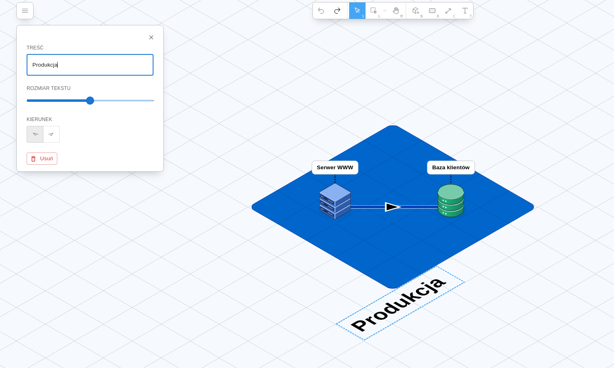

Po jednym tekście narzędzie wraca do Zaznaczania. Kliknij tekst później, żeby go zmienić.

## 8. Zaznaczanie i edycja

### Zaznaczanie

- **Jeden element:** kliknij go. Otworzy się jego panel.
- **Kilka elementów:**
  - przeciągnij po pustym płótnie narzędziem Zaznacz, żeby narysować **ramkę zaznaczenia**: zaznacza się wszystko, czego położenie jest w ramce (strefy tylko wtedy, gdy cała strefa mieści się w ramce);
  - **Shift+klik** dodaje element do zaznaczenia albo go zabiera;
  - narzędzia **Zaznaczanie ramką** (L) i **Lasso odręczne** (F) robią to samo i zostają włączone na kolejne zaznaczenia; lasso pozwala narysować dowolny kształt;
  - **Ctrl+A** zaznacza wszystko.
- Połączenie zaznacza się razem z innymi, gdy wszystkie jego punkty załamania są w ramce, a łączone węzły też są zaznaczone.

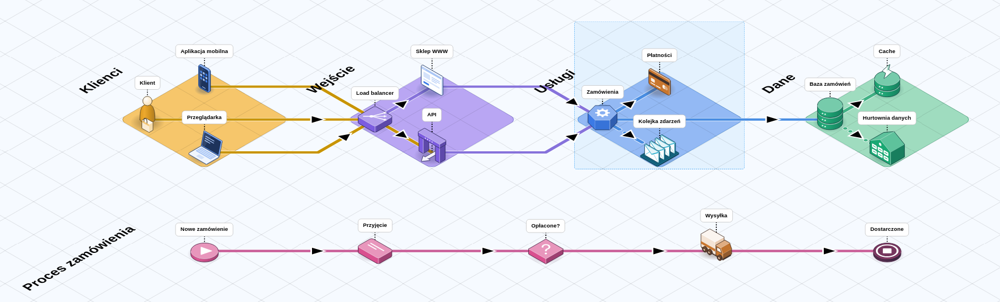

### Przesuwanie

- **Przeciągnij** zaznaczony element, a całe zaznaczenie przesunie się razem, łącznie z punktami załamania zaznaczonych połączeń. Po upuszczeniu zostaje zaznaczone.
- **Strzałki** przesuwają zaznaczenie o jedno pole.
- Pojedynczy węzeł, strefę czy tekst możesz przeciągnąć bez wcześniejszego zaznaczania.

### Kopiowanie, wklejanie, duplikowanie, usuwanie

| Działanie | Klawisze | Uwagi |
|---|---|---|
| Kopiuj | Ctrl+C | Połączenia między kopiowanymi węzłami kopiują się razem z nimi |
| Wytnij | Ctrl+X | Kopiuje, a potem usuwa |
| Wklej | Ctrl+V | W miejscu kursora (prawy przycisk → Wklej: w tym miejscu); wklejone elementy zostają zaznaczone |
| Duplikuj | Ctrl+D | Kopia tuż obok oryginału, bez ruszania schowka |
| Usuń | Delete albo Backspace | Zaznaczenie, jako jeden krok do cofnięcia |
| Na wierzch / Pod spód | Ctrl+] / Ctrl+[ | Kolejność nachodzących na siebie stref, tekstów i węzłów |

Kopiowanie i wklejanie działa w obrębie otwartego diagramu. Schowek czyści się po otwarciu innego diagramu i nie wymienia danych z innymi programami.

## 9. Menu prawego przycisku

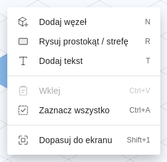 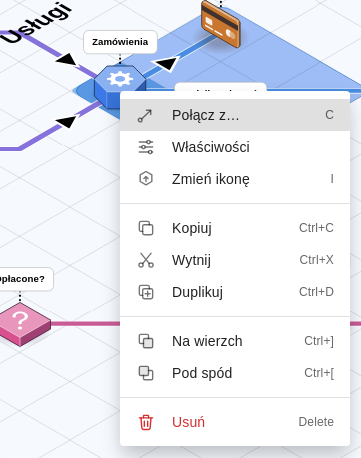

**Na pustym płótnie:** Dodaj węzeł, Rysuj prostokąt / strefę, Dodaj tekst, Wklej, Zaznacz wszystko, Dopasuj do ekranu.

**Na elemencie:**

- każdy element: Właściwości, Usuń;
- węzły: Połącz z…, Zmień ikonę;
- węzły, strefy i teksty: Kopiuj, Wytnij, Duplikuj, Na wierzch, Pod spód.

Jeśli klikasz prawym przyciskiem element, który jest częścią zaznaczenia, Kopiuj, Wytnij, Duplikuj, kolejność i Usuń dotyczą całego zaznaczenia.

## 10. Cofanie i ponawianie

**Ctrl+Z** cofa ostatnią zmianę, **Ctrl+Y** (albo **Ctrl+Shift+Z**) ją ponawia; strzałki po lewej stronie paska narzędzi robią to samo. Wklejenie i usunięcie kilku elementów to po jednym kroku. Przeciąganie zapisuje się małymi krokami, więc cofnięcie długiego przeciągnięcia może wymagać kilku Ctrl+Z.

## 11. Zapisywanie i otwieranie

W skrócie (szczegóły w [Zapisywaniu i otwieraniu diagramów](saving.pl.md)):

- **Zapisz** (górny pasek, ☰ albo **Ctrl+S**) zapisuje otwarty diagram. Za pierwszym razem pyta o nazwę.
- **Moje diagramy** (górny pasek, ☰ albo **Ctrl+O**) to lista zapisanych diagramów: **Wczytaj**, **Usuń**, a w Dockerze także **Udostępnij** (link tylko do odczytu; przy logowaniu udostępnianie osobom i linki: [rozdział 17](#17-konta-i-logowanie)).

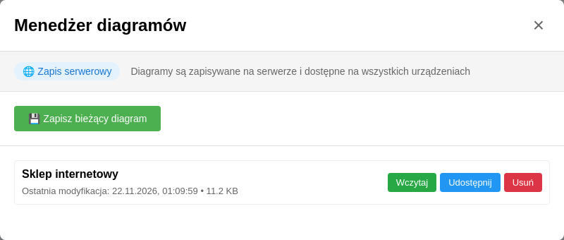

- Zapis jest ręczny: górny pasek pokazuje **Zmodyfikowany**, dopóki nie zapiszesz, a przeglądarka ostrzega przed zamknięciem karty z niezapisanymi zmianami.
- **☰ → Nowy diagram** zaczyna pusty diagram; **☰ → Wyczyść obszar roboczy** opróżnia bieżący.
- **☰ → Otwórz z pliku** otwiera wyeksportowany plik `.json`. Diagramy ze starszych wersji otwierają się bez problemu, a ich wbudowane ikony dostają aktualne rysunki.

Gdzie są diagramy: na Twoim serwerze (Docker, wspólne dla wszystkich, którzy go otwierają), w `Dokumenty/ArchFlow` (aplikacja na komputer) albo tylko w przeglądarce (demo albo Docker z wyłączonym zapisem na serwerze). W tym ostatnim przypadku regularnie eksportuj pracę do pliku.

## 12. Eksport

**☰ → Eksportuj do JSON** pobiera diagram jako plik, który otworzysz w każdym ArchFlow (☰ → Otwórz z pliku). Zawiera wszystkie użyte ikony, także zaimportowane. Używaj go do kopii zapasowych i do wysyłania diagramów innym.

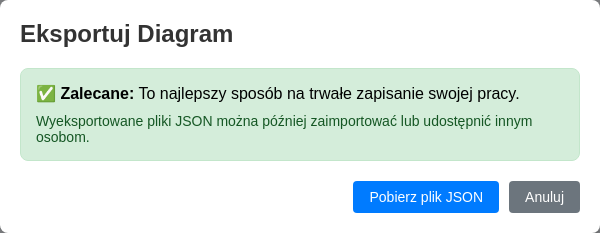

**☰ → Eksportuj do obrazu** zapisuje obraz PNG. Okno pokazuje podgląd i pozwala wybrać:

- czy pokazać siatkę;
- rozwinięcie opisów węzłów;
- przycięcie do zawartości albo zaznaczenie obszaru do eksportu;
- kolor tła albo przezroczyste tło;
- jakość (od 72 do 288 DPI albo własna skala).

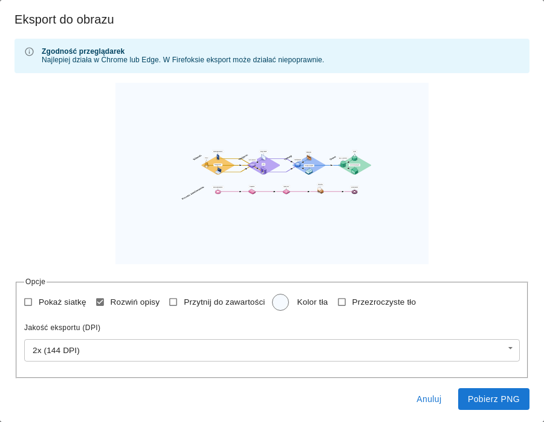

Eksport obrazu najlepiej działa w Chrome lub Edge; w Firefoksie ma znane problemy.

## 13. Ustawienia

**☰ → Ustawienia**, trzy sekcje na jednej stronie:

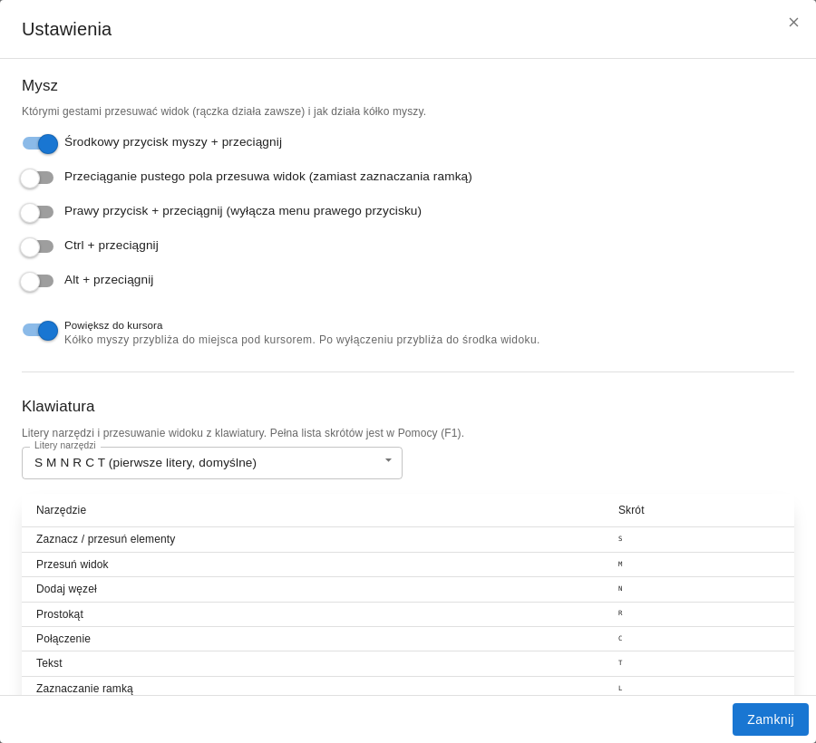

**Mysz**

- którymi gestami przesuwać widok: środkowy przycisk + przeciągnięcie (domyślnie włączone), przeciąganie pustego płótna (domyślnie wyłączone: rysuje ramkę zaznaczenia), prawy przycisk + przeciągnięcie (wyłącza menu prawego przycisku), Ctrl + przeciągnięcie, Alt + przeciągnięcie;
- **Powiększ do kursora**: kółko myszy przybliża w stronę kursora; wyłączone: w stronę środka widoku.

**Klawiatura**

- **Litery narzędzi**: S M N R C T (pierwsze litery, domyślnie), Q W E R T Y (pod lewą ręką) albo bez liter; tabela pokazuje, która litera uruchamia które narzędzie;
- przesuwanie widoku strzałkami, W A S D albo I J K L, gdy nic nie jest zaznaczone, i jego szybkość.

**Połączenia**

- **Tryb kliknięcia** (domyślny): kliknij pierwszy węzeł, potem drugi;
- **Tryb przeciągania**: przeciągnij od pierwszego węzła do drugiego.

Wszystkie ustawienia są zapamiętywane w tej przeglądarce (albo w aplikacji na komputer).

## 14. Język

**☰ → Język** otwiera listę języków interfejsu: English, Polski, Deutsch, Français, Español, Italiano, Português (Brasil), Čeština, Nederlands i Українська. Kliknij jeden, żeby przełączyć. Zmienia się wszystko, łącznie z nazwami ikon i kategorii. Wybór jest zapamiętywany.

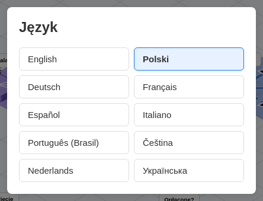

## 15. Skróty klawiszowe

Naciśnij **F1** w ArchFlow, żeby zobaczyć wszystkie.

**Narzędzia** (domyślne litery; zmienisz je w Ustawieniach → Klawiatura)

| Klawisz | Narzędzie |
|---|---|
| S | Zaznacz / przesuń elementy |
| L / F | Zaznaczanie ramką / Lasso odręczne |
| M | Przesuń widok |
| N | Dodaj węzeł |
| R | Prostokąt / strefa |
| C | Połączenie |
| T | Tekst |
| Esc | Anuluj, powrót do Zaznaczania |

**Edycja**

| Klawisze | Działanie |
|---|---|
| Ctrl+Z / Ctrl+Y (Ctrl+Shift+Z) | Cofnij / ponów |
| Ctrl+C / Ctrl+X / Ctrl+V | Kopiuj / wytnij / wklej |
| Ctrl+D | Duplikuj |
| Ctrl+A | Zaznacz wszystko |
| Delete / Backspace | Usuń zaznaczenie |
| Strzałki | Przesuń zaznaczenie o jedno pole (bez zaznaczenia: przesuń widok) |
| Ctrl+] / Ctrl+[ | Na wierzch / pod spód |
| F2 | Zmień nazwę zaznaczonego węzła |
| I | Zmień ikonę zaznaczonego węzła |

**Widok i pliki**

| Klawisze | Działanie |
|---|---|
| Środkowy przycisk + przeciągnięcie, Spacja + przeciągnięcie | Przesuń widok |
| Kółko myszy, Ctrl + / Ctrl − | Zoom |
| Shift+1 | Dopasuj do ekranu |
| Ctrl+S | Zapisz |
| Ctrl+O | Moje diagramy |
| F1 | Pomoc |

**Mysz**

| | |
|---|---|
| Shift+klik | Dodaj do zaznaczenia / zabierz z zaznaczenia |
| Prawy przycisk | Menu płótna albo elementu |

Skróty nie działają, gdy piszesz w polu tekstowym.

## 16. Rozwiązywanie problemów

**„Kliknąłem, a nic się nie zaznaczyło.”** Podpisy wiszą nad węzłami i przechwytują kliknięcia; kliknij ikonę albo strefę nieco dalej od podpisów.

**„Połączenie skończyło się w pustym miejscu.”** W trybie kliknięcia kliknięcie w puste pole kończy tam połączenie. Żeby zagiąć połączenie, najpierw narysuj je od węzła do węzła, a potem przeciągnij jego linię.

**„Przeciąganie pustego płótna rysuje ramkę zamiast przesuwać widok.”** Tak jest domyślnie. Widok przesuwasz środkowym przyciskiem albo Spacją + przeciągnięciem; możesz też włączyć *Przeciąganie pustego pola przesuwa widok* w Ustawieniach → Mysz.

**„Nie pojawia się menu prawego przycisku.”** W Ustawieniach → Mysz jest włączone *Prawy przycisk + przeciągnij*, które używa prawego przycisku do przesuwania widoku.

**„Eksport obrazu wygląda źle.”** Użyj Chrome albo Edge.

**„Nie da się bardziej przybliżyć.”** Zoom kończy się na 100 %.

**„Moje diagramy zniknęły” (demo / tylko przeglądarka).** W tym trybie diagramy są w pamięci przeglądarki, która czyści się razem z danymi przeglądarki. Ważne diagramy eksportuj do plików.

**Windows: „System Windows ochronił ten komputer”.** Instalator nie jest jeszcze podpisany certyfikatem. Kliknij **Więcej informacji → Uruchom mimo to**.

**Linux: AppImage się nie uruchamia.** Nadaj mu prawo uruchamiania (`chmod +x`). Na niektórych dystrybucjach AppImage potrzebuje też FUSE 2 (np. `sudo apt install libfuse2` na Ubuntu).

**Docker: nie mogę edytować plików w `./diagrams`.** Kontener zapisuje je jako `root`; przejmij je poleceniem `sudo chown -R $USER: diagrams`. Więcej w [instrukcji Dockera](docker.pl.md).

## 17. Konta i logowanie

Tylko w ArchFlow w Dockerze z logowaniem (domyślny `compose.yml` od wersji 0.9.0). Aplikacja desktopowa i ArchFlow bez logowania nie mają kont.

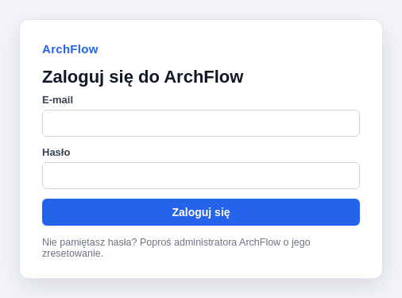

- **Logowanie.** ArchFlow pyta o e-mail i hasło. W zupełnie nowym ArchFlow pierwsza osoba tworzy konto administratora. Jeśli administrator dał Ci hasło tymczasowe, po zalogowaniu ustawisz własne. Nie pamiętasz hasła? Administrator je zresetuje.
- **Twoje konto.** Kliknij swoje imię u góry (☰ → *Konto*), żeby zmienić hasło, utworzyć tokeny dla asystentów AI ([Asystenci AI](mcp.pl.md#mcp-w-dockerze-przez-http)) albo się wylogować.
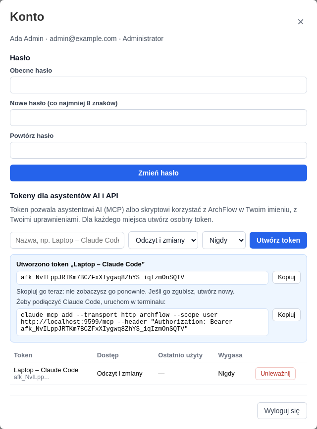

- **Role.** *Edytorzy* tworzą i zmieniają diagramy; *czytelnicy* tylko je otwierają (edytor jest wtedy tylko do podglądu i nie ma *Zapisz*). Każdy zalogowany widzi diagramy zespołu oraz prywatne, które mu udostępniono. *Moje diagramy* pokazują, kto ostatni zmienił każdy z nich.
- **Administratorzy** zarządzają ludźmi w ☰ → *Użytkownicy i ustawienia*: dodają użytkowników (ArchFlow raz pokazuje hasło tymczasowe), zmieniają role, resetują hasła, wyłączają i usuwają konta oraz pozwalają na dostęp do API i MCP.
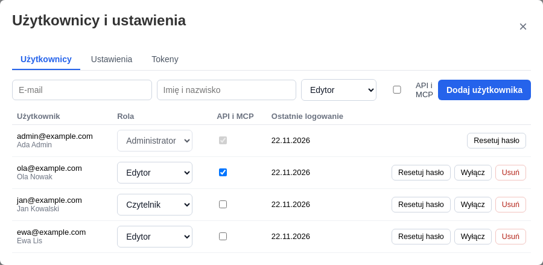

- **Udostępnianie.** W *Moich diagramach* autor (albo administrator) klika *Udostępnij*, żeby ustawić diagram jako prywatny, dać wybranym osobom prawo do oglądania albo edycji, albo utworzyć link tylko do odczytu, działający bez konta. Linki mogą wygasać i można je unieważnić.
- **Dostęp publiczny.** Gdy administrator go włączy, niezalogowani też mogą projektować, ale zapisują tylko w swojej przeglądarce albo do pliku. *Zaloguj się* u góry przełącza na Twoje konto.

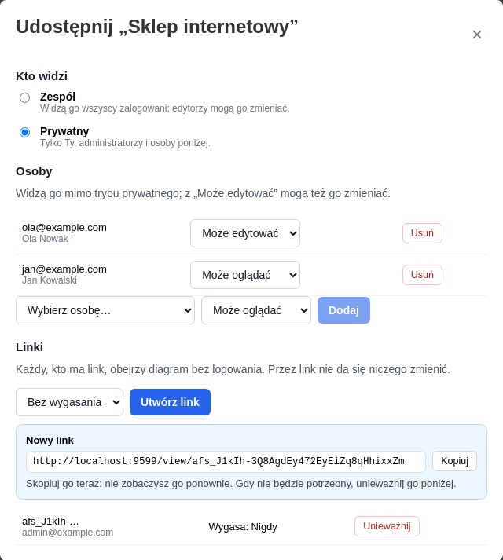

Konfigurację na serwerze opisuje [instrukcja Dockera](docker.pl.md#konta-i-logowanie).

## 18. Asystenci AI (MCP)

ArchFlow ma serwer MCP, więc asystenci AI (Claude Code, Claude Desktop, lokalne modele przez programy takie jak Open WebUI) narysują i zmienią diagram na podstawie zwykłego opisu, np. *„narysuj nasz sklep: przeglądarka, load balancer, dwa serwery aplikacji, PostgreSQL”*. Asystent dobiera ikony, rozmieszcza diagram i go zapisuje, a Ty otwierasz go w *Moich diagramach*.

- **Na Twoim komputerze:** asystent sam uruchamia serwer (`npx -y archflow-mcp@latest`). Działa z aplikacją desktopową, folderem z plikami albo ArchFlow w Dockerze.
- **ArchFlow w Dockerze:** serwer jest wbudowany. Przy logowaniu utwórz osobisty token w *Koncie* (okno pokaże gotowe polecenie dla Claude Code); asystent ma wtedy Twoje uprawnienia.
- **Nie zmieniaj jednego diagramu w dwóch miejscach naraz:** jeśli asystent zmienia diagram, który masz otwarty, wczytaj go ponownie z *Moich diagramów*, zanim zaczniesz dalej pracować.

Konfiguracja, przykłady, lokalne modele i rozwiązywanie problemów: [Asystenci AI (MCP)](mcp.pl.md).

---

[← Powrót do README](README.pl.md)
