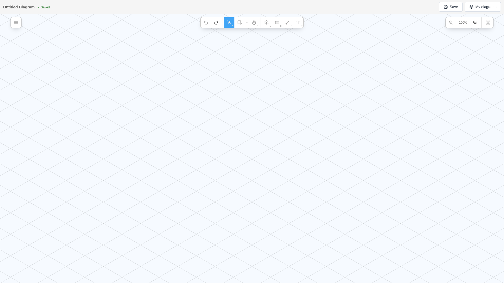
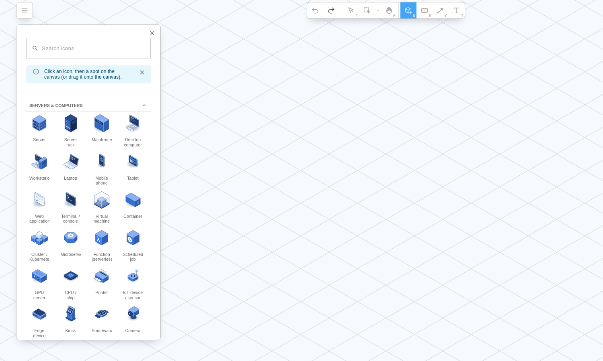
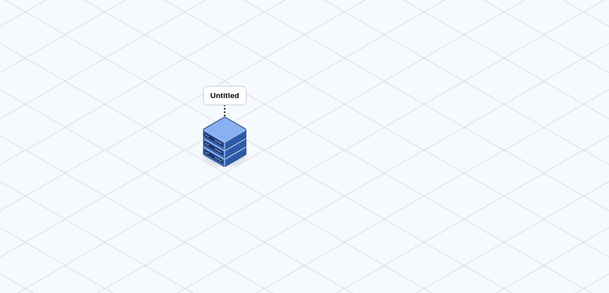
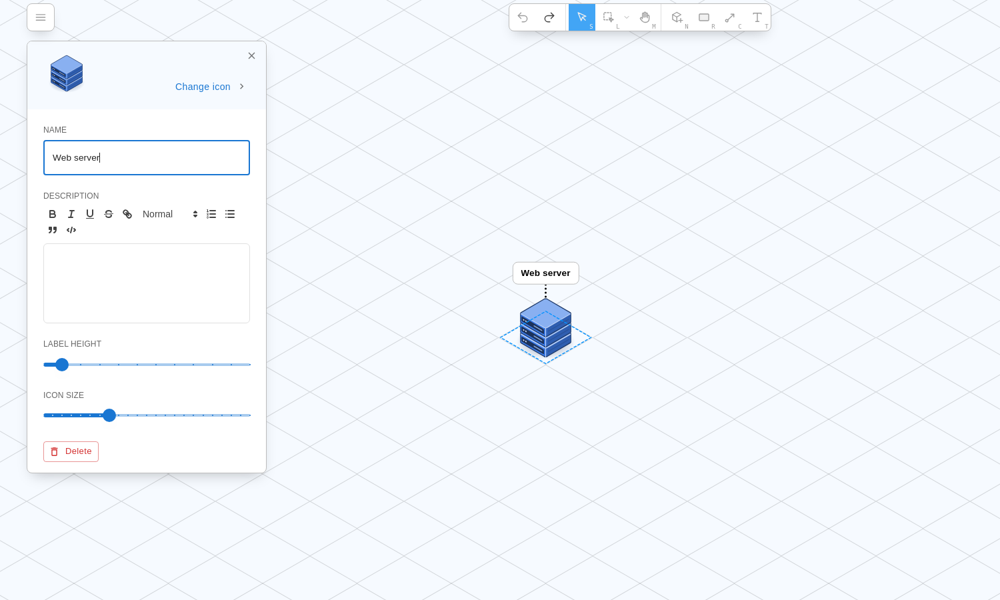
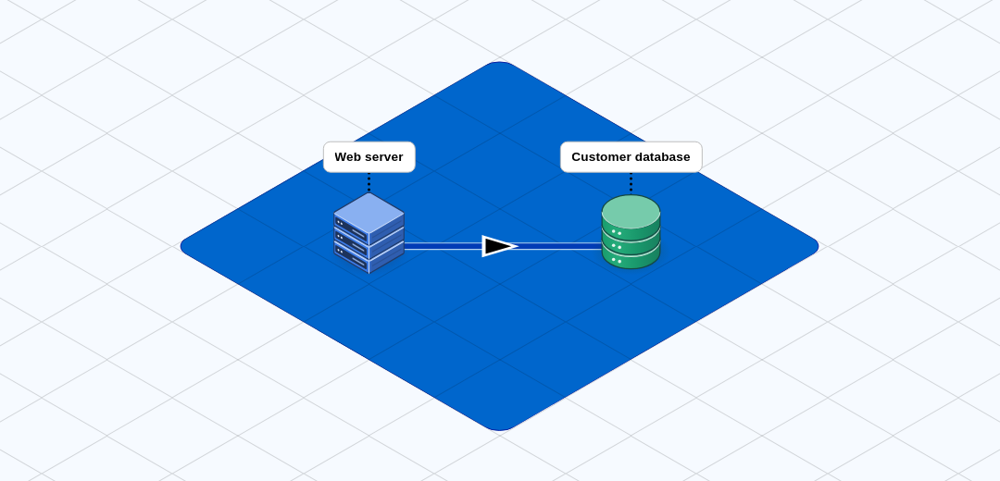
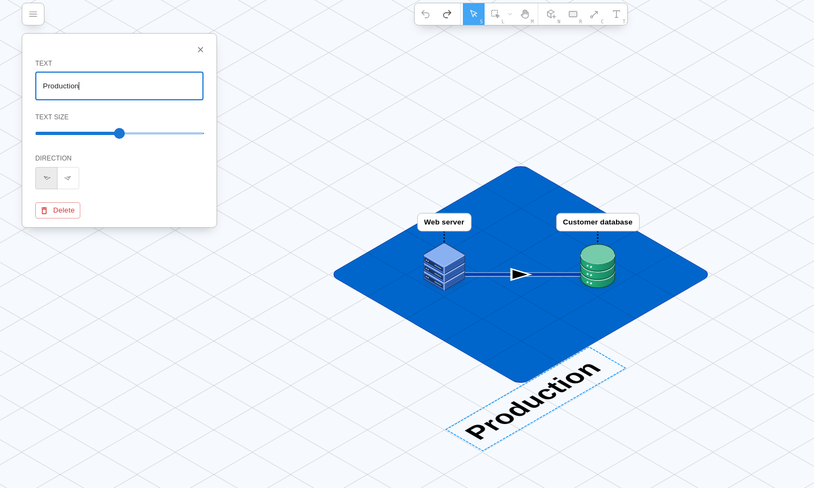
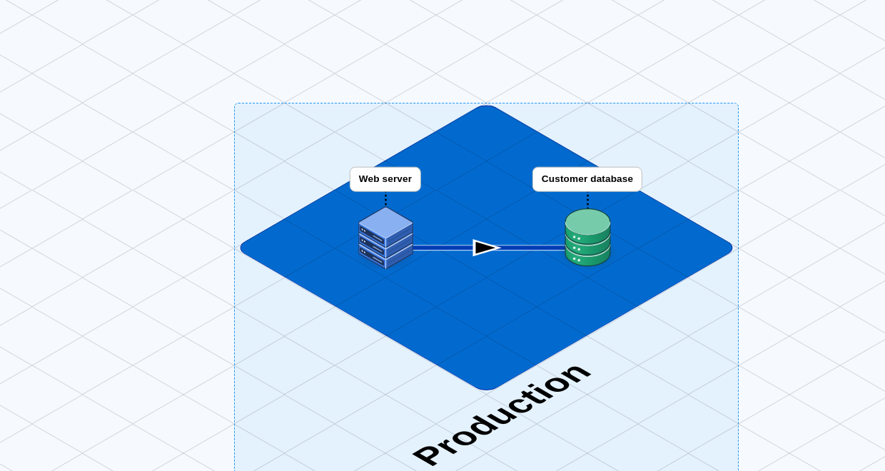
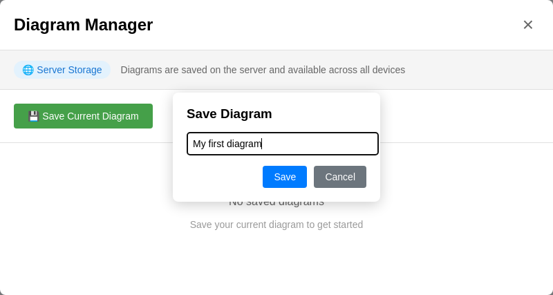
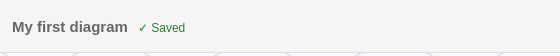

# ArchFlow quick start

 <b>English</b> | <a href="quick-start.pl.md">Polski</a>

Ten steps from an empty canvas to a saved diagram: two connected nodes in a zone, with a label. It takes about five minutes.

You can follow along in the [live demo](https://cyryllo.github.io/ArchFlow/app/), in the [desktop app](https://github.com/cyryllo/ArchFlow/releases/latest) or in your own [Docker installation](docker.md). If your Docker ArchFlow asks you to log in, do that first; on a brand-new one you create the administrator account ([Accounts and logins](docker.md#accounts-and-logins)).

## 1. Get to know the screen

- **Top bar:** the diagram's name and whether it's saved, plus **Save** and **My diagrams**.
- **☰** (top left): files, export, settings, language and help.
- **Tools** (top middle): undo and redo, then Select, Box select, Pan view, Add node, Rectangle, Connector and Text. The small letter on each button is its keyboard shortcut.
- **Zoom** (top right): zoom out, zoom in, fit the diagram to the screen.

Move the view by dragging with the **middle mouse button** (or hold **Space** and drag). Zoom with the **mouse wheel**.

## 2. Open the icon picker

Press **N** (or click the **Add node** button).

Icons are grouped in colour-coded categories. Scroll through them or type in the search box.

## 3. Place a node

Click an icon (here **Server**), then click a spot on the canvas. The node appears and the editor goes back to Select.

> You can also drag an icon from the picker straight onto the canvas.

## 4. Name it

Click the node to open its properties, then type a name (or select the node and press **F2**).

The panel also has a description, label height and icon size. Close it with **×** or **Esc**.

## 5. Add a second node

Press **N** again, type `database` in the search box, click **Database** and place it to the right of the server. Name it, e.g. *Customer database*.

## 6. Draw a zone around them

Press **R** and drag a rectangle that covers both nodes. Zones group things that belong together (a network, a team, an environment). Click a zone to change its colour.

## 7. Connect the nodes

Press **C**, click the first node, then the second. An arrow appears between them.

- To bend a connector, drag its line: that adds a bend point you can move.
- The connector tool stays on so you can draw several in a row. Press **Esc** when you're done.
- Click a connector to change its colour, line style or arrow, or to add labels.

## 8. Add a label

Press **T** and click below the zone, then type the text in the panel (here *Production*).

## 9. Select and move

Drag on empty space to draw a **selection box** around everything, then drag any selected element: the zone, the nodes, the connector and the label move together.

- **Shift+click** adds an element to the selection or takes it out.
- The **arrow keys** nudge the selection one tile at a time.
- **Delete** removes the selection, **Ctrl+Z** brings it back.

## 10. Save

Click **Save** in the top bar. The first time, ArchFlow asks for a name: click **Save Current Diagram**, type the name and confirm.

The top bar now shows the name and **Saved**. Every later change switches it to **Modified** until you save again (**Ctrl+S**).

Saved diagrams are listed in **My diagrams** (**Ctrl+O**). Where they are stored depends on how you run ArchFlow: on your server (Docker), in `Documents/ArchFlow` (desktop app) or only in your browser (demo). See [Saving and Opening Diagrams](saving.md).

## What next

- **Share or back up:** ☰ → **Export as JSON** gives you a file that opens in any ArchFlow; ☰ → **Export as image** saves a PNG.
- **Right-click** anything for more actions: connect, copy, duplicate, bring to front, delete…
- Press **F1** for all keyboard shortcuts, and see ☰ → **Settings** for mouse and keyboard options.
- Everything in detail: the **[user manual](manual.md)**.

| Most used shortcuts | |
|---|---|
| N / R / C / T | Add node / rectangle / connector / text |
| Esc | Back to Select |
| Ctrl+Z / Ctrl+Y | Undo / redo |
| Ctrl+C / Ctrl+V / Ctrl+D | Copy / paste / duplicate |
| Delete | Delete the selection |
| Shift+1 | Fit to screen |
| Ctrl+S / Ctrl+O | Save / My diagrams |
