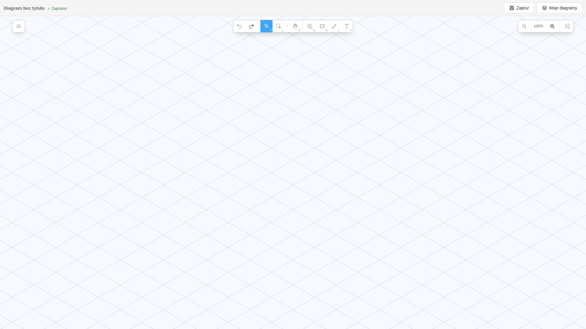
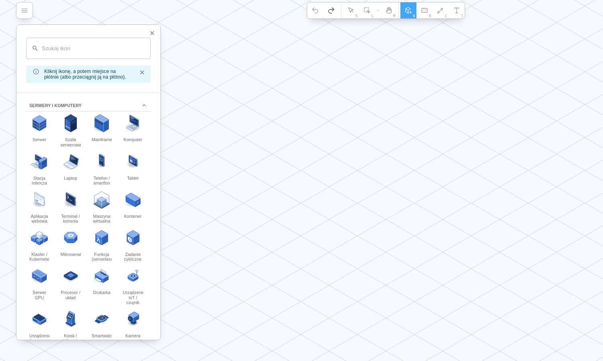
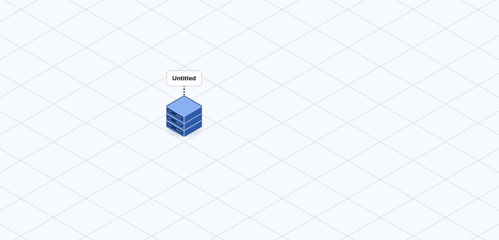
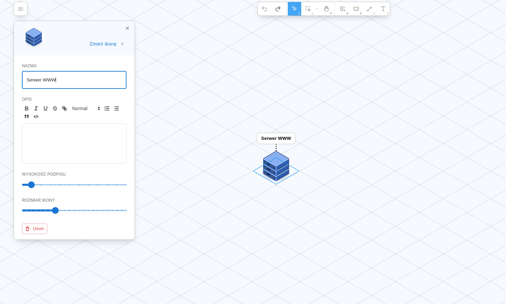
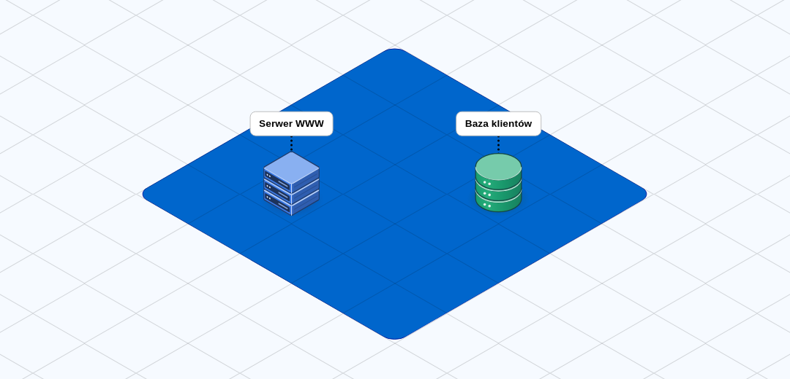
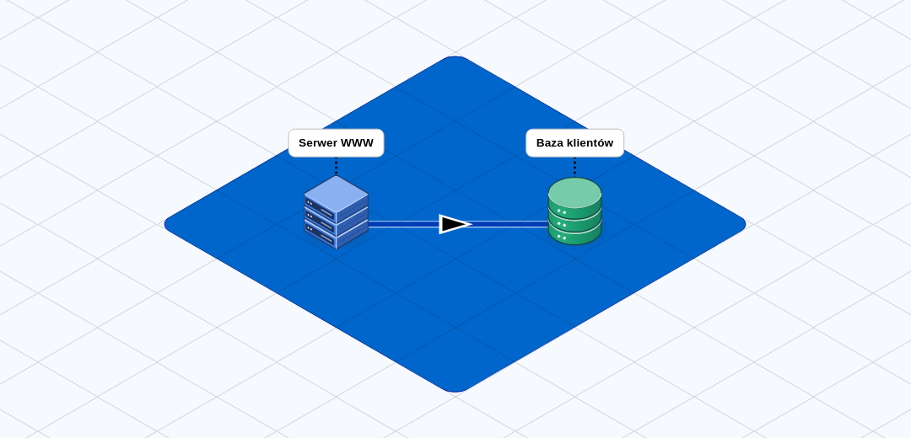
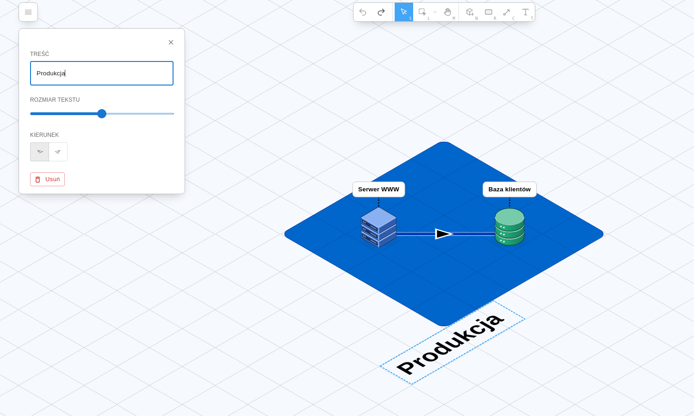
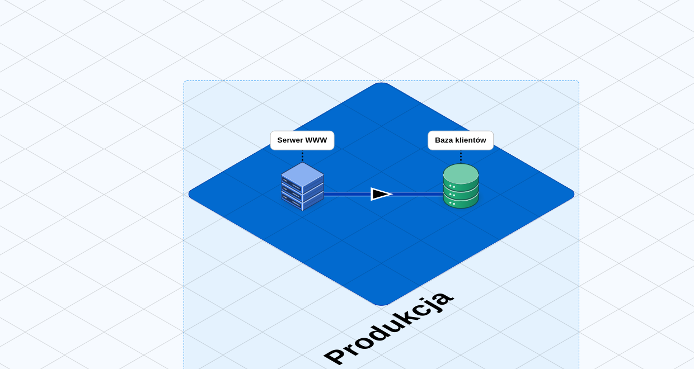
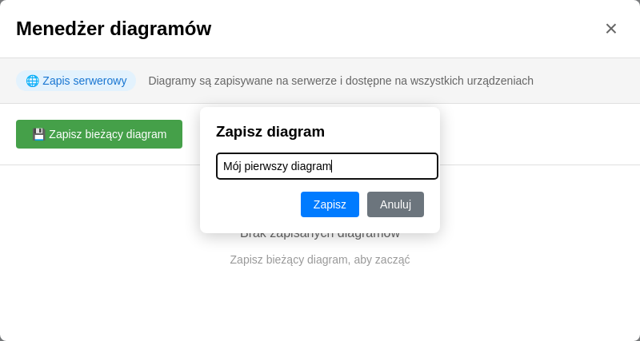
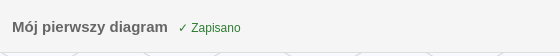

# Szybki start z ArchFlow

 <a href="quick-start.md">English</a> | <b>Polski</b>

Dziesięć kroków od pustego płótna do zapisanego diagramu: dwa połączone węzły w strefie i podpis. Zajmie Ci to około pięciu minut.

Możesz robić to równolegle w [demo online](https://cyryllo.github.io/ArchFlow/app/), w [aplikacji na komputer](https://github.com/cyryllo/ArchFlow/releases/latest) albo we własnej [instalacji w Dockerze](docker.pl.md). Jeśli Twój ArchFlow w Dockerze prosi o zalogowanie, zrób to najpierw; w zupełnie nowym tworzysz konto administratora ([Konta i logowanie](docker.pl.md#konta-i-logowanie)).

## 1. Poznaj ekran

- **Górny pasek:** nazwa diagramu i informacja, czy jest zapisany, oraz przyciski **Zapisz** i **Moje diagramy**.
- **☰** (u góry po lewej): pliki, eksport, ustawienia, język i pomoc.
- **Narzędzia** (u góry na środku): cofnij i ponów, potem Zaznacz, Zaznaczanie ramką, Przesuń widok, Dodaj węzeł, Prostokąt, Połączenie i Tekst. Mała litera na przycisku to jego skrót klawiszowy.
- **Zoom** (u góry po prawej): pomniejsz, powiększ, dopasuj diagram do ekranu.

Widok przesuwasz, przeciągając **środkowym przyciskiem myszy** (albo trzymając **Spację** i przeciągając). Przybliżasz **kółkiem myszy**.

## 2. Otwórz wybór ikon

Naciśnij **N** (albo kliknij przycisk **Dodaj węzeł**).

Ikony są pogrupowane w kategorie, każda w swoim kolorze. Przewiń listę albo wpisz nazwę w wyszukiwarkę.

## 3. Postaw węzeł

Kliknij ikonę (tutaj **Serwer**), a potem miejsce na płótnie. Węzeł się pojawi, a edytor wróci do Zaznaczania.

> Ikonę możesz też przeciągnąć z panelu prosto na płótno.

## 4. Nazwij go

Kliknij węzeł, żeby otworzyć jego właściwości, i wpisz nazwę (albo zaznacz węzeł i naciśnij **F2**).

W panelu jest też opis, wysokość podpisu i rozmiar ikony. Zamykasz go **×** albo klawiszem **Esc**.

## 5. Dodaj drugi węzeł

Znowu naciśnij **N**, wpisz w wyszukiwarkę `baza`, kliknij **Baza danych** i postaw ją na prawo od serwera. Nazwij ją, np. *Baza klientów*.

## 6. Narysuj wokół nich strefę

Naciśnij **R** i przeciągnij prostokąt obejmujący oba węzły. Strefy grupują to, co do siebie należy (sieć, zespół, środowisko). Kliknij strefę, żeby zmienić jej kolor.

## 7. Połącz węzły

Naciśnij **C**, kliknij pierwszy węzeł, potem drugi. Między nimi pojawi się strzałka.

- Żeby zagiąć połączenie, przeciągnij jego linię: powstanie punkt załamania, który możesz przesuwać.
- Narzędzie połączeń zostaje włączone, więc możesz narysować kilka połączeń pod rząd. Na koniec naciśnij **Esc**.
- Kliknij połączenie, żeby zmienić jego kolor, styl linii czy strzałkę albo dodać etykiety.

## 8. Dodaj podpis

Naciśnij **T**, kliknij pod strefą i wpisz tekst w panelu (tutaj *Produkcja*).

## 9. Zaznacz i przesuń

Przeciągnij po pustym polu, żeby narysować **ramkę zaznaczenia** wokół wszystkiego, a potem przeciągnij dowolny zaznaczony element: strefa, węzły, połączenie i podpis przesuną się razem.

- **Shift+klik** dodaje element do zaznaczenia albo go z niego zabiera.
- **Strzałki** przesuwają zaznaczenie o jedno pole.
- **Delete** usuwa zaznaczenie, **Ctrl+Z** przywraca.

## 10. Zapisz

Kliknij **Zapisz** na górnym pasku. Za pierwszym razem ArchFlow zapyta o nazwę: kliknij **Zapisz bieżący diagram**, wpisz nazwę i potwierdź.

Górny pasek pokazuje teraz nazwę i **Zapisano**. Każda kolejna zmiana przełącza go na **Zmodyfikowany**, dopóki znowu nie zapiszesz (**Ctrl+S**).

Zapisane diagramy znajdziesz w **Moich diagramach** (**Ctrl+O**). Gdzie są przechowywane, zależy od tego, jak uruchamiasz ArchFlow: na Twoim serwerze (Docker), w `Dokumenty/ArchFlow` (aplikacja na komputer) albo tylko w przeglądarce (demo). Więcej w sekcji [Zapisywanie i otwieranie diagramów](saving.pl.md).

## Co dalej

- **Udostępnij albo zrób kopię:** ☰ → **Eksportuj do JSON** daje plik, który otworzysz w każdym ArchFlow; ☰ → **Eksportuj do obrazu** zapisuje PNG.
- **Prawy przycisk** na dowolnym elemencie daje więcej akcji: połącz, kopiuj, duplikuj, na wierzch, usuń…
- **F1** pokazuje wszystkie skróty klawiszowe, a ☰ → **Ustawienia** opcje myszy i klawiatury.
- Wszystko szczegółowo: **[instrukcja obsługi](manual.pl.md)**.

| Najczęściej używane skróty | |
|---|---|
| N / R / C / T | Dodaj węzeł / prostokąt / połączenie / tekst |
| Esc | Powrót do Zaznaczania |
| Ctrl+Z / Ctrl+Y | Cofnij / ponów |
| Ctrl+C / Ctrl+V / Ctrl+D | Kopiuj / wklej / duplikuj |
| Delete | Usuń zaznaczenie |
| Shift+1 | Dopasuj do ekranu |
| Ctrl+S / Ctrl+O | Zapisz / Moje diagramy |
