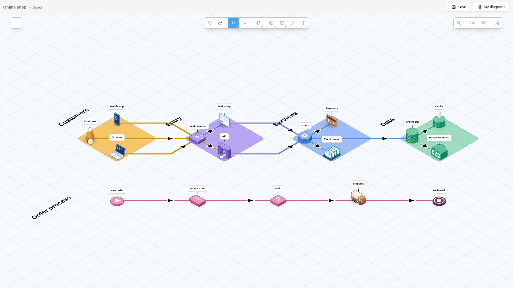

This release brings a redesigned editor, a brand-new icon set and, for the first time, ready-made desktop downloads for Linux and Windows. It covers everything since v0.4.7 (v0.5.0, v0.6.0 and v0.6.1).

### 💻 Desktop app downloads

Download the file for your system from **Assets** below:

| File | For |
|---|---|
| `ArchFlow-0.6.1-x86_64.AppImage` | Linux (any distribution) |
| `ArchFlow-0.6.1-amd64.deb` | Debian / Ubuntu |
| `ArchFlow-Setup-0.6.1.exe` | Windows installer |

~~~bash
# Linux AppImage
chmod +x ArchFlow-0.6.1-x86_64.AppImage
./ArchFlow-0.6.1-x86_64.AppImage
~~~

The desktop app saves your diagrams as files in `Documents/ArchFlow`. The Windows installer isn't code-signed yet, so SmartScreen may warn you the first time: click **More info → Run anyway**. From now on every release tag builds these files automatically.

### 🎨 New isometric icon set

- **177 icons** drawn from scratch in one consistent isometric style, grouped into 9 colour-coded categories: servers & computers, network, communication, data, security, people & organisation, flow & process, business & logistics, shapes.
- Not just infrastructure: there are icons for process and flow diagrams too (start/end events, decisions, gateways, documents, approvals, milestones, timers…) and for business and logistics (orders, invoices, bank, warehouse, forklift, ship, train…).
- **Existing diagrams upgrade automatically.** The old icons keep their names, so your nodes simply get the new drawings. Imported icons and icon-pack icons (AWS, GCP…) are kept.
- The icon picker opens with all categories expanded. Icon and category names follow the interface language.

### 🧰 Redesigned editor

- **One toolbar row:** ☰ menu on the left; tools in the middle (undo/redo · select, box/freehand lasso, hand · node, rectangle, connector, text, each with its shortcut letter); zoom and fit on the right.
- **Right-click menu** on empty canvas (add node, draw rectangle, add text, paste, select all, fit) and on elements (connect to…, properties, change icon, copy, cut, duplicate, bring to front / send to back, delete).
- **☰ menu** grouped into File / Export / Application, including New diagram, My diagrams, Save, Export (JSON, image), Settings, Language and Help.
- **Slimmer top bar:** diagram name, save state (Modified / Saved), **Save** and **My diagrams**.
- **Settings** on a single page: Mouse, Keyboard, Connectors.
- **Fully translated** interface (English / Polish), including property panels and the export dialog.

### ⌨️ Selecting, moving and shortcuts

- Dragging on empty space draws a **selection box**, like in other editors. Drag the selection to move nodes, zones, texts and connector points together.
- **Shift+click** adds an element to the selection or removes it.
- **Middle mouse button** or **Space + drag** pans the view from any tool; the hand tool pans too.
- Rectangle, node and text tools go back to Select after one use; connector and lasso stay active until **Esc**, which always returns to Select.
- New shortcuts: **Ctrl+C / X / V / D** (copy, cut, paste, duplicate), **Ctrl+A** (select all), **Delete**, **arrow keys** (nudge the selection), **Ctrl+] / Ctrl+[** (stacking order), **Ctrl + / Ctrl −** (zoom), **Shift+1** (fit to screen), **F2** (rename). Press **F1** for the full list.

> **Changed default:** dragging on empty space used to pan the view; it now draws a selection box. To get panning back, turn on *Settings → Mouse → Dragging empty space pans the view*.

### 🐛 Fixes

- **Loading a diagram could show the previous canvas** (often empty). Saving at that point overwrote the stored diagram. Fixed.
- The editor no longer reports its model in an endless loop in the background, which used CPU even when idle.
- Pan settings now work and are remembered; dragging empty space no longer leaves the editor stuck in pan mode; middle- and right-click panning move the view again.
- Moving a zone no longer tears apart connectors drawn point by point.
- Tool letters no longer fire together with Ctrl (Ctrl+C used to switch to the connector tool).

### 🐳 Docker

Nothing changes for Docker users; update as usual:

~~~bash
docker compose pull
docker compose up -d
~~~

Your diagrams in `./diagrams` are kept and open with the new icons.

**Full changelog**: https://github.com/cyryllo/ArchFlow/compare/v0.4.7...v0.6.1
