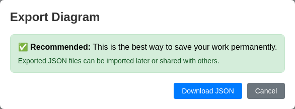
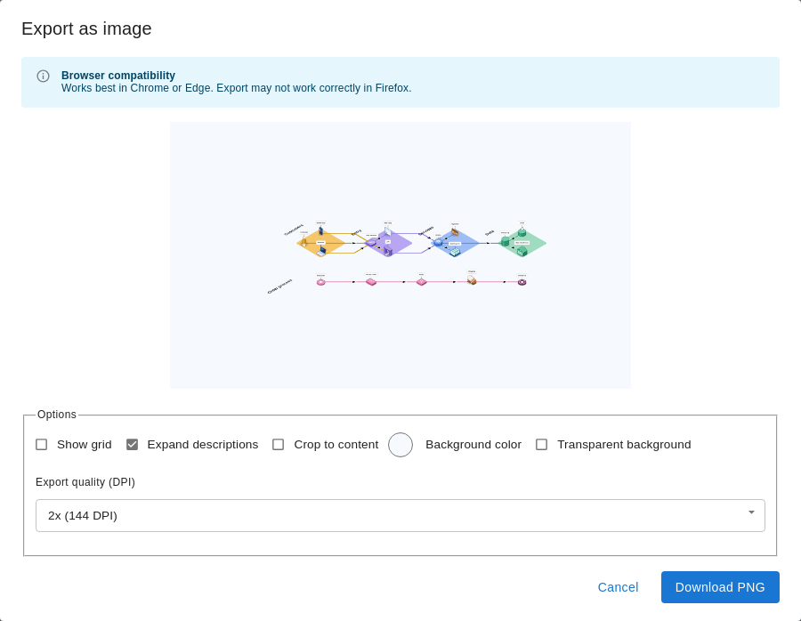
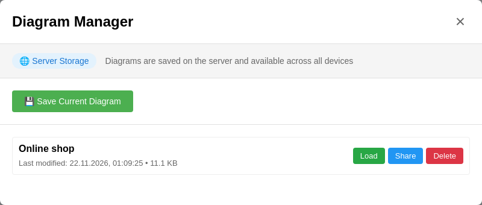

# Saving and opening diagrams

 <b>English</b> | <a href="saving.pl.md">Polski</a>

ArchFlow has **two independent ways** to keep your work. You can use both at the same time.

| | 💾 Files on your computer | 🗄️ My diagrams |
|---|---|---|
| What it is | You export a `.json` file and open it again later | Diagrams are kept by ArchFlow itself, in a list |
| Where the data is | Wherever you save the exported file | Docker: `./diagrams` on the server. Desktop app: `~/Documents/ArchFlow` |
| Available | Always, everywhere | Docker with server storage enabled (default) and the desktop app |
| Good for | Backups, sending a diagram to someone, moving between ArchFlow installations | Everyday work, a shared list for the whole team |

## 💾 Files on your computer

- **☰ → Export as JSON** downloads the current diagram as `<name>-<date>.json`. The file includes every icon the diagram uses, also custom imported ones, so it opens correctly in any other ArchFlow.
- **☰ → Open from file** loads a diagram from a `.json` file. It replaces what's on the canvas. Older files keep working, and built-in icons get the current drawings.
- **☰ → Export as image** saves a PNG picture. It shows a preview and lets you choose whether to show the grid, expand descriptions, crop to the content, the background colour (or transparent) and the resolution (DPI). Use Chrome or Edge for this; Firefox has known issues with image export.

 

## 🗄️ My diagrams

**My diagrams** (top bar, ☰ menu or **Ctrl+O**) opens the list of saved diagrams:

- **Save Current Diagram** saves the diagram under a name. If a diagram with that name already exists, ArchFlow asks before overwriting it. Each diagram becomes a file named after it, e.g. `./diagrams/Online shop.json`.
- **Load** opens a saved diagram, **Share** copies a read-only link (`http://your-server:9500/display/<name>`, Docker only), **Delete** removes the diagram and its file after a confirmation.
- **Save** in the top bar (or **Ctrl+S**) saves the open diagram again under the same name.

Important:

- **Saving is manual.** The top bar shows **Modified** until you save, and the browser warns you if you try to close the tab with unsaved changes.
- **In Docker, the list is shared.** Everyone who opens the same ArchFlow address sees and edits the same diagrams. There are no user accounts.

## Browser only (no server storage)

When ArchFlow is hosted as a plain website (like the demo) or Docker runs with `ENABLE_SERVER_STORAGE=false`, **Save** and **My diagrams** keep diagrams in your browser's storage instead:

- they are only in this browser, on this computer,
- they disappear when you clear the browser's data,
- browser storage is small (a few MB), so big diagrams may not fit.

Export to a file regularly in this mode, it's the only way to keep your work safe.

## Automatic restore

Independently of the above, the browser remembers the diagram you were working on and opens it again after a page reload. This is a convenience, **not a backup**: it lives only in your browser and is replaced as soon as you open another diagram.

## Which options do I get?

| Where ArchFlow runs | What you get |
|---|---|
| Desktop app | **My diagrams** (files in `~/Documents/ArchFlow`) + export / open files |
| Docker, server storage enabled (default) | **My diagrams** (files in `./diagrams` on the host, shared) + export / open files |
| Plain web hosting / Docker with server storage disabled | My diagrams in the browser only + export / open files |

---

[← Back to the README](../README.md)
