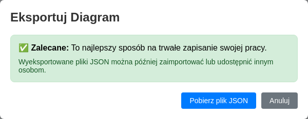
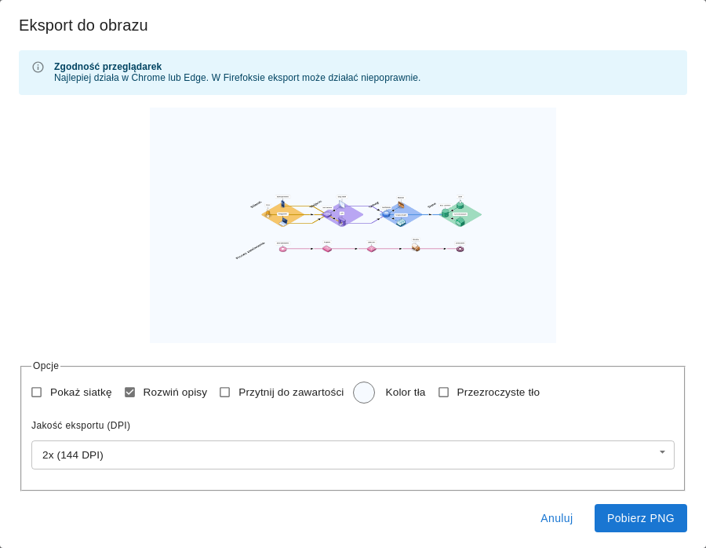
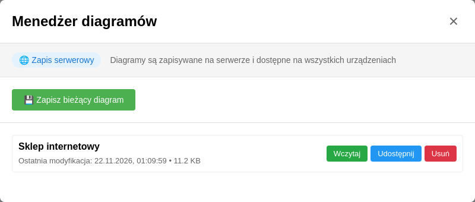

# Zapisywanie i otwieranie diagramów

 <a href="saving.md">English</a> | <b>Polski</b>

ArchFlow ma **dwa niezależne sposoby** na zachowanie pracy. Możesz używać obu jednocześnie.

| | 💾 Pliki na Twoim komputerze | 🗄️ Moje diagramy |
|---|---|---|
| Co to jest | Eksportujesz plik `.json` i otwierasz go później | Diagramy przechowuje sam ArchFlow, na liście |
| Gdzie są dane | Tam, gdzie zapiszesz wyeksportowany plik | Docker: `./diagrams` na serwerze. Aplikacja desktopowa: `~/Dokumenty/ArchFlow` |
| Dostępne | Zawsze, wszędzie | Docker z zapisem na serwerze (domyślnie) i aplikacja desktopowa |
| Do czego | Kopie zapasowe, wysyłanie diagramu, przenoszenie między instalacjami | Codzienna praca, wspólna lista dla zespołu |

## 💾 Pliki na Twoim komputerze

- **☰ → Eksportuj do JSON** pobiera bieżący diagram jako `<nazwa>-<data>.json`. Plik zawiera wszystkie użyte ikony, także zaimportowane, więc otworzy się poprawnie w każdym innym ArchFlow.
- **☰ → Otwórz z pliku** wczytuje diagram z pliku `.json` i zastępuje to, co jest na płótnie. Starsze pliki nadal działają, a wbudowane ikony dostają aktualne rysunki.
- **☰ → Eksportuj do obrazu** zapisuje obraz PNG. Pokazuje podgląd i pozwala wybrać siatkę, rozwinięte opisy, przycięcie do zawartości, kolor tła (albo przezroczyste) i rozdzielczość (DPI). Używaj Chrome lub Edge; w Firefoksie eksport obrazu ma znane problemy.

 

## 🗄️ Moje diagramy

**Moje diagramy** (górny pasek, menu ☰ albo **Ctrl+O**) otwierają listę zapisanych diagramów:

- **Zapisz bieżący diagram** zapisuje diagram pod nazwą. Jeśli diagram o tej nazwie już istnieje, ArchFlow zapyta przed nadpisaniem. Każdy diagram staje się plikiem nazwanym tak jak on, np. `./diagrams/Sklep internetowy.json`.
- **Wczytaj** otwiera zapisany diagram, **Udostępnij** kopiuje link tylko do odczytu (`http://twoj-serwer:9500/display/<nazwa>`, tylko Docker; przy logowaniu otwiera okno udostępniania z osobami i linkami, zobacz [instrukcję Dockera](docker.pl.md#konta-i-logowanie)), **Usuń** usuwa diagram i jego plik po potwierdzeniu.
- **Zapisz** na górnym pasku (albo **Ctrl+S**) zapisuje otwarty diagram ponownie pod tą samą nazwą.

Ważne:

- **Zapis jest ręczny.** Górny pasek pokazuje **Zmodyfikowany**, dopóki nie zapiszesz, a przeglądarka ostrzeże Cię przy zamykaniu karty z niezapisanymi zmianami.
- **W Dockerze lista jest wspólna.** Każdy, kto otworzy ten sam adres ArchFlow, widzi i edytuje te same diagramy. Przy logowaniu (od wersji 0.9.0) o tym, kto co widzi i zmienia, decydują role i diagramy prywatne: zobacz [Konta i logowanie](docker.pl.md#konta-i-logowanie).

## Tylko przeglądarka (bez zapisu na serwerze)

Gdy ArchFlow działa jako zwykła strona WWW (jak demo) albo Docker ma `ENABLE_SERVER_STORAGE=false`, **Zapisz** i **Moje diagramy** trzymają diagramy w pamięci przeglądarki:

- są tylko w tej przeglądarce, na tym komputerze,
- znikają po wyczyszczeniu danych przeglądarki,
- pamięć przeglądarki jest mała (kilka MB), więc duże diagramy mogą się nie zmieścić.

W tym trybie regularnie eksportuj do pliku, to jedyny pewny sposób na zachowanie pracy.

## Automatyczne przywracanie

Niezależnie od powyższego przeglądarka pamięta diagram, nad którym pracowałeś, i otwiera go ponownie po odświeżeniu strony. To wygoda, **nie kopia zapasowa**: istnieje tylko w Twojej przeglądarce i zostaje zastąpiona, gdy tylko otworzysz inny diagram.

## Jakie opcje mam?

| Gdzie działa ArchFlow | Co dostajesz |
|---|---|
| Aplikacja desktopowa | **Moje diagramy** (pliki w `~/Dokumenty/ArchFlow`) + eksport / otwieranie plików |
| Docker z zapisem na serwerze (domyślnie) | **Moje diagramy** (pliki w `./diagrams` na serwerze, wspólne) + eksport / otwieranie plików |
| Zwykły hosting WWW / Docker bez zapisu na serwerze | Moje diagramy tylko w przeglądarce + eksport / otwieranie plików |

---

[← Powrót do README](README.pl.md)
