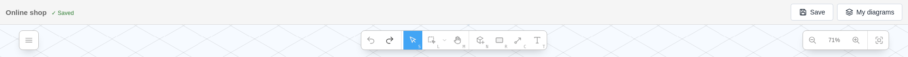
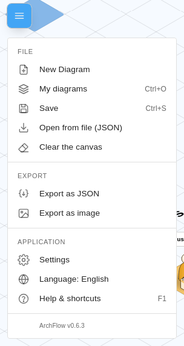
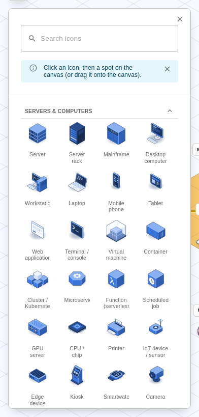
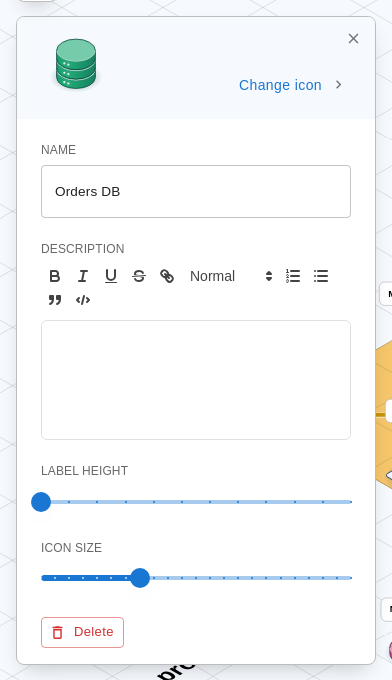
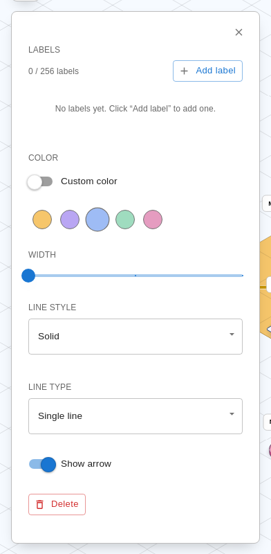
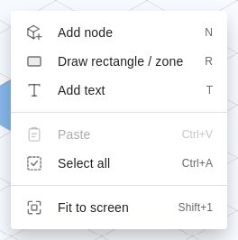
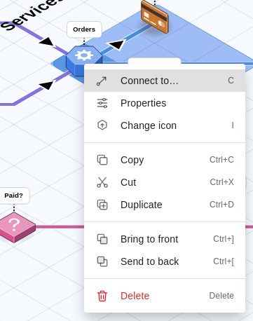
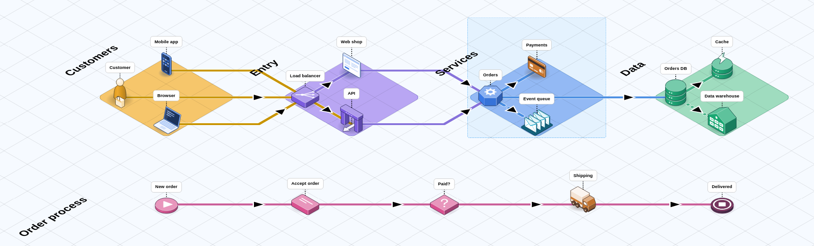
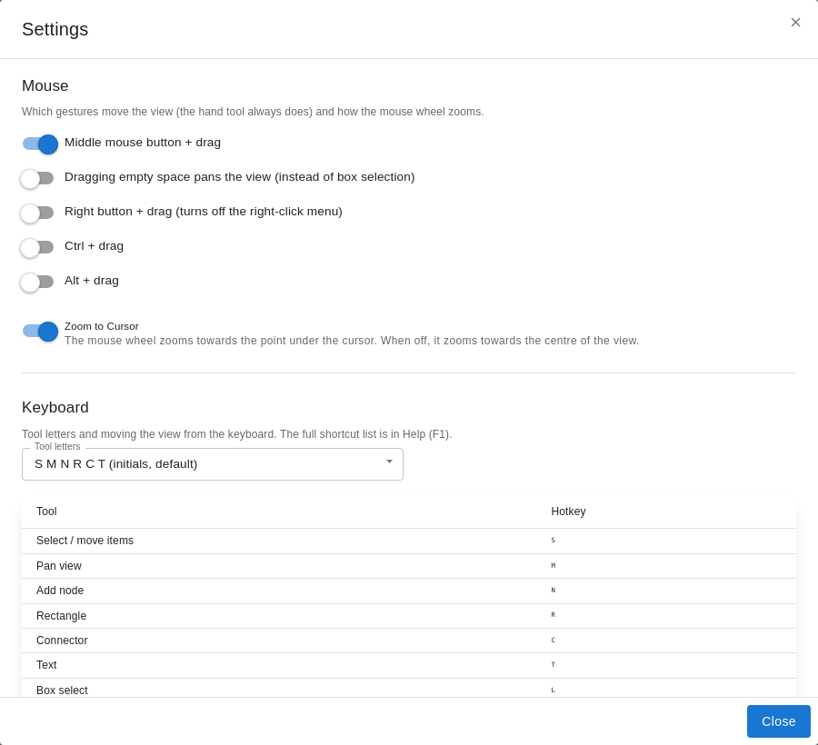

# Using ArchFlow

 <b>English</b> | <a href="usage.pl.md">Polski</a>

**New to ArchFlow? Start with the [quick start](quick-start.md):** ten steps from an empty canvas to a saved diagram, with screenshots.

## The screen

- **Top bar:** the diagram's name and save state (**Modified** / **Saved**), **Save** and **My diagrams**.
- **☰ menu** (left): New diagram, My diagrams, Save, Open from file, Clear the canvas, Export as JSON / image, Settings, Language, Help.
- **Tools** (middle): Undo, Redo · **Select / move** (S), **Box select** or **Freehand lasso** (L / F, switch with the small arrow), **Pan view** (M) · **Add node** (N), **Rectangle / zone** (R), **Connector** (C), **Text** (T). The letter in each button's corner is its shortcut.
- **Zoom** (right): zoom out / in and **Fit to screen**.

## Building a diagram

1. **Add a node:** press **N** (or the node button, or right-click the canvas → *Add node*), pick an icon from a category or search, then click a spot on the canvas.
2. **Draw a zone:** press **R** and drag out a rectangle.
3. **Connect:** press **C**, click the first node, then the second (or right-click a node → *Connect to…*). To bend a connector, drag its line.
4. **Add text:** press **T** and click where it should go.
5. **Edit properties:** click an element to open its panel (name, description, icon, colours, line style…), or right-click it → *Properties*.

  

Rectangle, node and text tools return to **Select** after one use; Connector and the lassos stay active until you press **Esc**, which always brings you back to Select.

## Right-click menus

 

- **On the canvas:** add a node, draw a rectangle, add text, paste, select all, fit to screen.
- **On an element:** connect to…, properties, change icon, copy, cut, duplicate, bring to front / send to back, delete. If the element is part of a selection, the action applies to the whole selection.

## Selecting and moving

- **Drag on empty space** to draw a selection box; **Shift+click** adds or removes elements.
- **Drag the selection** (or use the **arrow keys**) to move nodes, zones, text and connector points together.
- **Middle mouse button** or **Space + drag** moves the view from any tool; the mouse wheel zooms.

## Keyboard shortcuts

| Shortcut | Action |
|---|---|
| Ctrl+Z / Ctrl+Y (Ctrl+Shift+Z) | Undo / redo |
| Ctrl+C / Ctrl+X / Ctrl+V | Copy / cut / paste (at the mouse position) |
| Ctrl+D | Duplicate |
| Ctrl+A | Select all |
| Delete / Backspace | Delete the selection |
| ← ↑ → ↓ | Move the selection one tile (nothing selected: move the view) |
| Ctrl+] / Ctrl+[ | Bring to front / send to back |
| Ctrl + / Ctrl − | Zoom in / out |
| Shift+1 | Fit to screen |
| F2 | Rename the selected node |
| Esc | Cancel and return to Select |
| S M N R C T L F | Tools (letters can be changed in Settings) |
| F1 | Help with all shortcuts |

## Settings

**☰ → Settings** has three sections: **Mouse** (which gestures move the view, zoom towards the cursor), **Keyboard** (tool letters, moving the view with the keyboard) and **Connectors** (create them by clicking or by dragging).

---

[← Back to the README](../README.md)
