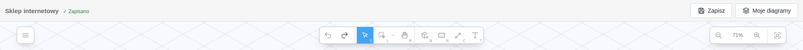
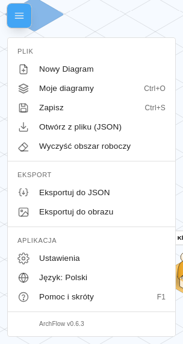
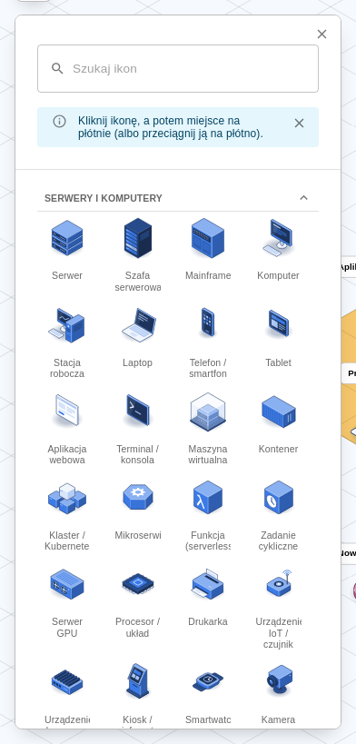
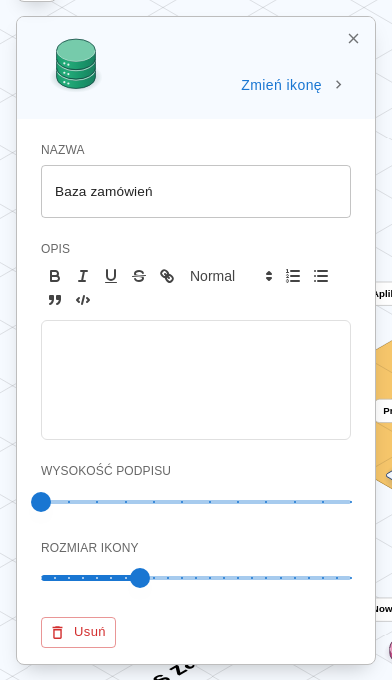
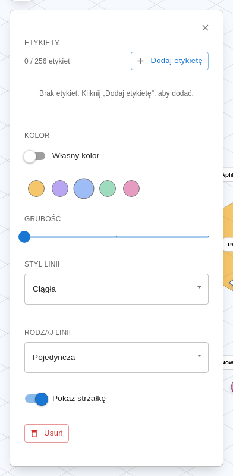
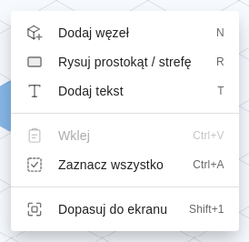
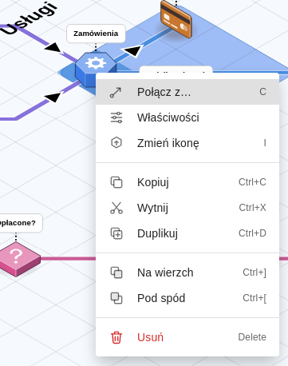
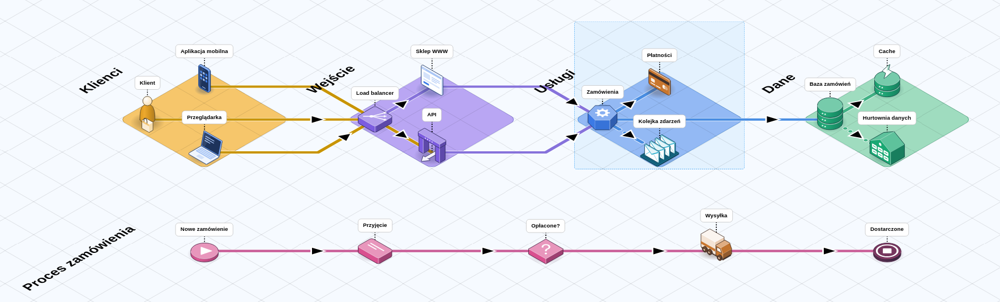
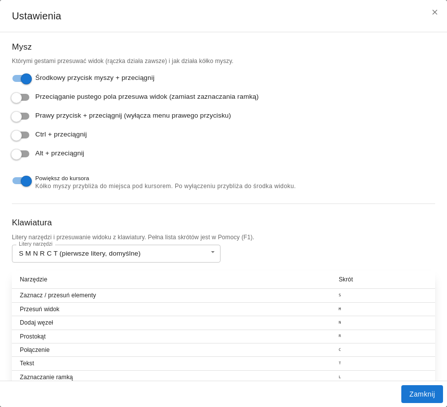

# Korzystanie z ArchFlow

 <a href="usage.md">English</a> | <b>Polski</b>

**Pierwszy raz z ArchFlow? Zacznij od [szybkiego startu](quick-start.pl.md):** dziesięć kroków od pustego płótna do zapisanego diagramu, ze zrzutami ekranu.

## Ekran

- **Górny pasek:** nazwa diagramu i stan zapisu (**Zmodyfikowany** / **Zapisano**), **Zapisz** i **Moje diagramy**.
- **Menu ☰** (po lewej): Nowy diagram, Moje diagramy, Zapisz, Otwórz z pliku, Wyczyść obszar roboczy, Eksportuj do JSON / obrazu, Ustawienia, Język, Pomoc.
- **Narzędzia** (na środku): Cofnij, Ponów · **Zaznacz / przesuń** (S), **Zaznaczanie ramką** albo **Lasso odręczne** (L / F, przełączane strzałką obok), **Przesuń widok** (M) · **Dodaj węzeł** (N), **Prostokąt / strefa** (R), **Połączenie** (C), **Tekst** (T). Litera w rogu przycisku to jego skrót.
- **Zoom** (po prawej): pomniejsz / powiększ i **Dopasuj do ekranu**.

## Budowanie diagramu

1. **Dodaj węzeł:** naciśnij **N** (albo przycisk węzła, albo prawy przycisk na płótnie → *Dodaj węzeł*), wybierz ikonę z kategorii lub wyszukaj, potem kliknij miejsce na płótnie.
2. **Narysuj strefę:** naciśnij **R** i przeciągnij prostokąt.
3. **Połącz:** naciśnij **C**, kliknij pierwszy węzeł, potem drugi (albo prawy przycisk na węźle → *Połącz z…*). Żeby zagiąć połączenie, przeciągnij jego linię.
4. **Dodaj tekst:** naciśnij **T** i kliknij, gdzie ma się pojawić.
5. **Zmień właściwości:** kliknij element, żeby otworzyć jego panel (nazwa, opis, ikona, kolory, styl linii…), albo prawy przycisk → *Właściwości*.

  

Prostokąt, węzeł i tekst wracają do **Zaznaczania** po jednym użyciu; Połączenie i lassa zostają aktywne, dopóki nie naciśniesz **Esc**, który zawsze wraca do Zaznaczania.

## Menu prawego przycisku

 

- **Na płótnie:** dodaj węzeł, narysuj prostokąt, dodaj tekst, wklej, zaznacz wszystko, dopasuj do ekranu.
- **Na elemencie:** połącz z…, właściwości, zmień ikonę, kopiuj, wytnij, duplikuj, na wierzch / pod spód, usuń. Jeśli element jest częścią zaznaczenia, akcja dotyczy całego zaznaczenia.

## Zaznaczanie i przesuwanie

- **Przeciągnij po pustym polu**, żeby narysować ramkę zaznaczenia; **Shift+klik** dodaje albo zabiera elementy.
- **Przeciągnij zaznaczenie** (albo użyj **strzałek**), żeby przesunąć razem węzły, strefy, teksty i punkty połączeń.
- **Środkowy przycisk myszy** albo **Spacja + przeciągnij** przesuwa widok w każdym narzędziu; kółko myszy przybliża.

## Skróty klawiszowe

| Skrót | Działanie |
|---|---|
| Ctrl+Z / Ctrl+Y (Ctrl+Shift+Z) | Cofnij / ponów |
| Ctrl+C / Ctrl+X / Ctrl+V | Kopiuj / wytnij / wklej (w miejscu kursora) |
| Ctrl+D | Duplikuj |
| Ctrl+A | Zaznacz wszystko |
| Delete / Backspace | Usuń zaznaczenie |
| ← ↑ → ↓ | Przesuń zaznaczenie o jedno pole (bez zaznaczenia: przesuń widok) |
| Ctrl+] / Ctrl+[ | Na wierzch / pod spód |
| Ctrl + / Ctrl − | Powiększ / pomniejsz |
| Shift+1 | Dopasuj do ekranu |
| F2 | Zmień nazwę zaznaczonego węzła |
| Esc | Anuluj i wróć do Zaznaczania |
| S M N R C T L F | Narzędzia (litery zmienisz w Ustawieniach) |
| F1 | Pomoc ze wszystkimi skrótami |

## Ustawienia

**☰ → Ustawienia** mają trzy sekcje: **Mysz** (którymi gestami przesuwać widok, przybliżanie do kursora), **Klawiatura** (litery narzędzi, przesuwanie widoku klawiaturą) i **Połączenia** (tworzenie przez klikanie albo przeciąganie).

---

[← Powrót do README](README.pl.md)
